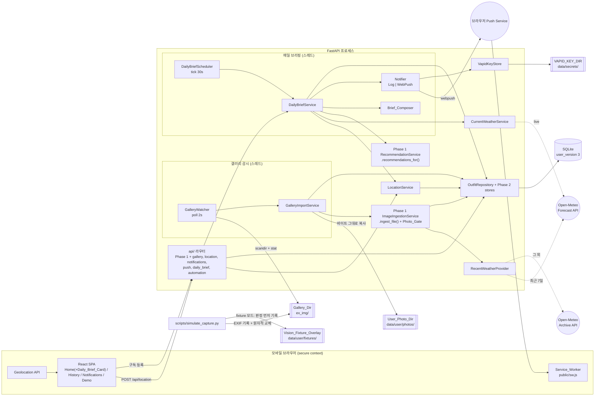
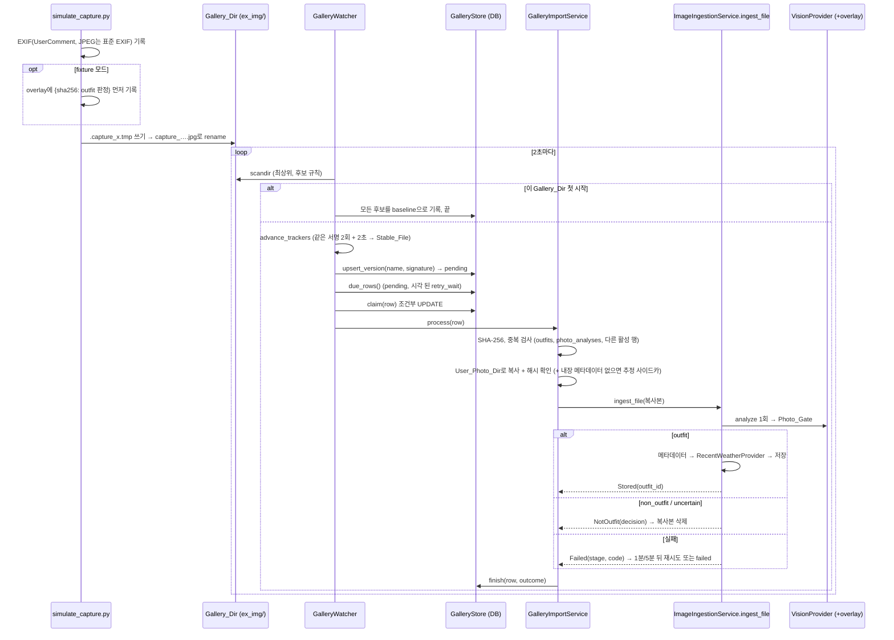
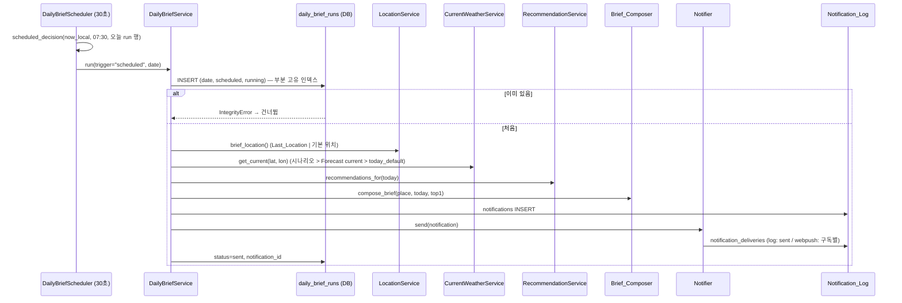
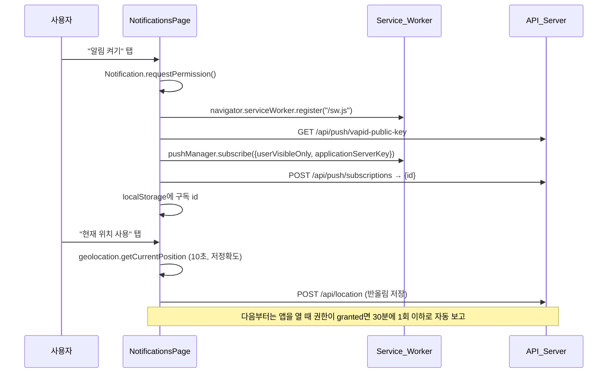
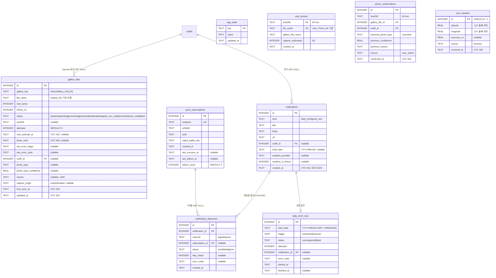

# Design Document: WeatherWear Automation (Phase 2)

## Overview

Phase 2는 `requirements.md`의 Requirement 1~20을 구현한다. Phase 1(`.kiro/specs/weatherwear/`)을 main(PR #6, 사진 분류 게이트)과 병합한 코드 위에 두 개의 자동화 흐름을 더한다.

- **갤러리 감시**: `ex_img/`(Gallery_Dir)를 2초마다 확인한다. 새로 생기고 쓰기가 끝난 사진은 `data/user/photos`(User_Photo_Dir)에 바이트 그대로 복사한 뒤 Phase 1 수집 절차(Photo_Gate 포함)에 넣는다. `outfit`만 착장 기록이 된다.
- **매일 브리핑**: 매일 07:30(APP_TIMEZONE)에 마지막 위치의 현재 날씨로 rule_based_v1 1순위 추천을 고른다. 그 결과로 "오늘 서울 14.5°C, 습도 55%. 비슷했던 14.4°C 날 크림 니트를 입고 '적당했어'라고 했어요." 같은 알림을 만든다. 알림은 기록하고 Notifier로 보낸다. 기본 Notifier는 오프라인 `log`이고, `webpush`는 표준 Web Push(VAPID)다.

### 설계 원칙

- **Phase 1 코드를 다시 쓴다.** 수집은 Phase 1 `ImageIngestionService`의 파일 1건 처리를, 추천은 `RecommendationService`와 `RuleBasedTemperatureStrategy`를, 메타데이터 대체는 Phase 1 사이드카 경로를 그대로 쓴다. Phase 1 파일은 공개 메서드 2개를 꺼내는 리팩터만 하고 동작은 바꾸지 않는다.
- **추가만 한다.** 새 테이블, 새 API 경로, 새 화면, 새 환경 변수만 더한다. 기존 테이블의 열과 CHECK 제약, 기존 API 응답 스키마, 기존 화면 동작은 바꾸지 않는다(Req 19.5, 14.7). 예외는 사진 엔드포인트의 파일 위치 해석 하나다(Req 3.5).
- **기본값은 꺼짐이고 오프라인이다.** 감시와 브리핑은 기본으로 꺼져 있다. Notifier 기본값은 `log`, Vision·Weather 기본값은 Phase 1과 같이 fixture다. 테스트와 기본 데모에는 네트워크가 필요 없다.
- **순수 함수와 I/O를 나눈다.** 후보 판별, 안정 판정, 추정 촬영 정보, 재시도 일정, 엔드포인트 선택, Forecast 응답 변환, 브리핑 문구, 조사, 장소 이름, 예약 판정, 전달 결과 분류, 설정 해석, 푸시 상태 판정은 I/O 없는 함수다. property test는 이 함수들을 대상으로 한다.
- **멱등성은 DB가 보장한다.** 같은 파일 버전 1회 처리, 같은 날짜 예약 브리핑 1회, VAPID 키 1쌍은 프로세스 메모리가 아니라 DB 제약과 파일 `O_EXCL`로 지킨다. 그래서 서버와 CLI가 함께 돌아도 안전하다.

### 근거와 가정

이 문서를 쓰는 동안 웹 검색을 하지 않았다. 아래 표는 근거 수준을 나눠 적는다. "저장소 확인"은 2026-11-14에 이 저장소와 원본 체크아웃을 읽어 확인한 사실이다. "Phase 1 리서치"는 Phase 1 design의 리서치 요약에 출처와 함께 적힌 내용이다. "가정"은 구현 전에 공식 문서로 다시 확인해야 한다.

| 주제 | 근거 수준 | 내용 | 설계 반영 |
|---|---|---|---|
| `ex_img/` 내용 | 저장소 확인 | 원본 체크아웃 `ex_img/`에는 데모 사진 174장(PNG 134 `007_…`~`140_…`, JPG 40 `2025-…_KST.jpg`)과 `clothing_tags.json`만 있다. 데모에 쓰지 않은 이미지는 없다 | 감시 첫 시작 때 기준선으로 기록한다(Req 2.4). 흉내 스크립트 원본은 `--source` / Capture_Pool_Dir / 플레이스홀더에서 고른다(Req 8.2, 가정 A6) |
| main `cf87e92` | 저장소 확인 | 데모 사진 189장(생성 사진 `141_…`~`155_…` 15장 추가, EXIF 없이 사이드카)이다. `compose.yaml`(PR #7)은 backend를 `read_only`로 띄우고, DB는 named volume, 사진은 `:ro`로 마운트한다. Vision 평가 도구(PR #8)가 있다. UI(PR #10)는 `home-dashboard` 그리드, `app-nav`, `Icon`, `app.css`다. `today_default`는 9.0°C(체감 6.5, 습도 55)이고 `scenario_expectations.json`은 없다. 그 뒤 `b29c9cf`(PR #9)에서 `today_default`가 14.5°C/55로 돌아오고 `scenario_expectations.json`, `ex_img_vision.json`(ex_img 해시별 분석, 비정규 태그·`photo_type` 없음)이 생겼다. 저장소는 `jgoneit/kirothon-020`이다 | 데모 사진 수 불변식은 189로 둔다. 예시 문장은 단위 테스트로 고정하고 통합 테스트는 병합 데이터에서 기대 문장을 만든다. compose에 Phase 2 변수와 볼륨을 더한다(아래 결정). 프론트엔드 태스크를 새 구조에 맞춘다 |
| 요구 예시 문장 | 저장소 확인 (이 브랜치 데이터) | 이 브랜치의 `weather.json`에서 `today_default`는 14.5°C, 습도 55다. `scenario_expectations.json`의 `chilly-morning`(14.5°C) 1위는 `015_loose_hair_front_cream.png`다(과거 14.4°C, `comfortable`). main의 `vision.json`에서 이 사진의 태그는 `knit`, `outer_type: none`, 색상 `cream`이다 | 이 값으로 만든 입력을 단위 테스트에 넣어 예시 문장과 정확히 같은지 고정한다. main 데이터(`cf87e92` 9.0°C, `b29c9cf` 14.5°C)와 병합한 뒤에도 깨지지 않게 통합 테스트는 기대 문장을 데이터에서 만든다(Req 20.3 (h)) |
| main PR #6 | 저장소 확인(`origin/main` `a63e37c`) | `VisionAnalysis`와 Photo_Gate(0.70)가 있다. `photo_analyses` 테이블(해시별 판정)이 있다. Fixture는 미등록 해시를 `uncertain`으로 판정한다. 의류 타입은 닫힌 snake_case 목록이다. `SCHEMA_VERSION`은 2 그대로이고, `photo_analyses`는 `create_all()`로 추가했다 | 수집 결과를 5가지(`imported`/`duplicate`/`skipped_non_outfit`/`uncertain`/실패)로 처리한다. 한국어 태그 표기는 닫힌 목록 전체를 덮는다(Req 11.7). DB 추가 방식은 main과 같은 방향이다 |
| main `vision.json` 키 수 | 저장소 확인 | `cf87e92`에서 174개, `b29c9cf`에서 189개 키로 manifest 189장과 같다 | Phase 2는 키 수에 의존하지 않는다. 감시로 들어온 새 사진은 Vision_Fixture_Overlay로만 fixture 판정을 더한다 |
| Open-Meteo 최근 날씨 | Phase 1 리서치 | Historical(Archive) API는 재분석 자료라 최근 며칠 값이 늦게 들어온다. 공식 문서는 최근 데이터에 Forecast API의 `past_days` 사용을 권한다(Phase 1 design 리서치 요약, Historical Weather API 문서와 이슈 #1480) | 촬영일이 최근 7일 안이면 Forecast `past_days` + `hourly`, 아니면 Archive를 쓴다(Req 7) |
| Forecast API 파라미터 | 가정 | `https://api.open-meteo.com/v1/forecast`는 `latitude`, `longitude`, `hourly`, `current`, `timezone`, `past_days`(0~92), `forecast_days`(0~16)를 받는다. 응답의 `hourly`는 Archive와 같은 `time[]` + 변수 배열 형식이고, `current`는 `time`, `interval`과 요청한 변수를 담는다. 변수 이름은 `temperature_2m`, `relative_humidity_2m`, `apparent_temperature`, `precipitation`, `wind_speed_10m`, `weather_code`이고 기본 단위는 °C, %, mm, km/h다 | `hourly` 변환은 Phase 1 `map_archive_response`를 다시 쓴다. 구현 첫 단계에서 공식 문서로 이름·범위·단위를 확인한다(tasks 4.1) |
| Archive 지연 일수 | 가정 | 공식 문서는 지연을 "최근 며칠"로만 적는다(Phase 1 리서치). 정확한 일수는 확인하지 않았다 | Recent_Weather_Window를 7일로 둔다. 상수 1곳(`RECENT_DAYS_BACK`)이다 |
| Web Push 표준 | 가정(널리 알려진 표준) | 브라우저 `PushManager.subscribe({userVisibleOnly: true, applicationServerKey})`의 키는 P-256 공개키 비압축 점(65바이트)이다. 서버는 VAPID(RFC 8292) JWT와 RFC 8291 암호화로 endpoint에 POST한다. 404/410은 구독 만료를 뜻한다. Service Worker, Push, Geolocation은 secure context(`localhost` 포함)에서만 쓸 수 있다. iOS Safari(16.4+)는 홈 화면에 추가한 웹 앱에서만 Web Push를 받는다 | 키 생성, 구독 API, 410 처리, README 안내(Req 15, 16, 20.7) |
| `pywebpush` | 가정 | `webpush(subscription_info, data, vapid_private_key, vapid_claims, ttl, timeout)`가 RFC 8291 암호화와 VAPID 서명을 한다. `vapid_private_key`에는 PEM 파일 경로를 줄 수 있다. 실패하면 `WebPushException`을 내고 `.response.status_code`가 있다. HTTP는 `requests`로 보낸다(httpx가 아니라서 respx로 막을 수 없다) | `PyWebPushSender` 한 곳에서만 쓰고, 테스트는 가짜 Push_Sender를 주입한다. 구현 시 설치한 버전의 시그니처를 확인한다 |
| 라이브러리 버전 | 가정 | 이 문서를 쓰는 동안 네트워크를 쓰지 않아 PyPI 최신 버전을 확인하지 못했다 | 구현자가 `pywebpush`, `cryptography`를 설치하고 전체 테스트가 통과하면 그 버전을 `==`로 고정한다(Req 20.6). `watchdog`과 `APScheduler`는 쓰지 않는다(아래 결정) |

*외부 문서 내용은 요약·재서술했다.*

### 추가 의존성

| 영역 | 패키지 | 용도 | 버전 |
|---|---|---|---|
| Backend | `pywebpush` | Web Push 암호화·VAPID 서명·전송(`PyWebPushSender`만 import) | 구현 시 확인 후 `==` 고정 |
| Backend | `cryptography` | VAPID P-256 키 생성과 PEM 직렬화(`vapid.py`에서 직접 import). `pywebpush`의 의존성이기도 하다 | `pywebpush`가 요구하는 범위 안의 설치 버전으로 `==` 고정 |
| Frontend | 없음 | Service Worker와 Push API는 브라우저 내장 API다 | – |

## Architecture

### 시스템 구성



### 저장소 레이아웃과 작업 소유권

병렬 worker가 서로 다른 파일만 고치도록 흐름 4개로 나눈다. **리드**는 공유 계약(설정, DB 테이블, API 스키마, 라우터 골격, 컨테이너)과 Phase 1 접점을 맡는다. **A**는 갤러리 감시, **B**는 매일 브리핑과 알림, **C**는 프론트엔드를 맡는다. 테스트 파일도 흐름별로 따로 둔다. property test 생성기는 각 `*_props.py` 파일 안에 둔다. Phase 1 `tests/strategies.py`는 고치지 않는다.

```
.
├── .env.example / .gitignore / README.md          # 리드 (Req 18.5, 18.6, 4.5, 20.7, 20.8)
├── compose.yaml                                   # 리드: Phase 2 변수·볼륨 (Req 18.10)
├── backend/
│   ├── requirements.txt                           # 리드: pywebpush, cryptography 고정 (Req 20.6)
│   ├── app/
│   │   ├── config.py                              # 리드: AutomationConfig, RawSettings 9개, resolve_automation_config()
│   │   ├── db.py                                  # 리드: SCHEMA_VERSION=3, migrate_schema() (Req 19)
│   │   ├── db_automation.py                       # 리드: Phase 2 SQLModel 테이블 9개
│   │   ├── schemas_automation.py                  # 리드: Phase 2 API 요청/응답 모델
│   │   ├── location.py                            # 리드: LocationService, round_location()
│   │   ├── deps.py / main.py                      # 리드: 컨테이너 필드·getter, lifespan, 라우터, 오류 매핑
│   │   ├── ingestion/service.py                   # 리드: ingest_file() 공개 (동작 불변)
│   │   ├── recommendation/service.py              # 리드: recommendations_for(today) 공개 (동작 불변)
│   │   ├── api/location.py, api/automation.py     # 리드
│   │   ├── api/outfits.py                         # A: 사진 파일 위치 해석 확장 (Req 3.5)
│   │   ├── api/gallery.py                         # A
│   │   ├── providers/vision/fixture.py, factory.py  # A: Vision_Fixture_Overlay
│   │   ├── gallery/                               # A
│   │   │   ├── rules.py        #   is_gallery_candidate(), advance_trackers() 순수 함수
│   │   │   ├── store.py        #   GalleryStore (gallery_files, app_state, user_photos)
│   │   │   ├── estimate.py     #   read_partial_exif(), estimate_capture(), estimated_sidecar_json()
│   │   │   ├── weather_recent.py  # choose_weather_endpoint(), RecentWeatherProvider
│   │   │   ├── processor.py    #   GalleryImportService, failure_transition() 순수 함수
│   │   │   ├── confirm.py      #   OutfitConfirmService, confirmed_analysis() (Req 6.12~6.15)
│   │   │   ├── watcher.py      #   GalleryWatcher(poll_once, run)
│   │   │   ├── simulate.py     #   Capture_Simulator 순수 helper (EXIF 바이트, 이름, overlay 항목)
│   │   │   └── runtime.py      #   build_gallery_runtime(config, container)
│   │   ├── providers/weather/forecast.py          # B: ForecastClient, build_*_params(), map_current_response()
│   │   ├── api/notifications.py, api/push.py, api/daily_brief.py  # B
│   │   └── notifications/                         # B
│   │       ├── labels_ko.py    #   의류 타입·색상 한국어 표기
│   │       ├── josa.py         #   object_particle()
│   │       ├── places.py       #   KNOWN_PLACES, place_label()
│   │       ├── compose.py      #   outfit_phrase(), compose_brief()
│   │       ├── current_weather.py  # CurrentWeatherService
│   │       ├── records.py      #   NotificationLog
│   │       ├── notifier.py     #   Notifier, DeliveryResult, LogNotifier, build_notifier()
│   │       ├── vapid.py        #   VapidKeyStore
│   │       ├── push_store.py   #   PushSubscriptionStore, validate_subscription()
│   │       ├── webpush.py      #   PushSender, PyWebPushSender, WebPushNotifier, classify_push_status()
│   │       ├── daily_brief.py  #   DailyBriefService
│   │       ├── scheduler.py    #   scheduled_decision(), next_run_at(), DailyBriefScheduler
│   │       └── runtime.py      #   build_brief_runtime(config, container)
│   └── tests/                                     # 흐름별 파일 (Testing Strategy 절)
├── scripts/
│   ├── watch_gallery.py, simulate_capture.py      # A
│   └── daily_brief.py                             # B
├── data/user/ (git 무시)                          # photos/, fixtures/vision.overlay.json, capture_pool/
├── data/secrets/ (git 무시)                       # vapid_private.pem, vapid_public.txt
└── frontend/                                      # C
    ├── public/sw.js, public/manifest.webmanifest
    ├── scripts/check-bundle.mjs                   #   VAPID 개인키 검사 추가 (Req 18.8)
    └── src/
        ├── api/client.ts (schema.d.ts는 리드가 재생성)
        ├── lib/push.ts, lib/location.ts, lib/strings.ts
        ├── components/DailyBriefCard.tsx, PushToggle.tsx, LocationToggle.tsx, GalleryImportList.tsx
        ├── components/layout/BottomTabBar.tsx     #   "알림" 탭 (PR #10 tabs 배열 + Icon "bell")
        ├── components/Icon.tsx, styles/automation.css (app.css에서 @import)
        └── pages/NotificationsPage.tsx, HomePage.tsx, HistoryPage.tsx, DemoPage.tsx, App.tsx(라우트)
```

### 주요 흐름: 갤러리 감시와 수집



### 주요 흐름: 매일 브리핑과 알림



### 주요 흐름: 푸시 구독과 위치 보고



### 설계 결정과 근거

| 쟁점 | 결정 | 근거 / 버린 대안 |
|---|---|---|
| 감시 방식 | 표준 라이브러리 polling(`os.scandir` + `stat`, 2초). `watchdog`은 쓰지 않는다 | (1) 쓰기 중인 파일은 이벤트 방식에서도 크기가 안정될 때까지 타이머로 다시 확인해야 한다. 결국 polling 루프가 필요하다. (2) 감시 폴더는 약 175개 파일이라 2초마다 `stat`해도 비용이 ms 수준이다. 해시는 안정된 새 파일에만 계산한다. (3) macOS FSEvents는 디렉터리 단위로 이벤트를 합치고, Finder 복사·AirDrop·`cp`·rename마다 이벤트 순서가 다르다. 그 차이를 다루는 코드가 polling보다 길어진다. (4) 버전을 오프라인에서 확인할 수 없는 의존성이 하나 줄어든다. (5) 재시작 후 따라잡기(Req 2.5)가 첫 확인으로 자연스럽게 된다. (6) `poll_once()`와 주입한 시계로 결정적인 테스트를 할 수 있다. 버린 대안: `watchdog` Observer(이벤트 + debounce 타이머 + 시작 시 전체 확인이 모두 필요). 나중에 바꾸더라도 `GalleryWatcher` 인터페이스는 그대로다 |
| 실행 위치 | FastAPI lifespan의 데몬 스레드 1개(GALLERY_WATCH_ENABLED). CLI `scripts/watch_gallery.py`도 같은 클래스를 쓴다 | 수집이 동기 I/O(Pillow, 해시, google-genai 동기 SDK)라 asyncio 작업보다 스레드가 단순하다. 종료할 때는 `threading.Event`로 멈추고, 최대 35초(Gemini 30초 + 여유) 기다린다 |
| 쓰기 중 파일 | File_Signature `(size, mtime_ns)`가 0보다 크고, 연속 두 번 관찰에서 같고, 처음 관찰한 뒤 GALLERY_POLL_SECONDS가 지나야 Stable_File이다 | 크기만 보면 미리 할당하는 복사 도구에서 틀린다. mtime을 함께 본다. 그래도 쓰기가 오래 멈춘 경우 잘린 파일이 Phase 1 `check_image`에서 `INVALID_IMAGE_FORMAT`이 될 수 있다. 쓰기가 다시 시작되면 서명이 바뀌어 새 버전으로 다시 처리되므로 스스로 회복한다(Req 2.3) |
| 후보·무시 규칙 | Phase 1 `SUPPORTED_EXTENSIONS`와 사이드카 규칙을 다시 쓰고, 숨김 파일, `~`, `.tmp`/`.part`/`.crdownload`/`.download`/`.partial`을 더 뺀다 | Phase 1 수집과 같은 확장자다(Req 2.1). 흉내 스크립트의 `.`로 시작하는 임시 파일도 이 규칙으로 무시된다 |
| 기준선 | Gallery_Dir별 첫 시작 때 후보를 `baseline`으로 기록한다. 이후에는 SHA-256 중복 제거를 함께 쓴다 | 사용자 결정 1의 "이미 있던 사진은 다시 분석하지 않는다"를 지킨다. 데모 스캔 전이라도 `ex_img/`의 174장이 사용자 사진으로 잘못 수집되지 않는다. `app_state`에 `gallery.baseline:<gallery_key>` 표시를 남겨 빈 폴더 첫 시작과 기록 없음을 구분한다 |
| 새 사진 경로 | User_Photo_Dir(`data/user/photos`)로 **바이트 그대로 복사**한 뒤 복사본을 Phase 1 `ingest_file()`에 넣는다. 사진 위치는 `user_photos(sha256 → file_name)`로 찾는다 | Photo_Dir에 넣으면 `test_demo_data_layout`, `test_image_check`(manifest 189장) 불변식이 깨진다. 원본 경로(`ex_img/`)로 바로 수집하면 갤러리에서 사진을 지우거나 옮길 때 기록 사진이 사라진다. 바이트 그대로 복사하므로 해시와 Embedded_Metadata가 같고, 중복 제거가 원본 기준으로 맞다. `outfits`에 열을 더하는 대신 별도 테이블을 쓴다. 그래서 Phase 1 테이블과 `OutfitCreate`가 바뀌지 않는다 |
| 권한 규칙 충돌 | Phase 1 tasks 19.16 규칙은 "데모 데이터로 옮길 때"에만 적용한다. 감시 사진은 사용자 본인 사진이고, git 무시 폴더에만 두며, manifest는 그대로다 | 사용자 결정 1은 `ex_img/`를 사용자 갤러리로 본다. 데모 데이터(공개·커밋 대상)와 사용자 데이터(로컬 전용)를 저장 위치로 분리하면 두 규칙이 충돌하지 않는다(Req 4.3, 4.4) |
| Vision과 게이트 | 두 모드 모두 시도 1회당 Vision 1회, main의 Photo_Gate 그대로 쓴다. fixture 모드에서는 Vision_Fixture_Overlay를 데모 fixture보다 먼저 찾는다 | fixture는 미등록 해시를 `uncertain`으로 판정하므로, overlay가 없으면 fixture 모드에서 새 사진이 저장되지 않는다. 흉내 스크립트가 파일을 넣기 **전에** overlay에 판정을 기록하면 경쟁 없이 저장된다. 데모 fixture 파일은 커밋 대상이라 고치지 않는다. overlay 판정도 `vision_provider=fixture`로 저장되어 화면에 fixture 라벨이 붙으므로, 실제 분석처럼 보이지 않는다 |
| 재시도 | 일시적 오류(Vision API·시간 초과·스키마, 저장, 날씨, 파일 읽기, 복사)는 1분, 5분 뒤 다시 시도하고 3회째 실패하면 `failed`. 형식 오류·크기 초과는 바로 `failed`. `uncertain`과 `skipped_non_outfit`은 그 버전의 최종 결과 | 같은 파일이 2초마다 Gemini를 부르지 않게 한다. 파일 버전당 호출은 최대 3회다(Req 6.11). `uncertain`을 자동으로 다시 분석하면 fixture에서는 결과가 같고, Gemini에서는 비용만 든다. 사용자가 원하면 "다시 분석"(Req 6.8)을 누른다 |
| 건너뛴 사진 알림 | `non_outfit`은 알리지 않는다. `uncertain`은 푸시하지 않고 Notifications_Page "확인이 필요한 사진"에만 보인다 | 실제 갤러리에는 음식·스크린샷이 많다. 사진마다 알리면 귀찮은 일이 늘어 제품 목표와 맞지 않는다(결정 A5). `uncertain`은 사용자가 할 수 있는 일(착장 맞음, 다시 분석)이 있어서 앱 안에만 보여 준다 |
| uncertain 확정 | `POST /api/gallery/imports/{id}/confirm-outfit`. Vision을 다시 부르지 않고 저장된 판정의 태그로 `outfit` 판정을 만든다. Gallery_Dir 원본을 다시 복사하고 Phase 1 메타데이터 → 날씨 → 저장을 진행한다. Outfit 저장, `photo_analyses` 변경, `photo_confirmations` 감사 기록은 한 트랜잭션이다 | 결정 A5다. 원본을 다시 복사하는 이유는 `uncertain` 복사본을 남기지 않는 규칙(Req 3.4)을 그대로 두기 위해서다. 원본이 없거나 해시가 다르면 409를 낸다. 같은 바이트가 아니면 사용자가 본 사진과 저장할 사진이 다를 수 있기 때문이다. 태그가 모두 `unknown`이면 기록에는 보이지만 Phase 1 규칙대로 추천에서는 빠진다. 사용자에게 그 사실을 안내한다 |
| Docker Compose | backend 서비스에 Phase 2 변수(감시·브리핑 기본 `true`, NOTIFIER `log`)를 넘기고 컨테이너 경로를 고정한다. 볼륨은 `ex_img` → `/data/gallery:ro`, `./data/user` → `/data/user`(바인드, 쓰기), named volume `vapid-keys` → `/data/secrets` | `read_only` 루트 파일시스템을 유지하려면 쓰는 곳을 모두 볼륨으로 빼야 한다. 감시는 Gallery_Dir에 쓰지 않으므로 `:ro`가 된다(Req 1.6). Capture_Simulator는 호스트에서 돌려 `ex_img/`와 `data/user/fixtures`에 쓰므로 `data/user`는 바인드 마운트다. 키는 호스트와 공유할 필요가 없어서 named volume에 둔다. 호스트 스크립트는 컨테이너 DB를 읽을 수 없으므로 위치는 `--lat/--lon` 또는 기본 위치를 쓴다 |
| 메타데이터 대체 | 내장 메타데이터가 없으면 Estimated_Capture를 만들어 복사본 옆 사이드카로 쓴다. 그러면 Phase 1 사이드카 대체 경로가 읽는다(`source=demo_sidecar`, `metadata_synthetic=true`) | Phase 1 design이 이미 "내장 메타데이터가 없는 사진은 사이드카로 대체 출처를 쓴다"를 정의했다. 새 `source` 값을 넣으면 `outfits`의 CHECK 제약을 바꿔야 하는데, SQLite는 CHECK를 바꾸려면 테이블을 다시 만들어야 한다(Req 19.5 위반). 추정 여부는 `gallery_files.capture_origin`과 `user_photos.capture_estimated`에 남겨 화면에 "촬영 정보 추정"을 보인다. 사이드카는 Photo_Gate가 `outfit`일 때만 읽힌다 |
| 추정 촬영 시각 | EXIF DateTimeOriginal(오프셋 없으면 APP_TIMEZONE) → 파일 수정 시각(mtime, APP_TIMEZONE). mtime이 미래이면 처리 시각 | 결정 A3이다. mtime은 서버가 멈춘 동안 생긴 파일에도 실제 시각에 가깝고, `os.utime`으로 테스트를 결정적으로 만들 수 있다. Finder 복사처럼 원래 mtime이 유지되는 경우 오래된 시각이 될 수 있지만, 그 사진의 실제 날짜에 더 가깝다 |
| 촬영 시점 날씨 | 최근 7일 안이면 Forecast `hourly` + `past_days`, 그 밖은 Phase 1 Archive. Forecast가 실패하면 Archive → fixture | Phase 1 리서치의 공식 권장을 따랐다. 데모 스캔(Phase 1)은 바꾸지 않는다(Req 7.5) |
| 오늘 현재 날씨 | 브리핑은 항상 Current_Weather_Service(시나리오 > Forecast `current` > `today_default`)를 쓴다. 홈 화면은 Live 모드에서만 같은 서비스를 쓰고(마지막 위치), fixture 모드는 Phase 1 그대로다 | 결정 A8이다. Phase 1 오늘 날씨는 Archive로 조회해서 Live 모드에서도 대부분 fixture로 대체된다. 브리핑과 Live 홈이 같은 서비스를 쓰면 같은 시각의 기온이 서로 어긋나지 않는다(Req 10.8). `TodayWeatherService`에는 선택 인자 `live_current`만 더한다. 그래서 Phase 1 단위 테스트가 직접 만드는 인스턴스는 동작이 그대로다 |
| 스케줄러 | 앱 안 표준 라이브러리 루프(30초 tick, 주입한 시계) + CLI `scripts/daily_brief.py`(cron/launchd용). APScheduler는 쓰지 않는다 | 필요한 기능은 "하루 1회, 시각 이후, 놓치면 3시간 안 따라잡기"뿐이다. 순수 함수 `scheduled_decision()` 1개로 끝난다. APScheduler는 3.x와 4.x API가 크게 다르고 오프라인에서 버전을 확인할 수 없다. 멱등성도 결국 DB로 해야 한다(여러 프로세스). OS cron/launchd만 쓰면 사용자가 plist/crontab을 직접 설정해야 해서 제품 목표와 맞지 않는다. 그래서 CLI는 선택 경로로 둔다 |
| 하루 1회 멱등성 | `daily_brief_runs`의 부분 고유 인덱스 `UNIQUE(brief_date) WHERE trigger='scheduled'`에 INSERT해 처리권을 얻는다 | 서버 재시작, `uvicorn --workers N`, CLI 동시 실행에도 1회만 나간다. 수동 실행은 인덱스 대상이 아니라서 데모에서 몇 번이든 보낼 수 있다(Req 13.1) |
| 데이터 부족 | "비슷한 기온에서 입었던 착장 기록이 아직 없어요. 오늘 입은 옷을 찍어 두면 다음에 알려 드릴게요." 알림을 보낸다 | 알림이 오지 않으면 사용자는 기능이 고장 났다고 생각한다. 사진을 찍으라는 안내가 자동 수집으로 이어진다 |
| 장소 이름 | 코드에 둔 국내 주요 도시 16곳 중 30km 안의 가장 가까운 곳. 없으면 "현재 위치" | 브라우저 위치에는 이름이 없다. 역지오코딩 서비스를 쓰면 네트워크·개인정보 문제가 생긴다. 기본 위치가 "서울"이 되어 예시 문장과 맞는다 |
| 태그 표기 | main의 닫힌 의류 타입 목록 전체에 한국어 표기를 두고, 색상은 데모 fixture에 나오는 이름에 표기를 둔다. 표기가 없으면 원문을 쓴다 | 의류 타입은 닫힌 목록이라 빠짐없이 덮는지 테스트할 수 있다. 색상은 자유 문자열이라 원문 대체가 필요하다 |
| 알림 화면 | 홈에 Daily_Brief_Card를 새로 두고, Phase 1 Notification_Card(피드백 버튼)는 그대로 둔다 | Phase 1 카드의 동작과 테스트(Req 13)를 건드리지 않는다. 브리핑 카드는 읽기 전용이고, 누르면 그 Outfit 상세로 간다. 상세 화면에서 Phase 1 피드백을 남긴다 |
| Notifier | 알림 기록을 먼저 저장한 뒤 Notifier로 보낸다. 기본값은 `log` | 웹 내부 카드는 기록만으로 동작한다. 그래서 `log`만으로 데모와 테스트가 끝난다. `webpush`는 같은 기록에 전달 결과만 더한다 |
| Web Push | `pywebpush`로 보내고 키는 `cryptography`로 직접 만든다. 개인키는 PKCS8 PEM 파일(0600), 공개키는 base64url 파일. 404/410이면 구독을 지운다 | 키 생성 API가 단순하고 안정적이다. 파일 생성은 `O_CREAT|O_EXCL`이라 동시 첫 실행에도 1쌍만 생긴다. 키가 깨지면 지우지 않고 이름을 바꾼 뒤 다시 만든다. Phase 1 DB 백업과 같은 방식이다. 이전 키로 만든 구독은 새 키로 보낼 수 없으므로 지운다 |
| DB 변경 | `create_all()`의 `CREATE TABLE IF NOT EXISTS`로 테이블 9개를 더하고 `user_version`을 2 → 3으로 올린다. 2 미만만 Phase 1처럼 백업 후 다시 만든다 | Phase 1 규칙(`user_version < SCHEMA_VERSION`이면 백업 후 새로 만들기)을 그대로 두고 버전만 3으로 올리면 모든 Phase 1 DB가 백업되고 사용자 피드백이 활성 DB에서 사라진다. 바뀌는 것이 새 테이블뿐이라 추가 방식으로 충분하다. main도 `photo_analyses`를 같은 방식으로 더했다 |
| 환경 변수 | 9개를 더한다(합계 21개). 값 검증은 Phase 1처럼 이슈를 기록하고 기본값으로 대체한다 | 시간 간격·재시도 같은 운영 상수는 코드 상수로 둔다(Recent_Weather_Window 7일, Catch_Up_Window 3시간, 재시도 1분/5분). 변수가 늘수록 사용자 설정 부담이 커지기 때문이다 |

## Components and Interfaces

### 1. AutomationConfig (`app/config.py`, 리드)

```python
class RawSettings(BaseSettings):          # Phase 1 필드 11개 + 아래 9개
    GALLERY_WATCH_ENABLED: str = "false"
    GALLERY_DIR: str = "./ex_img"
    GALLERY_POLL_SECONDS: str = "2"
    USER_PHOTO_DIR: str = "./data/user/photos"
    DAILY_BRIEF_ENABLED: str = "false"
    DAILY_BRIEF_TIME: str = "07:30"
    NOTIFIER: str = "log"
    VAPID_KEY_DIR: str = "./data/secrets"
    VAPID_SUBJECT: str = "mailto:weatherwear@example.com"

@dataclass(frozen=True)
class AutomationConfig:                   # 기본값 = 모두 꺼짐 (Req 18.4)
    gallery_watch_enabled: bool = False
    gallery_dir: Path = Path("./ex_img")
    gallery_poll_seconds: float = 2.0     # 0.5 ≤ x ≤ 60
    user_photo_dir: Path = Path("./data/user/photos")
    daily_brief_enabled: bool = False
    daily_brief_time: time = time(7, 30)
    notifier: Literal["log", "webpush"] = "log"
    vapid_key_dir: Path = Path("./data/secrets")
    vapid_subject: str = "mailto:weatherwear@example.com"

    @property
    def vision_overlay_path(self) -> Path:   # data/user/fixtures/vision.overlay.json
        return self.user_photo_dir.parent / "fixtures" / "vision.overlay.json"

@dataclass(frozen=True)
class AppConfig:                          # Phase 1 필드 11개는 그대로
    ...
    automation: AutomationConfig = field(default_factory=AutomationConfig)

def parse_bool(value: str) -> bool | None: ...          # true/false/1/0/yes/no/on/off, 대소문자 무시
def parse_hhmm(value: str) -> time | None: ...          # ^([01]\d|2[0-3]):[0-5]\d$
def resolve_automation_config(raw: Mapping[str, str], *, photo_dir: Path) -> tuple[AutomationConfig, list[ConfigIssue]]: ...
```

- `resolve_config()`는 Phase 1 해석 뒤 `resolve_automation_config()`를 불러 결과를 `automation`에 넣고 이슈를 합친다. 메시지에는 변수 이름과 허용값만 넣는다(Req 18.2).
- `main.resolve_automation_paths(config, root, *, issues=None)`가 `gallery_dir`, `user_photo_dir`, `vapid_key_dir`를 저장소 루트 기준 절대 경로로 바꾼다(Req 18.3). `create_app`은 `resolve_automation_paths(resolve_paths(config))` 순서로 부른다. Phase 1 `resolve_paths()`는 그대로 두어 Phase 1 `test_resolve_paths_uses_repo_root_for_relative_paths`가 고치지 않고 통과한다. 경로 충돌 검사(Req 4.2)는 `resolve_automation_config()`에서 설정 문자열 기준으로 한 번, `resolve_automation_paths()`에서 절대 경로 기준으로 한 번 더 한다. `user_photo_dir`이 `photo_dir`/`gallery_dir`와 같거나 조상·자손 관계이면 이슈를 기록하고 기본값(절대 경로)을 쓴다. 기본값도 충돌하면 감시를 끈다.
- `VITE_API_BASE_URL`처럼 프론트엔드 전용 변수는 더하지 않는다(Req 16.10).
- `.env.example`에 9개 변수를 더한다(Req 18.5). Phase 1 테스트 2개는 Phase 1 목록(12/11)과 Phase 2 목록(9/9)의 합으로 정확히 비교하도록 고친다(Req 20.4).

### 2. Phase 1 접점의 작은 리팩터 (리드)

**`ImageIngestionService.ingest_file(path) -> FileResult`** (`app/ingestion/service.py`): main 병합 후 `_process()` 본문을 공개 메서드로 옮기고, `scan()`은 파일마다 이 메서드를 부른다. 집계와 동작은 그대로다.

```python
@dataclass(frozen=True)
class Stored:      sha256: str; outfit_id: int
@dataclass(frozen=True)
class Duplicate:   sha256: str
@dataclass(frozen=True)
class NotOutfit:   sha256: str; analysis: VisionAnalysis      # non_outfit | uncertain
@dataclass(frozen=True)
class Failed:      stage: FailureStage; code: str; message: str

FileResult = Stored | Duplicate | NotOutfit | Failed

class ImageIngestionService:
    def ingest_file(self, image: Path, *, processed_hashes: set[str] | None = None) -> FileResult: ...
```

`create_outfit_bundle()`이 돌려주는 id를 `Stored.outfit_id`로 내보낸다. 기존 `test_ingestion*.py`, `test_integration.py`가 고치지 않고 통과하는지로 리팩터를 확인한다.

uncertain 확정(Req 6.12~6.15)을 위해 선택 인자 두 개를 더한다. `ingest_file(..., analysis_override: VisionAnalysis | None = None, before_commit: Callable[[Session], None] | None = None)`. `analysis_override`가 있으면 Vision 호출, Photo_Gate, `save_photo_analysis`를 건너뛰고 그 판정으로 메타데이터 → 날씨 → 저장을 진행한다. `before_commit`은 `OutfitRepository.create_outfit_bundle(..., before_commit=...)`로 넘겨 같은 트랜잭션 안에서 부른다. 기본값 `None`이면 동작은 그대로다.

**Live 홈 오늘 날씨** (`app/today_weather.py`, B, Req 10.7, 10.8): `TodayWeatherService(..., live_current: Callable[[], WeatherContext] | None = None)`. 시나리오가 없고 `live_current`가 있으면 그 결과를 쓴다. 컨테이너는 `weather_provider == "open_meteo"`일 때만 `lambda: current_weather.get_current(location.brief_location()[0])`를 넘긴다(7.1). fixture 모드와 Phase 1 단위 테스트는 `None`이라 그대로다.

**`RecommendationService.recommendations_for(today: WeatherContext) -> RecommendationResponse`** (`app/recommendation/service.py`): `today_recommendations()`의 본문을 옮기고, 기존 메서드는 `self.recommendations_for(self._today_weather.get_today())`만 부른다(Req 11.1).

**사진 파일 위치** (`app/api/outfits.py`, A): `resolve_outfit_photo(record, *, photo_dir, user_photo_dir, user_photos) -> Path | None`. `user_photos.get(record.sha256)`이 있으면 `user_photo_dir`에서, 없으면 Phase 1 `resolve_photo_path(photo_dir, record.file_name)`으로 찾는다. 두 경우 모두 Phase 1과 같은 `resolve()` 포함 검사를 한다(Req 3.5).

### 3. 후보·안정 판정 (`app/gallery/rules.py`, A, 순수 함수)

```python
IGNORED_SUFFIXES = (".tmp", ".part", ".crdownload", ".download", ".partial")

def is_gallery_candidate(name: str, *, is_regular_file: bool, is_symlink: bool) -> bool:
    """숨김(.), ~ 끝, IGNORED_SUFFIXES, *.metadata.json, 지원 안 하는 확장자, 심볼릭 링크, 일반 파일 아님 → False.
    지원 확장자는 Phase 1 SUPPORTED_EXTENSIONS(.jpg/.jpeg/.png/.webp, 대소문자 무시)."""   # Req 2.1, 1.6

@dataclass(frozen=True)
class Signature:
    size: int
    mtime_ns: int

@dataclass(frozen=True)
class Tracker:
    signature: Signature
    first_seen: datetime          # 이 서명을 처음 본 시각 (aware UTC)
    seen_count: int               # 같은 서명을 연속으로 본 횟수
    emitted: bool                 # 이 서명으로 이미 Stable 이벤트를 냈는지

@dataclass(frozen=True)
class StableEvent:
    name: str
    signature: Signature
    first_seen: datetime

def advance_trackers(trackers: Mapping[str, Tracker], observed: Mapping[str, Signature],
                     now: datetime, stable_after: timedelta) -> tuple[dict[str, Tracker], list[StableEvent]]:
    """관찰에서 사라진 이름은 tracker 삭제. 서명이 바뀌면 (seen_count=1, first_seen=now, emitted=False).
    같으면 seen_count+1. size>0, seen_count≥2, now-first_seen ≥ stable_after, not emitted → 이벤트 1번.
    이벤트는 (first_seen, name) 순."""   # Req 2.2, 2.3, 2.8, 2.9
```

### 4. GalleryStore (`app/gallery/store.py`, A)

```python
GalleryStatus = Literal["baseline", "pending", "processing", "imported", "duplicate",
                        "skipped_non_outfit", "uncertain", "retry_wait", "failed"]
ACTIVE_STATUSES = ("pending", "processing", "retry_wait")
LEASE = timedelta(minutes=10)

def gallery_key(gallery_dir: Path) -> str: ...      # sha1(str(resolved path)).hexdigest()[:16]

class GalleryStore:
    def __init__(self, engine: Engine): ...
    def baseline_done(self, key: str) -> bool: ...
    def record_baseline(self, key: str, observed: Mapping[str, Signature], now: datetime) -> int:
        """app_state INSERT(이미 있으면 0 반환) + gallery_files(status=baseline) 일괄 INSERT, 한 트랜잭션."""  # Req 2.4
    def upsert_version(self, key: str, event: StableEvent, now: datetime) -> GalleryFileRow | None:
        """(key, name) 행이 없으면 pending으로 INSERT. 서명이 같으면 None(이미 처리됨, baseline 포함).
        서명이 다르면 새 버전: status=pending, attempts=0, sha/결과 필드 비움."""   # Req 2.3, 2.5
    def due_rows(self, key: str, now: datetime) -> list[GalleryFileRow]:
        """pending, 또는 next_attempt_at ≤ now인 retry_wait, 또는 lease가 끝난 processing. (first_seen_at, file_name) 순."""
    def claim(self, row_id: int, now: datetime) -> bool:
        """UPDATE … SET status='processing', lease_until=now+LEASE WHERE id=? AND (조건은 due_rows와 같음). rowcount==1."""  # Req 1.7
    def finish(self, row_id: int, outcome: ImportOutcome, now: datetime) -> None: ...
    def active_with_sha(self, sha256: str, *, exclude_id: int) -> bool: ...   # 같은 해시의 다른 imported/uncertain/활성 행
    def reset_for_reanalyze(self, row_id: int) -> Literal["ok", "not_found", "not_allowed"]: ...   # Req 6.8
    def list_imports(self, limit: int, status: GalleryStatus | None) -> list[GalleryFileRow]: ...   # baseline 제외
    def counts(self, key: str) -> dict[str, int]: ...
    # user_photos
    def put_user_photo(self, sha256: str, file_name: str, gallery_file_name: str, estimated: bool, now: datetime) -> None: ...
    def delete_user_photo(self, sha256: str) -> None: ...
    def user_photo_file(self, sha256: str) -> str | None: ...
```

tracker는 메모리에만 둔다. 재시작하면 처음부터 다시 관찰하지만, `upsert_version`이 서명이 같은 행을 무시하므로 다시 처리되지 않는다.

### 5. 추정 촬영 정보 (`app/gallery/estimate.py`, A, 순수 함수)

```python
@dataclass(frozen=True)
class PartialExif:
    date_time_original: datetime | None   # naive, DateTimeOriginal 파싱 성공 시
    offset: timezone | None               # OffsetTimeOriginal
    latitude: float | None                # GPS 도·분·초 → 십진, 범위 안일 때만
    longitude: float | None

@dataclass(frozen=True)
class EstimatedCapture:
    captured_at: datetime                 # 항상 aware
    latitude: float
    longitude: float
    time_source: Literal["exif_datetime", "file_mtime"]
    location_source: Literal["exif_gps", "browser", "default"]

def read_partial_exif(data: bytes) -> PartialExif: ...     # Phase 1 metadata.py의 DMS 변환 helper 재사용
def estimate_capture(partial: PartialExif, file_mtime: datetime, now: datetime, last_location: LatLon | None,
                     default_location: LatLon, tz: ZoneInfo) -> EstimatedCapture: ...   # Req 5.2, 5.6 (mtime > now → now)
def estimated_sidecar_json(estimate: EstimatedCapture) -> str:
    """{"captured_at": iso(오프셋 포함), "latitude", "longitude", "estimated": true,
        "time_source", "location_source"} — 추가 필드는 Phase 1 parse_sidecar_text가 무시한다."""   # Req 5.3, 5.7
```

`DateTimeOriginal`에 오프셋이 없으면 `datetime.replace(tzinfo=tz)`로 APP_TIMEZONE 오프셋을 붙인다(`fold=0`). 판단 순서는 Phase 1 `read_embedded_metadata()`가 유효한 `CaptureMetadata`를 돌려주면 그 값(Req 5.1), 아니면 이 함수다.

### 6. GalleryImportService (`app/gallery/processor.py`, A)

```python
RETRYABLE_CODES = {"VISION_API_ERROR", "VISION_TIMEOUT", "VISION_SCHEMA_INVALID", "STORAGE_ERROR",
                   "WEATHER_ERROR", "FILE_READ_ERROR", "GALLERY_COPY_ERROR"}
RETRY_DELAYS = (timedelta(minutes=1), timedelta(minutes=5))
MAX_ATTEMPTS = 3

@dataclass(frozen=True)
class ImportOutcome:
    status: Literal["imported", "duplicate", "skipped_non_outfit", "uncertain", "retry_wait", "failed"]
    sha256: str | None = None
    outfit_id: int | None = None
    stage: str | None = None
    code: str | None = None
    decision: ScanDecision | None = None          # main의 ScanDecision (photo_type, confidence, reason)
    capture_origin: Literal["exif", "estimated"] | None = None
    next_attempt_at: datetime | None = None

def failure_transition(code: str, attempts_done: int, now: datetime) -> tuple[Literal["retry_wait", "failed"], datetime | None]:
    """code ∈ RETRYABLE_CODES이고 attempts_done < MAX_ATTEMPTS이면 retry_wait, now + RETRY_DELAYS[attempts_done-1].
    아니면 failed."""   # Req 6.5, 6.6, 6.11

class GalleryImportService:
    def __init__(self, gallery_dir: Path, user_photo_dir: Path, store: GalleryStore,
                 repo: OutfitRepository, ingestion: ImageIngestionService,
                 location: LocationService, tz: ZoneInfo): ...
    def process(self, row: GalleryFileRow, now: datetime) -> ImportOutcome: ...
```

`process()` 순서(첫 실패에서 멈춘다):

1. Gallery_Dir에서 파일 다시 확인. 없거나 서명이 바뀌었으면 처리하지 않는다. 없으면 `failed(GALLERY_FILE_MISSING)`, 바뀌었으면 다음 확인에 맡긴다. 그다음 바이트를 읽고 SHA-256을 계산한다(`FILE_READ_ERROR`는 재시도).
2. 중복 검사(Req 2.6, 2.7): `repo.exists_sha` 또는 `store.active_with_sha`(같은 해시의 다른 Gallery_File이 `imported`·`uncertain`·활성) → `duplicate`. `photo_analyses`에 `non_outfit` → `skipped_non_outfit`(Vision 호출 없음). 감시 기록 없이 `photo_analyses`에만 `uncertain`이 있는 해시(데모 스캔 등 다른 경로에서 판정)는 Phase 1 규칙대로 `ingest_file`이 다시 분석한다.
3. 복사(Req 3.1, 3.2): 대상 이름이 비어 있거나 같은 바이트면 원래 이름을 쓰고, 다른 바이트면 `<stem>_<sha8><ext>`를 쓴다. `.<name>.partial`에 쓰고 `fsync`한 뒤 `os.replace`한다. 복사본 해시가 다르면 지우고 `GALLERY_COPY_ERROR`. 이어서 `store.put_user_photo()`.
4. 메타데이터 대체(Req 5): `read_embedded_metadata(data)`가 `CaptureMetadata`가 아니면 `estimate_capture()`를 만들고 복사본 옆에 `<stem>.metadata.json`을 쓴다(`capture_origin="estimated"`).
5. `ingestion.ingest_file(copy)`. 그 안에서 Vision 1회 → Photo_Gate → (outfit) 메타데이터 → `RecentWeatherProvider` → 저장이 진행된다.
6. 결과 변환:
   - `Stored` → `imported`(outfit_id).
   - `Duplicate` → `duplicate`, 복사본 삭제.
   - `NotOutfit` → `skipped_non_outfit` 또는 `uncertain`(decision). 복사본·사이드카·`user_photos` 삭제(Req 3.4).
   - `Failed` → `failure_transition()`. 최종 `failed`이면 복사본·사이드카·`user_photos`를 지운다. `retry_wait`이면 복사본을 남겨 다음 시도에 다시 쓴다.
7. 로그에는 파일 이름, 상태, 단계·코드만 남긴다(Req 6.10).

**uncertain 확정** (`app/gallery/confirm.py`, A, Req 6.12~6.15):

```python
class ConfirmOutcome(Enum): CONFIRMED, NOT_FOUND, NOT_CONFIRMABLE, SOURCE_MISSING

def confirmed_analysis(stored: VisionAnalysis | None) -> VisionAnalysis:
    """photo_type='outfit', photo_type_confidence=stored 값(없으면 0.0), reason='user confirmed',
    tags=stored.tags (없으면 UNKNOWN_TAGS). Photo_Gate를 거치지 않는다."""

class OutfitConfirmService:
    def confirm(self, row_id: int, now: datetime) -> tuple[ConfirmOutcome, GalleryFileRow | None]:
        """claim(status='uncertain' → 'processing') 실패 → NOT_CONFIRMABLE.
        원본 재읽기 + SHA-256 비교 실패 → 상태 원복, SOURCE_MISSING(409).
        복사 → (내장 메타데이터 없으면 추정 사이드카) → ingest_file(copy, analysis_override=…, before_commit=write_audit)
        write_audit: photo_analyses UPDATE(outfit) + photo_confirmations INSERT. Stored → finish(imported).
        Failed → 복사본 정리, 상태 uncertain 원복, 오류 코드 반환."""
```

Vision 호출이 없으므로 재시도 일정(Req 6.5)을 적용하지 않는다. 확정 중 실패하면 기록은 `uncertain`으로 돌아가고 API는 Phase 1 오류 형식으로 실패를 알린다.

갤러리 수집용 `ImageIngestionService`는 컨테이너가 따로 만든다. `photo_dir=user_photo_dir`, `weather=RecentWeatherProvider`, Vision은 API_Server와 같은 provider다.

### 7. GalleryWatcher와 CLI (`app/gallery/watcher.py`, `scripts/watch_gallery.py`, A)

```python
@dataclass
class WatcherStatus:
    enabled: bool; running: bool; dir_available: bool
    last_poll_at: datetime | None; pending: int; uncertain: int

class GalleryWatcher:
    def __init__(self, gallery_dir: Path, store: GalleryStore, importer: GalleryImportService,
                 *, poll_seconds: float, clock: Callable[[], datetime] = utc_now): ...
    def poll_once(self, stop: threading.Event | None = None) -> PollResult: ...
    def run(self, stop: threading.Event) -> None:      # while not stop.wait(poll_seconds): poll_once(stop)
    def status(self) -> WatcherStatus: ...
```

`poll_once()` 동작:

1. `os.scandir(gallery_dir)`로 후보와 서명을 모은다. 실패하면 `dir_available=False`이고, 상태가 바뀔 때만 WARNING을 남긴다(Req 1.5).
2. 기준선이 없으면 `record_baseline()`하고 끝낸다(Req 2.4).
3. `advance_trackers()` → `upsert_version()` → `due_rows()`를 차례로 부른다. 행마다 `stop`이 켜졌는지 보고, `claim()`에 성공한 행만 `process()` → `finish()`한다(Req 1.2, 1.7, 2.8).
4. 처리 중 예외가 나면 `failure_transition("STORAGE_ERROR")`로 기록하고 계속한다(Req 1.8).

CLI `scripts/watch_gallery.py`는 `load_settings()`와 `resolve_paths()`로 설정을 읽고 컨테이너를 만든다(FastAPI 없이). 인자는 `--once`(poll → `poll_seconds` 대기 → poll, 종료 코드 0, Req 1.4)와 `--gallery-dir`(테스트용)다. `KeyboardInterrupt`를 받으면 `stop`을 켜고 끝낸다.

### 8. Fixture Vision overlay (`app/providers/vision/fixture.py`, A)

```python
class FixtureVisionProvider:
    def __init__(self, analysis_by_hash: Mapping[str, VisionAnalysis], *, overlay_path: Path | None = None): ...
    def analyze(self, image: bytes, mime_type: str, sha256: str | None = None) -> VisionAnalysis:
        """overlay(크기·mtime_ns가 바뀌면 다시 읽음) → 데모 fixture → UNKNOWN_ANALYSIS(uncertain)."""   # Req 6.3, 6.4
```

overlay는 main의 `load_vision_fixture()`로 읽는다. 키 검증과 항목별 건너뛰기가 그대로 적용된다. 파일이 없으면 조용히 overlay 없이 동작한다. 읽기에 실패하면 서명마다 WARNING 1건만 남긴다. `build_vision_provider(cfg)`는 `cfg.automation.vision_overlay_path`를 넘긴다. 데모 스캔에도 같은 provider가 쓰이지만, overlay 키는 새 사진 해시라 데모 결과는 바뀌지 않는다(Req 4.6).

### 9. RecentWeatherProvider (`app/gallery/weather_recent.py`, A)

```python
RECENT_DAYS_BACK = 7
RECENT_DAYS_AHEAD = 1
FORECAST_DAYS = 2

def choose_weather_endpoint(captured_at: datetime, today: date, tz: ZoneInfo
                            ) -> tuple[Literal["forecast"], int] | tuple[Literal["archive"], None]:
    """d = (today - captured_at.astimezone(tz).date()).days.
    -RECENT_DAYS_AHEAD ≤ d ≤ RECENT_DAYS_BACK → ("forecast", max(d, 0)), 아니면 ("archive", None)."""   # Req 7.6

class RecentWeatherProvider:                     # WeatherProvider Protocol
    name = "open_meteo"
    def __init__(self, forecast: ForecastClient, archive: OpenMeteoWeatherProvider,
                 tz: ZoneInfo, today: Callable[[], date]): ...
    def get_weather(self, at: datetime, latitude: float, longitude: float) -> WeatherReading:
        """forecast: client.get_hourly(lat, lon, past_days, FORECAST_DAYS) → Phase 1 map_archive_response(payload, at, tz).
        실패/None → archive.get_weather(at, lat, lon) (Phase 1 provider가 내부에서 fixture로 대체)."""   # Req 7.1~7.3
```

`WEATHER_PROVIDER=fixture`이면 컨테이너가 이 클래스 대신 Phase 1 `FixtureWeatherProvider`를 넣는다(Req 7.4).

### 10. Capture_Simulator (`scripts/simulate_capture.py`, `app/gallery/simulate.py`, A)

```python
PLACEHOLDER_TAGS = ClothingTags(upper_type="knit", outer_type="none", lower_type="jeans",
                                colors=["cream"], layers_visible=1, confidence=0.9)

def user_comment_payload(at: datetime, lat: float, lon: float, tz_name: str) -> dict: ...   # synthetic: true, source: simulate_capture
def encode_with_exif(image: Image.Image, fmt: Literal["JPEG", "PNG"], at, lat, lon, tz_name) -> bytes:
    """UserComment(ASCII\\0\\0\\0 + JSON). JPEG은 DateTimeOriginal, OffsetTimeOriginal, GPS DMS,
    GPSProcessingMethod(ASCII\\0\\0\\0SYNTHETIC)도 기록."""   # Req 8.5, 8.9
def capture_file_name(at: datetime, ext: str, existing: set[str]) -> str: ...   # capture_YYYYMMDD_HHMMSS.ext, _2, _3 …
def is_demo_source(name: str, sha256: str, manifest_names: set[str], demo_hashes: set[str]) -> bool: ...  # Req 8.3
def overlay_entry(tags: ClothingTags) -> VisionAnalysis: ...   # outfit, 0.95, "simulate_capture fixture"
def add_overlay_entry_atomic(path: Path, sha256: str, entry: VisionAnalysis) -> None: ...   # tmp + os.replace
def draw_placeholder() -> Image.Image: ...   # 768x1024, 크림 니트 + 청바지 실루엣, 텍스트 없음
```

스크립트 순서는 다음과 같다(Req 8):

1. 원본을 고른다. `--source` → Capture_Pool_Dir(`.last_used` 다음 이름) → 플레이스홀더 순서다.
2. 데모 사진인지 검사한다. 데모 사진이면 종료 코드 2로 끝난다.
3. 시각·위치를 정한다. 위치는 DB를 읽기 전용으로 열어 `user_location`을 본다.
4. EXIF를 넣어 다시 인코딩한다. 원본이 PNG/WebP이면 PNG, JPEG이면 JPEG(quality 92)로 저장한다.
5. fixture 모드이고 태그가 있으면 overlay에 항목을 추가한다.
6. `.<name>.tmp`에 쓰고 `os.replace`한다.
7. 파일 이름을 출력한다.

모두 오프라인이다. pytest는 `simulate.py` 함수와 `main(argv)`를 tmp 디렉터리에서 불러 확인한다.

### 11. LocationService (`app/location.py`, `app/api/location.py`, 리드)

```python
@dataclass(frozen=True)
class LatLon:
    latitude: float
    longitude: float

def round_location(lat: float, lon: float) -> LatLon: ...   # 소수 둘째 자리, ROUND_HALF_UP (Decimal)
def validate_location(lat: object, lon: object, accuracy: object) -> LatLon | str: ...   # bool 거부, 유한, 범위

class LocationService:
    def __init__(self, engine: Engine, default: LatLon, clock: Callable[[], datetime]): ...
    def report(self, lat: float, lon: float, accuracy_m: float | None) -> StoredLocation: ...   # id=1 UPSERT
    def last(self) -> StoredLocation | None: ...
    def brief_location(self) -> tuple[LatLon, Literal["browser", "default"]]: ...   # Req 9.5
```

위경도는 어느 로그에도 남기지 않는다(Req 9.4). API 검증 오류는 `main.py`의 RequestValidationError 핸들러가 경로 `/api/location`에 대해 `INVALID_LOCATION`으로 바꾼다.

### 12. ForecastClient (`app/providers/weather/forecast.py`, B)

```python
FORECAST_ENDPOINT = "https://api.open-meteo.com/v1/forecast"
CURRENT_VARIABLES = ("temperature_2m", "relative_humidity_2m", "apparent_temperature",
                     "precipitation", "wind_speed_10m", "weather_code")
HOURLY_VARIABLES = ("temperature_2m", "precipitation", "relative_humidity_2m")   # Phase 1 Archive와 같음

class ForecastError(Exception): ...

def build_current_params(lat: float, lon: float, tz: ZoneInfo) -> dict[str, str]: ...
def build_hourly_params(lat: float, lon: float, tz: ZoneInfo, past_days: int, forecast_days: int) -> dict[str, str]: ...
def map_current_response(payload: dict, tz: ZoneInfo) -> WeatherContext | None:
    """current.temperature_2m 없음 → None. 나머지는 Phase 1 normalize_value()로 단위 확인(current_units),
    없는 변수는 None. observed_at = current.time(지역 시각) + tz. provider='open_meteo', is_fixture=False."""   # Req 10.1, 10.6

class ForecastClient:
    def __init__(self, http: httpx.Client | None = None, timeout_s: float = 10.0): ...
    def get_current(self, lat: float, lon: float, tz: ZoneInfo) -> dict: ...      # 2xx 아님/JSON 오류/타임아웃 → ForecastError
    def get_hourly(self, lat: float, lon: float, tz: ZoneInfo, past_days: int, forecast_days: int) -> dict: ...
```

API 키는 없다. 구현 첫 단계에서 공식 문서로 파라미터 이름, `past_days` 범위, `current` 응답 형식을 확인하고, 다르면 이 절과 상수를 고친다(가정 표).

### 13. CurrentWeatherService (`app/notifications/current_weather.py`, B)

```python
class CurrentWeatherService:
    def __init__(self, config: AppConfig, forecast: ForecastClient | None, store: ScenarioStore,
                 fixture: FixtureWeatherProvider, clock: Callable[[], datetime]): ...
    def get_current(self, location: LatLon) -> WeatherContext:
        """1) store.selected() → provider='scenario' (Phase 1 TodayWeatherService와 같은 변환)
        2) weather_provider == 'open_meteo' → map_current_response(forecast.get_current(...)); None/ForecastError → 3)
        3) fixture.get_weather(now, lat, lon) → today_default (provider='fixture', is_fixture=True), WARNING."""   # Req 10.2~10.4
```

Phase 1 `TodayWeatherService`와 `/api/weather/today`는 그대로 둔다(Req 10.5).

### 14. Brief_Composer (`app/notifications/{labels_ko,josa,places,compose}.py`, B, 순수 함수)

**한국어 표기** (`labels_ko.py`, Req 11.7): 닫힌 목록의 `none`, `unknown`을 뺀 모든 값에 표기를 둔다.

| 분류 | 표기 |
|---|---|
| UpperType | t_shirt 티셔츠, long_sleeve_t_shirt 긴소매 티셔츠, shirt 셔츠, blouse 블라우스, knit 니트, turtleneck 터틀넥, sweatshirt 맨투맨, hoodie 후드티, sleeveless_top 민소매 톱, cardigan 카디건, fleece 플리스, jersey 저지, dress 원피스, jumpsuit 점프슈트, coveralls 커버올 |
| OuterType | long_puffer 롱패딩, short_puffer 숏패딩, puffer_jacket 패딩 재킷, parka 파카, coat 코트, trench_coat 트렌치코트, jacket 재킷, blazer 블레이저, cardigan 카디건, denim_jacket 청재킷, leather_jacket 가죽 재킷, bomber_jacket 항공 점퍼, fleece_jacket 플리스 재킷, rain_jacket 레인 재킷, windbreaker 바람막이, track_jacket 트랙 재킷, utility_jacket 워크 재킷, shirt_jacket 셔츠 재킷, varsity_jacket 야구 점퍼, vest 조끼, jersey 저지 |
| LowerType | jeans 청바지, trousers 바지, slacks 슬랙스, chinos 치노 팬츠, cargo_pants 카고 팬츠, corduroy_pants 코듀로이 팬츠, leggings 레깅스, shorts 반바지, skirt 치마, track_pants 트랙 팬츠, jogger_pants 조거 팬츠, parachute_pants 파라슈트 팬츠 |
| 색상(예) | cream 크림, white 흰색, black 검정, grey 회색, navy 네이비, beige 베이지, camel 카멜, brown 갈색, blue 파란색, light blue 하늘색, green 초록, olive 올리브, khaki 카키, red 빨강, burgundy 버건디, pink 분홍, purple 보라, yellow 노랑, mustard 머스터드, orange 주황, ivory 아이보리, charcoal 차콜, denim 데님 … (데모 fixture에 나오는 모든 색상. 빠진 색상은 커버리지 테스트로 찾는다) |

**조사** (`josa.py`, Req 11.8, 11.15):

```python
def object_particle(word: str) -> Literal["을", "를", "을(를)"]:
    """마지막 문자가 U+AC00~U+D7A3이면 (code - 0xAC00) % 28 != 0 → "을", 아니면 "를". 그 밖은 "을(를)"."""
```

**장소** (`places.py`, Req 11.11): `KNOWN_PLACES`는 서울(37.5665, 126.9780), 부산, 인천, 대구, 대전, 광주, 울산, 세종, 수원, 고양, 창원, 청주, 전주, 춘천, 강릉, 제주 16곳의 대표 좌표다. `place_label(lat, lon)`은 haversine 거리가 30km 이하인 곳 중 가장 가까운 곳(같으면 목록 순서)을 돌려주고, 없으면 "현재 위치"를 돌려준다.

**문구** (`compose.py`):

```python
VOTE_SPOKEN = {"cold": "추웠어", "comfortable": "적당했어", "hot": "더웠어"}
VOTE_TAIL = {"cold": " 오늘은 한 겹 더 챙겨 보세요.", "hot": " 오늘은 조금 가볍게 입어 보세요."}
TITLE = "오늘의 착장 브리핑"

def outfit_phrase(tags: ClothingTags) -> str: ...      # Req 11.6

@dataclass(frozen=True)
class BriefInput:
    place: str
    today: WeatherContext                  # actual_temperature_c 필수
    top: RecommendationItemOut | None      # 1순위 또는 없음

@dataclass(frozen=True)
class BriefMessage:
    title: str
    body: str
    url: str
    outfit_id: int | None

def format_temp(c: float) -> str: ...      # Decimal ROUND_HALF_UP 소수 첫째 자리 + "°C" (Phase 1 explain과 같음)
def compose_brief(inp: BriefInput) -> BriefMessage: ...   # Req 11.2~11.5, 11.9, 11.10, 11.12~11.14
```

`outfit_phrase` 규칙(표기는 `labels_ko`, 색상은 `colors[0]`):

| upper | outer | 결과 |
|---|---|---|
| 알려짐 | `none`/`unknown` | `{색상} {upper}` (예: 크림 니트) |
| 알려짐 | 알려짐 | `{색상} {upper}에 {outer}` (예: 카멜 니트에 블레이저) |
| `unknown` | 알려짐 | `{색상} {outer}` |
| `unknown` | `none`/`unknown` | lower가 알려졌으면 `{색상} {lower}`, 아니면 "그날 착장" |

색상이 없으면 `{색상} ` 부분을 뺀다. 본문 조립:

```
p1 = f"오늘 {place} {T(today)}" + (f", 습도 {round(h)}%" if h is not None else "") + "."
fallback → lead = "기온이 가장 가까웠던" else "비슷했던"
vote 있음 → f" {lead} {T(past)} 날 {phrase}{을/를} 입고 '{VOTE_SPOKEN[v]}'라고 했어요." + VOTE_TAIL.get(v, "")
vote 없음 → f" {lead} {T(past)} 날 {phrase}{을/를} 입었어요. 그날 어땠는지 알려 주세요."
top 없음 → " 비슷한 기온에서 입었던 착장 기록이 아직 없어요. 오늘 입은 옷을 찍어 두면 다음에 알려 드릴게요."
```

제목에는 `today.provider`가 `fixture`이면 " (fixture 날씨)", `scenario`이면 " (시나리오 날씨)"를 붙인다. 본문이 200자를 넘으면 `phrase`의 각 표기를 12자로 자르고 다시 만든다. 닫힌 목록 표기는 모두 12자 이하라서 실제로 잘리는 것은 원문 색상뿐이다.

습도는 정수로 반올림한다(Phase 1 `formatHumidity`와 같음). 예시: today 14.5/55, top = 015(14.4, knit, none, cream, comfortable) → "오늘 서울 14.5°C, 습도 55%. 비슷했던 14.4°C 날 크림 니트를 입고 '적당했어'라고 했어요."

### 15. Notification_Log와 Notifier (`app/notifications/{records,notifier}.py`, B)

```python
NotificationKind = Literal["daily_brief", "push_test"]
Channel = Literal["log", "webpush"]
DeliveryStatus = Literal["sent", "failed", "gone"]

@dataclass(frozen=True)
class NotificationRecord:
    id: int; kind: NotificationKind; title: str; body: str; url: str
    outfit_id: int | None; brief_date: date | None
    weather_provider: str | None; weather_is_fixture: bool | None; created_at: datetime

@dataclass(frozen=True)
class DeliveryResult:
    channel: Channel; status: DeliveryStatus
    subscription_id: int | None = None; http_status: int | None = None; error_code: str | None = None

class NotificationLog:
    def create(self, kind, message: BriefMessage, *, brief_date, weather: WeatherContext | None) -> NotificationRecord: ...
    def add_deliveries(self, notification_id: int, results: Sequence[DeliveryResult]) -> None: ...
    def list_recent(self, limit: int, kind: NotificationKind | None) -> list[NotificationWithSummary]: ...  # created_at DESC, id DESC
    def latest_for_date(self, kind: NotificationKind, local_date: date, tz: ZoneInfo) -> NotificationRecord | None: ...

class Notifier(Protocol):
    name: Literal["log", "webpush"]
    def send(self, notification: NotificationRecord) -> list[DeliveryResult]: ...

class LogNotifier:
    name = "log"
    def send(self, n): logger.info("알림 기록: id=%d kind=%s", n.id, n.kind); return [DeliveryResult("log", "sent")]

def build_notifier(cfg: AppConfig, *, push_store, keys: VapidKeyStore, sender: PushSender) -> Notifier: ...
```

알림 기록은 Notifier보다 먼저 저장한다(Req 14.1). `send()`에서 예외가 나도 기록은 남고, 전달 결과는 `failed(NOTIFIER_ERROR)`로 남긴다.

### 16. VapidKeyStore (`app/notifications/vapid.py`, B)

```python
PRIVATE_NAME = "vapid_private.pem"
PUBLIC_NAME = "vapid_public.txt"

@dataclass(frozen=True)
class VapidKeys:
    private_key_path: Path
    public_key_b64url: str       # 65바이트 비압축 점, padding 없음

class VapidKeyUnavailable(Exception): ...

class VapidKeyStore:
    def __init__(self, key_dir: Path, clock: Callable[[], datetime]): ...
    def ensure(self) -> VapidKeys:
        """1) 개인키 로드 성공 → 공개키 계산(파일이 다르면 다시 씀). 2) 없음 → ec.generate_private_key(SECP256R1()),
        PKCS8 PEM을 os.open(O_CREAT|O_EXCL|O_WRONLY, 0o600)으로 쓰기; FileExistsError면 1)로 돌아감.
        3) 로드 실패 → .invalid-<stamp>로 이름 바꾸고 2), on_rotated 콜백(구독 정리) 호출.
        디렉터리 생성·쓰기 실패 → VapidKeyUnavailable."""   # Req 15.1~15.3, 15.10
    def secret_strings(self) -> list[str]: ...   # RedactingFilter에 넘길 PEM 본문 (Req 18.7)
```

공개키는 `public_bytes(Encoding.X962, PublicFormat.UncompressedPoint)`를 base64url로 인코딩한 값이다(padding 제거). 개인키 파일 경로만 `pywebpush`에 넘긴다. 개인키 문자열은 API 응답·로그에 넣지 않는다.

### 17. Push 구독과 WebPushNotifier (`app/notifications/{push_store,webpush}.py`, B)

```python
def validate_subscription(payload: PushSubscriptionIn) -> str | None:
    """endpoint: https://, ≤ 2048자. p256dh: base64url → 65바이트, 0x04 시작. auth: base64url → 16바이트."""   # Req 15.5

class PushSubscriptionStore:
    def upsert(self, sub: PushSubscriptionIn, public_key: str, now: datetime) -> int: ...   # endpoint UNIQUE
    def delete(self, sub_id: int) -> bool: ...
    def list_active(self) -> list[PushSubscriptionRow]: ...
    def delete_not_matching_key(self, public_key: str) -> int: ...
    def count(self) -> int: ...

@dataclass(frozen=True)
class SendResult:
    status_code: int | None; error_code: str | None   # None/"PUSH_TIMEOUT"/"PUSH_CONNECTION_ERROR"

class PushSender(Protocol):
    def send(self, sub: PushSubscriptionRow, payload: bytes, *, ttl: int, keys: VapidKeys, subject: str) -> SendResult: ...

class PyWebPushSender: ...     # pywebpush.webpush(..., timeout=10); WebPushException → response.status_code

def classify_push_status(result: SendResult) -> DeliveryStatus:
    """2xx → sent, 404/410 → gone, 그 밖 → failed."""   # Req 15.7

PUSH_TTL_SECONDS = 12 * 3600
MAX_PAYLOAD_BYTES = 3000

class WebPushNotifier:
    name = "webpush"
    def send(self, n: NotificationRecord) -> list[DeliveryResult]:
        """payload = json {"title","body","url","notification_id","kind"} (UTF-8, ≤ 3000바이트, 넘으면 body 자르기).
        구독마다 sender.send 1회, gone이면 store.delete. 키를 못 얻으면 [] (기록만)."""   # Req 14.3, 15.7, 15.8, 15.10
```

로그에는 구독 id와 `urlparse(endpoint).hostname`만 남긴다(Req 18.7).

### 18. DailyBriefService와 스케줄러 (`app/notifications/{daily_brief,scheduler}.py`, `scripts/daily_brief.py`, B)

```python
Trigger = Literal["scheduled", "manual"]
CATCH_UP = timedelta(hours=3)
RETRY_AFTER = timedelta(minutes=10)
MAX_SCHEDULED_ATTEMPTS = 3

class DailyBriefInProgress(Exception): ...

class DailyBriefService:
    def __init__(self, location: LocationService, current_weather: CurrentWeatherService,
                 recommendations: Callable[[], RecommendationService], log: NotificationLog,
                 notifier: Notifier, runs: DailyBriefRuns, tz: ZoneInfo, clock: Callable[[], datetime]): ...
    def run(self, trigger: Trigger, brief_date: date | None = None) -> BriefRunResult:
        """process-wide Lock(non-blocking) 실패 → DailyBriefInProgress (API 409).
        scheduled: runs.claim(brief_date) 실패 → BriefRunResult(skipped=True).
        위치 → 현재 날씨 → recommendations_for → compose_brief → log.create → notifier.send → log.add_deliveries → runs.finish."""

def scheduled_decision(now_local: datetime, brief_time: time, run: RunRow | None
                       ) -> Literal["run", "retry", "wait", "missed", "done"]:
    """start = combine(now_local.date(), brief_time, tz); end = start + CATCH_UP.
    now < start → wait; now ≥ end → (run 없음 → missed, 있음 → done);
    run 없음 → run; run.status == failed and attempts < 3 and now ≥ run.last + 10분 → retry; 그 밖 → done."""   # Req 12.1, 12.4, 12.5, 12.8

def next_run_at(now: datetime, brief_time: time, tz: ZoneInfo, done_today: bool) -> datetime: ...   # Automation_Status 표시용

class DailyBriefScheduler:
    def __init__(self, service: DailyBriefService, runs: DailyBriefRuns, brief_time: time,
                 tz: ZoneInfo, clock: Callable[[], datetime], tick_seconds: float = 30.0): ...
    def tick(self) -> str: ...                     # scheduled_decision → service.run("scheduled")
    def run(self, stop: threading.Event) -> None:  # tick(); while not stop.wait(tick_seconds): tick()
```

- 현지 날짜와 시각은 `now.astimezone(tz)`로 계산한다. `datetime.combine(..., tzinfo=tz)`에서 DST gap/overlap이 생겨도 날짜 키가 1개라 실행은 1회다(Req 12.7).
- 시계가 뒤로 가도 이미 있는 행 때문에 다시 실행되지 않는다(Req 12.8).
- `DailyBriefRuns.claim(date)`는 부분 고유 인덱스에 INSERT한다(`status=running`, `attempts=1`). `retry`는 같은 행을 `UPDATE … WHERE status='failed' AND attempts < 3`으로 되찾는다.
- `scripts/daily_brief.py [--force]`: 스케줄러와 같은 서비스로 `run("scheduled", today)` 또는 `run("manual")`을 부른다. `skipped`이면 "이미 보냄"을 출력하고 0으로 끝낸다(Req 12.6).
- `skipped_non_outfit`/`uncertain` 사진은 브리핑 입력(RecommendationService)에 들어가지 않는다. Photo_Gate가 저장하지 않기 때문이다(Req 6.9).

### 19. REST API (Phase 2 추가분)

Phase 1 공통 오류 형식 `{"error": {"code", "message"}}`를 그대로 쓴다. 스키마는 `schemas_automation.py`에 두고 OpenAPI로 노출한다. 경로 변수 이름은 Phase 1 `{outfit_id}`처럼 `{import_id}`, `{subscription_id}`다(요구사항의 `{id}`와 같은 URL). 1.7 골격 단계에서는 본문을 채우지 않은 경로가 501 `NOT_IMPLEMENTED`("아직 준비되지 않은 기능입니다.")를 낸다. 이 코드는 해당 태스크가 경로를 채우면 더 나오지 않는다.

| 메서드 · 경로 | 성공 | 오류 | 소유 | Req |
|---|---|---|---|---|
| `GET /api/automation/status` | 200 `AutomationStatusOut` | – | 리드 | 17.1, 17.2, 1.5 |
| `GET /api/gallery/imports?limit&status` | 200 `list[GalleryImportOut]` | 422 `VALIDATION_ERROR` | A | 17.3, 5.5, 6.9 |
| `POST /api/gallery/imports/{import_id}/reanalyze` | 202 `GalleryImportOut` | 404 `GALLERY_IMPORT_NOT_FOUND`, 409 `GALLERY_IMPORT_NOT_REANALYZABLE` | A | 6.8 |
| `POST /api/gallery/imports/{import_id}/confirm-outfit` | 200 `GalleryImportOut`(imported, outfit_id) | 404 `GALLERY_IMPORT_NOT_FOUND`, 409 `GALLERY_IMPORT_NOT_CONFIRMABLE`, 500 `STORAGE_ERROR` | A | 6.12~6.15 |
| `POST /api/location` | 200 `LocationOut` | 422 `INVALID_LOCATION` | 리드 | 9.1, 9.2 |
| `GET /api/location` | 200 `LocationStateOut` | – | 리드 | 9.3 |
| `GET /api/notifications?limit&kind` | 200 `list[NotificationOut]` | 422 `VALIDATION_ERROR` | B | 14.5 |
| `POST /api/daily-brief/run` | 200 `DailyBriefRunOut` | 409 `DAILY_BRIEF_IN_PROGRESS` | B | 13.1~13.3 |
| `GET /api/push/vapid-public-key` | 200 `{"public_key": str}` | 503 `VAPID_KEY_UNAVAILABLE` | B | 15.1, 15.4, 15.10 |
| `POST /api/push/subscriptions` | 201 `{"id": int}` | 422 `PUSH_SUBSCRIPTION_INVALID` | B | 15.5 |
| `DELETE /api/push/subscriptions/{subscription_id}` | 204 | 404 `PUSH_SUBSCRIPTION_NOT_FOUND` | B | 15.6 |
| `POST /api/push/test` | 200 `NotificationOut` | 409 `WEB_PUSH_DISABLED`, 503 `VAPID_KEY_UNAVAILABLE` | B | 15.9 |

주요 스키마는 다음과 같다. 모든 datetime은 오프셋을 포함한다(Phase 1 Req 10.10).

```python
class GalleryImportOut(BaseModel):
    id: int
    file_name: str                         # Gallery_Dir 기준 이름만
    status: Literal["pending", "processing", "imported", "duplicate", "skipped_non_outfit",
                    "uncertain", "retry_wait", "failed"]
    attempts: int
    last_error_stage: str | None; last_error_code: str | None
    next_attempt_at: AwareDatetime | None
    outfit_id: int | None
    photo_type: Literal["outfit", "non_outfit", "uncertain"] | None
    photo_type_confidence: float | None; reason: str | None
    capture_origin: Literal["exif", "estimated"] | None
    first_seen_at: AwareDatetime; updated_at: AwareDatetime

class LocationIn(BaseModel):               # strict: bool·문자열 거부
    model_config = ConfigDict(strict=True, extra="ignore")
    latitude: float; longitude: float; accuracy_m: float | None = None

class LocationStateOut(BaseModel):
    last: LocationOut | None               # 반올림 값 + received_at + place_label
    default_latitude: float; default_longitude: float
    brief_source: Literal["browser", "default"]; brief_place_label: str

class NotificationOut(BaseModel):
    id: int; kind: Literal["daily_brief", "push_test"]; title: str; body: str; url: str
    outfit_id: int | None; photo_url: str | None
    weather_provider: Literal["open_meteo", "fixture", "scenario"] | None; weather_is_fixture: bool | None
    created_at: AwareDatetime
    delivery: DeliverySummaryOut           # log_recorded, webpush_sent, webpush_failed, webpush_gone

class DailyBriefRunOut(BaseModel):
    notification: NotificationOut; trigger: Literal["scheduled", "manual"]

class PushSubscriptionIn(BaseModel):       # 브라우저 PushSubscription.toJSON()
    endpoint: str; expirationTime: int | None = None; keys: PushKeysIn   # p256dh, auth

class AutomationStatusOut(BaseModel):
    gallery: GalleryStatusOut              # enabled, running, dir_available, last_poll_at, pending, uncertain
    daily_brief: DailyBriefStatusOut       # enabled, time "HH:MM", timezone, next_run_at, last_scheduled {date, status} | None
    notifier: NotifierStatusOut            # name, vapid_ready, subscription_count
    location: LocationStatusOut            # has_last, received_at, place_label
```

`main.py`의 RequestValidationError 핸들러는 Phase 1 피드백 규칙 외에 다음 경로 규칙을 더한다. `POST /api/location` 본문 오류는 `INVALID_LOCATION`, `POST /api/push/subscriptions` 본문 오류는 `PUSH_SUBSCRIPTION_INVALID`가 된다. `ROUTER_MODULES`에는 `gallery`, `location`, `notifications`, `push`, `daily_brief`, `automation`을 더한다.

### 20. 컨테이너와 lifespan (`app/deps.py`, `app/main.py`, 리드)

`AppContainer`에 다음 필드를 더한다. 모두 기본값 `None`이고 `build_container`가 채운다.

- `location`, `place_label`(1.8에서 `fallback_place_label` "현재 위치", 7.1에서 `notifications.places.place_label`로 교체)
- `gallery_store`, `gallery_importer`, `gallery_watcher`(감시 꺼짐이면 `None`), `outfit_confirm`(3.20의 `OutfitConfirmService`)
- `current_weather`, `notification_log`, `push_store`, `vapid_keys`, `notifier`, `daily_brief`, `brief_scheduler`(꺼짐이면 `None`)

라우터는 `deps.get_*` 의존성 함수로 서비스를 받는다. 필드가 `None`이면 `deps.require()`가 501 `NOT_IMPLEMENTED`를 낸다. 흐름 A·B의 API 테스트는 `app.dependency_overrides[get_*]`로 자기 서비스를 넣어 7.1 연결 전에도 돈다.

갤러리 런타임은 `gallery/runtime.py`, 브리핑 런타임은 `notifications/runtime.py`의 builder가 만든다. 각 흐름이 자기 builder만 고치므로 `deps.py` 충돌이 없다.

lifespan은 다음 순서로 동작한다.

```python
@asynccontextmanager
async def lifespan(app):
    stop = threading.Event(); threads = []
    if cfg.automation.notifier == "webpush": safe(container.vapid_keys.ensure)       # Req 15.1
    if container.gallery_watcher: threads.append(start_daemon("gallery-watcher", container.gallery_watcher.run, stop))
    if container.brief_scheduler: threads.append(start_daemon("daily-brief", container.brief_scheduler.run, stop))
    try: yield
    finally:
        stop.set()
        for t in threads: t.join(timeout=35)                                          # Req 1.2
        container.engine.dispose()
```

`install_logging()`에서 Phase 1 `RedactingFilter`에 넘기는 비밀값 목록에 `vapid_keys.secret_strings()`를 더한다(Req 18.7). 키를 만들기 전이면 빈 목록이고, 키를 처음 만들 때 필터에 등록한다.

### 21. Mobile_Web_Client (C)

**Service_Worker** (`public/sw.js`, Req 16.1):

```js
self.addEventListener("push", (event) => {
  const data = event.data ? event.data.json() : {};
  event.waitUntil(self.registration.showNotification(data.title ?? "WeatherWear", {
    body: data.body ?? "", tag: "weatherwear-daily-brief", data: { url: data.url ?? "/" } }));
});
self.addEventListener("notificationclick", (event) => {
  event.notification.close();
  const url = new URL(event.notification.data?.url ?? "/", self.location.origin).href;
  event.waitUntil(clients.matchAll({ type: "window", includeUncontrolled: true }).then((list) => {
    const open = list.find((c) => new URL(c.url).origin === self.location.origin);
    return open ? open.focus().then(() => open.navigate(url)) : clients.openWindow(url);
  }));
});
```

`public/manifest.webmanifest`(`display: standalone`, 이름, 테마색)을 `index.html`에 연결한다. 아이콘 세트는 범위 밖이다.

**순수 판정 함수** (`src/lib/push.ts`, `src/lib/location.ts`, fast-check 대상, Req 16.5, 16.6, 16.12):

```ts
export type PushState = "unsupported" | "off" | "on" | "blocked";
export function pushState(env: { secure: boolean; serviceWorker: boolean; pushManager: boolean; notification: boolean },
                          permission: NotificationPermission | null, subscribed: boolean): PushState
export function urlBase64ToUint8Array(b64url: string): Uint8Array
export async function enablePush(api: Api): Promise<PushState>   // requestPermission → register → subscribe → POST → localStorage
export async function disablePush(api: Api): Promise<PushState>
export function shouldReportLocation(permission: PermissionState | null, lastReportedAt: number | null, now: number): boolean
                                                                  // granted && (null || now - last ≥ 30분)
export async function reportLocation(api: Api): Promise<"sent" | "denied" | "timeout" | "unsupported">
```

**화면** (Req 14.6, 16.8, 16.11, 13.4, 17.4, 5.5, 6.9):

PR #10 UI 구조에 맞춘다. 화면 구조는 `HomePage`의 `home-dashboard` 그리드, `BottomTabBar`의 `tabs` 배열 + `app-nav`/`nav-link` + `Icon`, `AppShell`의 `ShellFrame`이다. Phase 2 스타일은 `src/styles/automation.css` 한 파일에 두고 `app.css`에서 `@import` 1줄로 불러온다. 여러 태스크가 `app.css`를 동시에 고치지 않기 위해서다. `Icon`의 `name`에 `bell`을 더한다.

- `DailyBriefCard`: `GET /api/notifications?kind=daily_brief&limit=1` 결과가 오늘(`/api/meta`의 `app_timezone` 기준)이면 표시한다. `glass` 표면의 알림 배너로 "WeatherWear · 오늘 07:30", 본문, Outfit 썸네일, FixtureBadge(날씨 fixture일 때)를 보인다. 누르면 `url`로 이동한다. 홈 `home-dashboard`의 맨 앞에 `<div className="home-brief">`로 둔다(`home-weather` 앞). `home-feedback`의 Phase 1 `NotificationCard`는 그대로다.
- `NotificationsPage`(`/notifications`): `PushToggle`(상태 4종 + 켜기/끄기 + 차단 안내), `LocationToggle`(마지막 보고 시각·Place_Label, "현재 위치 사용"), 브리핑 설정(사용 여부·시각, 읽기 전용), 최근 알림 목록, "확인이 필요한 사진"(`GET /api/gallery/imports?status=uncertain`)과 "다시 분석" 버튼이 있다. 앱을 열 때 `AppShell`에서 `shouldReportLocation`이 true이면 `reportLocation()`을 조용히 부른다.
- `BottomTabBar`: `tabs` 배열에 `{ to: "/notifications", label: STRINGS.nav.notifications, icon: "bell", end: false }`를 기록 다음에 더한다(홈 / 기록 / 알림, 개발 모드에서만 데모). `AppShell.test.tsx` 기대값을 고친다(Req 20.4).
- "확인이 필요한 사진" 항목에는 "착장 맞음"(`POST …/confirm-outfit`, 처리 중 비활성, 성공 시 목록에서 빼고 태그가 모두 `unknown`이면 "태그가 없어 추천에는 쓰이지 않아요" 안내)과 "다시 분석" 버튼이 있다.
- `HistoryPage`: `document.visibilitychange`로 `visible`이 되면 목록을 다시 불러온다. 이때 이전 목록은 유지한다(Phase 1 Req 12.7).
- `DemoPage`: "오늘 브리핑 지금 보내기" 버튼(30초 제한, 중복 방지, 실패 표시)과 자동화 상태 카드(감시 동작·마지막 확인·최근 처리 5건·다음 브리핑·NOTIFIER)를 더한다.
- `GalleryImportList`: 상태 칩은 가져옴·중복·비착장 제외·확인 필요·재시도 대기·실패이고, `capture_origin=estimated`에는 "촬영 정보 추정"을 붙인다.
- 문구는 모두 `strings.ts`의 `notifications`, `push`, `location`, `gallery`, `brief` 묶음에 둔다(Req 16.9).

**번들 검사** (`scripts/check-bundle.mjs`, Req 18.8): 기존 `GEMINI` 검사에 두 가지를 더한다. (1) `PRIVATE KEY` 문자열. (2) VAPID_KEY_DIR(프로세스 환경 변수 → 루트 `.env` → `data/secrets`)의 `vapid_private.pem`이 있으면 PEM 본문 base64에서 연속 16자 창 전체를 검사한다. 출력에는 파일 이름만 나온다.

## Data Models

### ER 다이어그램 (Phase 2 추가 테이블)



제약과 인덱스는 다음과 같다.

- `gallery_files`: `UNIQUE(gallery_key, file_name)`. status·capture_origin·photo_type에 CHECK를 둔다. 인덱스는 `(gallery_key, status, next_attempt_at)`, `(sha256)`, `(updated_at DESC, id DESC)`. `outfit_id REFERENCES outfits(id) ON DELETE SET NULL`.
- `user_photos.file_name UNIQUE`: 복사본 이름 충돌을 막는 최종 방어선이다.
- `photo_confirmations`: INSERT만 한다(감사 기록). `UNIQUE(gallery_file_id)`로 같은 기록의 이중 확정을 막는다. `outfit_id … ON DELETE SET NULL`.
- `user_location`: `CHECK (id = 1)`로 1행만 둔다(Req 9.4).
- `push_subscriptions.endpoint UNIQUE`(Req 15.5).
- `notifications`: 인덱스 `(created_at DESC, id DESC)`, `(kind, created_at)`. `kind` CHECK.
- `notification_deliveries`: `notification_id … ON DELETE CASCADE`, `subscription_id … ON DELETE SET NULL`.
- `daily_brief_runs`: 부분 고유 인덱스 `ux_daily_brief_scheduled ON daily_brief_runs(brief_date) WHERE trigger = 'scheduled'`(SQLAlchemy `Index(..., unique=True, sqlite_where=text("trigger = 'scheduled'"))`). `trigger`, `status`에 CHECK를 둔다.
- 시각은 Phase 1과 같은 고정 폭 UTC ISO 문자열(`to_utc_iso`)이다. 기존 `outfits`·`weather_snapshots`·`feedback`·`photo_analyses`는 바꾸지 않는다(Req 19.5).

### 스키마 버전과 추가 업그레이드 (`app/db.py`, Req 19)

```python
SCHEMA_VERSION = 3
REBUILD_BELOW_VERSION = 2            # Phase 1 규칙: 이보다 낮으면 백업 후 새로 만든다

def migrate_schema(path: Path | None, engine: Engine) -> Literal["new", "rebuilt", "upgraded", "current", "newer"]:
    """기존 파일 user_version v:
       v < 2  → backup_outdated_db() (Phase 1 그대로, .v1-backup-…) → 새 파일 → create_all → 3
       v == 2 → create_all(checkfirst) (Phase 2 테이블·인덱스만 생김) → user_version = 3, INFO
       v == 3 → create_all (no-op)
       v > 3  → create_all, user_version 유지, WARNING"""
```

- `backup_outdated_db()`의 판정만 `< REBUILD_BELOW_VERSION`으로 바꾼다. 백업 이름 규칙(`.v1-backup-`)은 그대로라 Phase 1 `test_old_schema_db_is_backed_up_and_recreated`가 그대로 통과한다.
- main의 시작 마이그레이션(`migrate_legacy_garment_types`, `backfill_photo_analyses`)은 순서와 동작을 바꾸지 않는다.
- 업그레이드는 `create_all()`과 `PRAGMA user_version` 한 번이라 다시 실행해도 결과가 같다(Req 19.6).

### 파일 레이아웃 (git 무시)

| 경로 | 내용 | 쓰는 쪽 |
|---|---|---|
| `data/user/photos/<name>` | 감시 수집 사진의 바이트 그대로 복사본 (`imported`와 `retry_wait`만 남음) | GalleryImportService |
| `data/user/photos/<stem>.metadata.json` | Estimated_Capture 사이드카 (`estimated: true`) | GalleryImportService |
| `data/user/fixtures/vision.overlay.json` | `{sha256: VisionAnalysis}` | Capture_Simulator (fixture 모드) |
| `data/user/capture_pool/*` | 흉내 스크립트 원본 이미지(사용자가 넣음), 선택적 `clothing_tags.json`, `.last_used` | 사용자, Capture_Simulator |
| `data/secrets/vapid_private.pem` (0600), `vapid_public.txt` | VAPID 키 쌍 | VapidKeyStore |

`.gitignore`에 `data/user/`, `data/secrets/`를 더한다(Req 4.5, 18.6). 기존 `ex_img/` 무시 규칙은 그대로다.

## Correctness Properties

*A property is a characteristic or behavior that should hold true across all valid executions of a system-essentially, a formal statement about what the system should do. Properties serve as the bridge between human-readable specifications and machine-verifiable correctness guarantees.*

(속성은 시스템의 모든 유효한 실행에서 성립해야 하는 특성이나 동작이다. 사람이 읽는 요구사항과 기계가 검증하는 정확성 보장을 잇는다.)

아래 속성은 prework 분석 후 중복을 합친 결과다. 감시 관련 기준(2.2, 2.3, 2.9)은 하나의 참조 모델 속성으로, 브리핑 문장 기준(11.2~11.5, 11.9, 11.10, 11.12, 11.14)은 하나의 문장 규칙 속성으로 묶었다.

### Property 1: 갤러리 후보 판별

*For any* 파일 이름(대소문자가 섞인 지원·비지원 확장자, 숨김 접두사, `~` 접미사, 임시 확장자, 사이드카, `clothing_tags.json` 포함)과 파일 종류(일반 파일, 디렉터리, 심볼릭 링크)에 대해, `is_gallery_candidate`는 Req 2.1의 규칙을 그대로 옮긴 참조 함수와 같은 값을 돌려준다.

**Validates: Requirements 2.1, 1.6**

### Property 2: 안정 판정이 참조 모델과 일치한다

*For any* 관찰 순서(시각이 늘어나는 확인마다 각 이름의 서명이 생기거나, 커지거나, 같거나, 사라지거나, 0바이트인 임의 순서)에 대해, `advance_trackers`를 차례로 적용해 나온 Stable 이벤트는 "서명 > 0바이트, 같은 서명 연속 2회 이상, 처음 관찰 후 stable_after 이상, 서명당 1회"를 직접 계산한 참조 모델의 이벤트와 같고, 서명이 바뀌면 그 이름의 이벤트가 새 서명으로 다시 1회 나온다.

**Validates: Requirements 2.2, 2.3, 2.9**

### Property 3: 기준선과 재시작

*For any* 첫 시작 시점의 파일 집합 B와 그 뒤에 추가된 파일 집합 N(재시작이 임의 시점에 끼어듦)에 대해, 충분히 오래 감시한 뒤 처리된 파일 버전은 정확히 N의 각 파일 1회이고, B의 파일은 서명이 바뀌지 않는 한 처리되지 않으며, 처리 순서는 (first_seen, 이름) 순이다.

**Validates: Requirements 2.4, 2.5, 2.8**

### Property 4: 해시당 Outfit은 1건이다

*For any* 같은 바이트를 여러 이름으로 복사한 파일, 데모 Photo_Dir와 같은 바이트의 파일, `non_outfit` 판정이 이미 있는 해시의 파일이 섞인 Gallery_Dir와 처리 순서(서버와 CLI가 처리권을 다투는 경우 포함)에 대해, 해시마다 Outfit은 최대 1건이고, 중복 파일은 `duplicate`, 이미 `non_outfit`인 해시는 Vision 호출 없이 `skipped_non_outfit`이며, 같은 파일 버전의 `process` 호출은 1회다.

**Validates: Requirements 2.6, 2.7, 1.7, 4.6**

### Property 5: 판정별 복사본 정리와 데모 데이터 보존

*For any* Stable_File 집합과 파일마다 무작위로 고른 결과(`outfit`, `non_outfit`, `uncertain`, 재시도 가능 실패, 최종 실패)에 대해, 처리 후 User_Photo_Dir에는 `imported`·`retry_wait` 파일의 복사본(과 그 사이드카)만 있고, 각 복사본의 바이트는 원본과 같으며, 이름 충돌은 `<stem>_<sha8><ext>`로 풀리고, tmp에 만든 Photo_Dir·manifest·fixtures 사본의 바이트는 처리 전과 같다.

**Validates: Requirements 3.1, 3.2, 3.3, 3.4, 3.7, 4.1**

### Property 6: 추정 촬영 정보 우선순위

*For any* (DateTimeOriginal 있음/없음, OffsetTimeOriginal 있음/없음, GPS 유효/없음/범위 밖, Last_Location 있음/없음, 임의 mtime(현재보다 미래 포함)·now·tz) 조합에 대해, `estimate_capture`는 Req 5.2의 우선순위를 옮긴 참조 함수와 같은 시각·위치·출처를 돌려주고, captured_at은 항상 aware이며, 위경도는 항상 범위 안이다. 내장 메타데이터가 유효하면 수집은 Phase 1 값과 `source=exif`를 쓴다.

**Validates: Requirements 5.1, 5.2, 5.6**

### Property 7: 추정 사이드카 round-trip

*For any* EstimatedCapture 값에 대해, `estimated_sidecar_json` 결과를 Phase 1 `parse_sidecar_text(require_location=True)`로 읽으면 같은 지역 시각, 같은 UTC 오프셋, 같은 위경도가 나오고 오류가 없다. 그 사이드카를 가진 `outfit` 사진을 수집하면 `source=demo_sidecar`, `metadata_synthetic=true`로 저장된다.

**Validates: Requirements 5.3, 5.7**

### Property 8: 재시도 일정과 Vision 호출 상한

*For any* 시도 결과 순서(재시도 가능 코드, 재시도 불가 코드, 성공, `non_outfit`, `uncertain`)와 시계 진행에 대해, 한 파일 버전의 Vision 호출 수는 3 이하이고, 재시도 시각은 첫 실패 +1분, 두 번째 실패 +5분이며, 재시도 불가 코드·세 번째 실패 뒤에는 `failed`, 최종 상태 뒤에는 reanalyze 전까지 호출이 0회이고, 실패한 시도는 Outfit·Weather_Snapshot·feedback을 남기지 않는다.

**Validates: Requirements 6.1, 6.5, 6.6, 6.7, 6.10, 6.11**

### Property 9: Fixture overlay 조회 순서

*For any* 데모 fixture 맵, overlay 맵(같은 키 포함), overlay 파일 갱신 순서(내용 변경, 삭제, 깨진 JSON)에 대해, `FixtureVisionProvider.analyze`는 그 시점 overlay에 키가 있으면 overlay 값, 없으면 데모 값, 둘 다 없으면 `uncertain`(신뢰도 0.0)을 돌려주고, 네트워크 호출은 0회다.

**Validates: Requirements 6.3, 6.4**

### Property 10: 사진 파일 위치 해석

*For any* Outfit 기록, `user_photos` 맵, 파일 이름(`..`, 절대 경로, 심볼릭 링크 포함)에 대해, `resolve_outfit_photo`는 해시가 `user_photos`에 있으면 User_Photo_Dir 안의 경로, 없으면 Photo_Dir 안의 경로, 그 폴더 밖이거나 파일이 없으면 None을 돌려주며, 결과가 두 폴더 밖을 가리키는 경우는 없다.

**Validates: Requirements 3.5**

### Property 11: 촬영 시점 날씨 엔드포인트 선택

*For any* 촬영 시각(임의 오프셋)과 오늘 날짜에 대해, `choose_weather_endpoint`는 APP_TIMEZONE 촬영 날짜가 [오늘 − 7일, 오늘 + 1일]이면 Forecast와 0~7의 past_days를, 아니면 Archive를 돌려주고, Forecast 요청 파라미터의 forecast_days는 2, hourly는 Phase 1과 같은 3개 변수다.

**Validates: Requirements 7.1, 7.2, 7.6**

### Property 12: Forecast 응답 변환과 대체

*For any* Forecast `current`/`hourly` 응답(변수 일부 null·누락, 단위 표기 포함)과 실패 형태(타임아웃, 연결 오류, 2xx 아님, 잘못된 JSON)에 대해, `map_current_response`는 temperature_2m이 있으면 Req 10.1의 필드 매핑과 Phase 1 단위 정규화 결과를, 없으면 None을 돌려주고, Current_Weather_Service와 RecentWeatherProvider는 실패 시 각각 fixture `today_default`, Phase 1 Archive provider 결과와 같은 값을 예외 없이 돌려준다.

**Validates: Requirements 7.3, 10.1, 10.2, 10.6**

### Property 13: 흉내 스크립트 EXIF round-trip

*For any* 촬영 시각(초 단위, −12:00~+14:00 오프셋)과 범위 안 위경도, 형식(PNG, JPEG)에 대해, `encode_with_exif` 결과를 Phase 1 `read_embedded_metadata`로 읽으면 같은 지역 시각·오프셋·위경도와 synthetic=true가 나오고, JPEG에서 UserComment를 지운 뒤 읽어도 표준 EXIF로 같은 시각과 0.00001도 이내 위경도가 나온다.

**Validates: Requirements 8.5, 8.9**

### Property 14: Last_Location은 마지막 유효 보고다

*For any* 유효·무효(범위 밖, NaN, 불리언, 문자열, 음수 accuracy) 위치 보고 순서에 대해, 각 보고 후 Last_Location은 그때까지 마지막 유효 보고 값을 소수 둘째 자리로 반올림한 값이고, 무효 보고는 422를 받고 상태를 바꾸지 않으며, `user_location` 행은 최대 1개다.

**Validates: Requirements 9.1, 9.2, 9.6**

### Property 15: 장소 이름

*For any* 위경도에 대해, `place_label`은 30km 이하인 KNOWN_PLACES 중 haversine 거리가 가장 작은 곳(동률이면 목록 순서)의 이름을, 없으면 "현재 위치"를 돌려주고, 기본 위치(37.5665, 126.9780)는 "서울"이다.

**Validates: Requirements 11.11**

### Property 16: 조사 선택

*For any* 문자열에 대해, `object_particle`은 마지막 문자가 한글 음절이면 `(code − 0xAC00) mod 28 ≠ 0`일 때 "을", 아니면 "를"을, 마지막 문자가 한글 음절이 아니면 "을(를)"을 돌려준다.

**Validates: Requirements 11.8, 11.15**

### Property 17: 착장 문구와 한국어 표기

*For any* ClothingTags(닫힌 목록 전체, 색상 0~5개, 표기 없는 색상 포함)에 대해, `outfit_phrase`는 Req 11.6의 표를 옮긴 참조 함수와 같은 문자열을 돌려주고, 결과에 `unknown`·`none`이나 snake_case 식별자가 나오지 않으며, UpperType·OuterType·LowerType의 모든 값(`none`, `unknown` 제외)과 데모 fixture의 모든 색상에 한국어 표기가 있다.

**Validates: Requirements 11.6, 11.7**

### Property 18: 브리핑 문장 규칙

*For any* 오늘 WeatherContext(provider fixture/open_meteo/scenario, 습도 null 포함), Place_Label, 1순위 추천(없음, 투표 없음/cold/comfortable/hot, fallback 여부, 임의 태그)에 대해, `compose_brief`의 본문은 오늘 기온과 과거 기온을 소수 첫째 자리 °C 문자열로 담고, 습도가 있으면 정수 %를, 체감 표기는 Effective_Vote와 대응하며(cold·hot은 해당 꼬리 문장 포함), 투표가 없으면 "그날 어땠는지 알려 주세요", fallback이면 "기온이 가장 가까웠던", 추천이 없으면 데이터 부족 문장을 담고, 200자 이하다. 제목은 provider에 따라 정확히 하나의 표시를 붙이거나 붙이지 않는다.

**Validates: Requirements 11.2, 11.3, 11.4, 11.5, 11.9, 11.10, 11.12, 11.14**

### Property 19: 예약 실행은 날짜당 1회다

*For any* 시계 진행 순서(30초 tick, 재시작, 뒤로 가는 시각, 날짜 경계, 서버가 Catch_Up_Window 뒤에 켜짐, DST가 있는 타임존)와 예외 주입에 대해, `scheduled_decision` + `DailyBriefRuns.claim`으로 만든 예약 알림 수는 현지 날짜마다 1 이하이고, 시작 시각은 모두 그 날짜의 Catch_Up_Window 안이며, 실패한 날짜의 시도는 10분 간격 최대 3회다.

**Validates: Requirements 12.1, 12.3, 12.4, 12.5, 12.7, 12.8**

### Property 20: 알림 기록 수와 정렬

*For any* 알림 생성 순서(같은 created_at 포함)와 Notifier 결과(성공, 실패, 예외)에 대해, `notifications` 행 수는 생성 요청 수와 같고, GET /api/notifications의 순서는 (created_at 내림차순, id 내림차순) 참조 정렬과 같으며, 전달 결과 요약은 `notification_deliveries` 행 수와 같다.

**Validates: Requirements 14.1, 14.5, 14.8**

### Property 21: Web Push 전달 결과 분류

*For any* 구독 집합과 구독별 Push_Sender 결과(2xx, 404, 410, 그 밖 4xx, 5xx, 타임아웃, 연결 오류)에 대해, 각 구독에는 send가 1회 불리고, 2xx는 `sent`, 404·410은 `gone`이며 그 구독만 삭제되고, 나머지는 `failed`이며 구독이 남고, 같은 알림을 다시 보내지 않는다.

**Validates: Requirements 15.7, 14.3**

### Property 22: VAPID 키 round-trip

*For any* 빈 키 폴더, 유효한 키가 있는 폴더, 깨진 개인키가 있는 폴더에 대해, `ensure()`를 여러 번(동시 호출 포함) 불러도 유효한 개인키는 1개이고, 개인키 PEM을 다시 읽어 계산한 공개키는 저장된 공개키와 같으며, 공개키를 base64url로 디코딩하면 0x04로 시작하는 65바이트이고, 깨진 키는 지워지지 않고 `.invalid-` 이름으로 남는다.

**Validates: Requirements 15.1, 15.2, 15.3, 15.11**

### Property 23: 구독 검증과 upsert

*For any* 구독 JSON(https/http/기타 scheme, 길이 경계, 잘못된 base64url, 길이가 다른 p256dh·auth, 같은 endpoint 반복)에 대해, `validate_subscription`은 Req 15.5 규칙의 참조 함수와 같은 판정을 내리고, 유효한 같은 endpoint를 여러 번 등록해도 행은 1개이며 마지막 키 값이 남는다.

**Validates: Requirements 15.5**

### Property 24: Phase 2 설정 해석

*For any* Phase 2 변수 9개에 대한 임의 문자열(빈 값, 대소문자 변형 불리언, 범위 밖·NaN 숫자, 잘못된 시각, 허용 밖 notifier, scheme 없는 subject)과 임의 경로 조합(USER_PHOTO_DIR가 PHOTO_DIR·GALLERY_DIR와 같거나 안팎에 있음)에 대해, 해석은 예외 없이 AutomationConfig를 만들고, 각 변수는 유효하면 그 값, 무효하면 기본값이며, 무효 변수마다 변수 이름만 담은 ConfigIssue가 1건 생기고, 입력값은 메시지에 나오지 않는다.

**Validates: Requirements 18.1, 18.2, 18.9, 4.2**

### Property 25: 비밀값 비노출

*For any* 생성된 VAPID 키와 임의 구독(endpoint, p256dh, auth)에 대해, 전송 실패·키 재생성·구독 삭제 경로에서 남은 로그, 예외 메시지, Automation_Status, 사진 처리 기록, 알림 API, vapid-public-key 응답 어디에도 개인키 PEM 본문의 길이 16 이상 부분 문자열, endpoint 전체, p256dh, auth 값이 나타나지 않는다.

**Validates: Requirements 18.7, 15.4, 17.2**

### Property 26: DB 추가 업그레이드는 보존적이고 멱등이다

*For any* user_version 2 DB(임의 Outfit, Weather_Snapshot, feedback, photo_analyses 행)에 대해, Phase 2 엔진을 만들면 네 테이블의 행이 그대로이고, Phase 2 테이블 9개가 생기며, user_version은 3이고, 같은 파일로 다시 만들면 행·테이블·버전이 바뀌지 않는다.

**Validates: Requirements 19.2, 19.6**

### Property 27: 푸시 상태와 위치 재보고 판정 (프론트엔드)

*For any* (secure context, serviceWorker, PushManager, Notification 지원 여부, 권한 default/granted/denied/null, 구독 여부) 조합에 대해, `pushState`는 Req 16.5 규칙의 참조 함수와 같은 상태를 돌려주고, *for any* (위치 권한 상태, 마지막 보고 시각, 현재 시각)에 대해 `shouldReportLocation`은 권한이 `granted`이고 마지막 보고가 없거나 30분 이상 지났을 때에만 true다.

**Validates: Requirements 16.5, 16.6, 16.12**

### Property 28: uncertain 확정은 Vision 없이 원자적으로 저장된다

*For any* Gallery_File 기록 상태(`uncertain`, 그 밖의 상태, 없는 id), 원본 상태(같은 바이트, 바뀐 바이트, 없음), 저장된 판정 태그(있음/없음), 저장 단계 실패 주입에 대해, 확정은 `uncertain` + 같은 바이트일 때에만 Outfit 1건, `photo_analyses`의 `outfit` 판정, `photo_confirmations` 1건을 함께 남기고, 그 밖의 경우나 저장 실패 시에는 셋 다 남기지 않으며 기록은 `uncertain`으로 남고, 어떤 경우에도 Vision_Provider 호출은 0회이며, 같은 기록을 두 번 확정해도 Outfit은 1건이다.

**Validates: Requirements 6.12, 6.13, 6.14**

### Property 29: 홈 오늘 날씨의 Live 전환

*For any* (WEATHER_PROVIDER fixture/open_meteo, 시나리오 선택 여부, Last_Location 유무, Forecast 응답 성공/실패)에 대해, GET /api/weather/today의 값은 fixture 모드이거나 시나리오가 선택되어 있으면 Phase 1 TodayWeatherService 결과와 같고, Live 모드이고 시나리오가 없으면 같은 시계와 위치로 부른 Current_Weather_Service 결과(실패 시 `provider=fixture`, `is_fixture=true`)와 같으며, 응답 스키마 필드 집합은 Phase 1과 같다.

**Validates: Requirements 10.5, 10.7, 10.8**

## Error Handling

### 오류 코드 표 (Phase 2 추가)

| 코드 | HTTP | 발생 위치 | 사용자 메시지(한국어) | 데이터 변경 |
|---|---|---|---|---|
| `INVALID_LOCATION` | 422 | POST /api/location 검증 | 위치 값이 올바르지 않습니다. | 없음 (Last_Location 유지) |
| `GALLERY_IMPORT_NOT_FOUND` | 404 | reanalyze | 사진 처리 기록을 찾을 수 없습니다. | 없음 |
| `GALLERY_IMPORT_NOT_REANALYZABLE` | 409 | reanalyze | 이 사진은 다시 분석할 수 없는 상태입니다. | 없음 |
| `GALLERY_IMPORT_NOT_CONFIRMABLE` | 409 | confirm-outfit | 이 사진은 착장으로 확정할 수 없는 상태입니다. (원본 문제: 원본 사진을 찾을 수 없습니다.) | 없음 (uncertain 유지) |
| `DAILY_BRIEF_IN_PROGRESS` | 409 | daily-brief/run 잠금 | 브리핑을 만드는 중입니다. 잠시 뒤 다시 시도해 주세요. | 없음 |
| `PUSH_SUBSCRIPTION_INVALID` | 422 | 구독 검증 | 푸시 구독 정보가 올바르지 않습니다. | 없음 |
| `PUSH_SUBSCRIPTION_NOT_FOUND` | 404 | 구독 삭제 | 푸시 구독을 찾을 수 없습니다. | 없음 |
| `WEB_PUSH_DISABLED` | 409 | push/test, NOTIFIER=log | 웹 푸시가 꺼져 있습니다. | 없음 |
| `VAPID_KEY_UNAVAILABLE` | 503 | 키 폴더 쓰기 실패 | 푸시 키를 준비하지 못했습니다. | 없음 |

### 사진 처리 기록 코드 (`gallery_files.last_error_code`)

| 단계 | 코드 | 재시도 |
|---|---|---|
| validation | `FILE_TOO_LARGE`, `INVALID_IMAGE_FORMAT` (Phase 1) | 안 함 (서명 바뀌면 새 버전) |
| validation | `FILE_READ_ERROR` (Phase 1), `GALLERY_FILE_MISSING` | 읽기 오류는 1분·5분 재시도, 파일 없음은 안 함 |
| copy | `GALLERY_COPY_ERROR` (User_Photo_Dir 쓰기 실패, 복사본 해시 불일치) | 1분·5분 |
| analysis | `VISION_SCHEMA_INVALID`, `VISION_API_ERROR`, `VISION_TIMEOUT`, `WEATHER_ERROR` (Phase 1) | 1분·5분 |
| storage | `STORAGE_ERROR` (Phase 1, 예상 못 한 예외 포함) | 1분·5분 |

`METADATA_*`/`SIDECAR_*` 코드는 감시 수집에서 나오지 않는다. 메타데이터가 없으면 Estimated_Capture를 쓰기 때문이다. Gallery_Dir의 사이드카는 읽지 않는다.

### 처리 원칙

- **대체할 수 있으면 대체한다.** Forecast 실패는 Archive → fixture, 현재 날씨 실패는 `today_default`, 메타데이터 없음은 Estimated_Capture, 키 파일 손상은 이름 변경 후 재생성으로 대체한다. 대체한 값은 `provider`, `is_fixture`, `capture_origin`, 제목 표시로 드러낸다.
- **대체할 수 없으면 저장하지 않는다.** Vision 실패, `non_outfit`·`uncertain`, 저장 오류는 Outfit을 남기지 않는다(Phase 1 원칙). 태그·날씨를 지어내지 않는다. 흉내 스크립트의 overlay 태그도 `fixture` 라벨로만 저장된다.
- **알림 기록은 전달보다 먼저 저장한다.** 전달 실패는 기록에 결과로만 남고 알림을 지우지 않는다.
- **백그라운드 스레드는 죽지 않는다.** 감시와 스케줄러의 루프 본문은 예외를 잡아 기록하고 다음 tick으로 넘어간다. 예외 로그는 Phase 1 `RedactingFilter`를 거친다.
- **경로·비밀값·위치 비노출.** 응답과 로그에는 파일 이름만 남긴다. 구독은 id와 호스트 이름, 위치는 Place_Label만 남긴다.
- **로그 수준.** 감시 폴더 사용 불가 전환·Forecast 대체·키 재생성은 WARNING, 수집 결과와 알림 기록은 INFO, 설정 이슈는 ERROR다(Phase 1과 같음).

### 프론트엔드 오류 처리

| 상황 | 동작 | Req |
|---|---|---|
| 푸시 권한 거부 | 상태 "차단됨" + 브라우저 설정 안내, 다른 기능은 그대로 | 16.5 |
| 구독/해지 API 실패 | "알림 설정을 저장하지 못했어요" 토스트, 상태를 이전 값으로 되돌림 | 16.3, 16.4 |
| 위치 거부·10초 초과 | "기본 위치(서울) 날씨로 알려 드릴게요" 안내 | 16.7 |
| 알림 목록·처리 기록 실패 | 이전 목록 유지 + 다시 시도 버튼(Phase 1 ErrorRetry) | 14.5, 17.3 |
| "지금 보내기" 실패·30초 초과·409 | "브리핑 보내기에 실패했어요"(409면 "이미 만드는 중이에요") + 버튼 재활성 | 13.4 |
| "다시 분석" 409/404 | 항목 상태를 다시 불러와 표시 | 6.8 |

## Testing Strategy

### 원칙

- **모든 테스트는 오프라인이다.** Phase 1 `conftest.py`의 autouse 소켓 가드가 localhost 외 연결을 막는다. Open-Meteo Forecast는 `respx`, Web Push는 주입한 `FakePushSender`, Gemini는 Phase 1 가짜 클라이언트로 대신한다. `pywebpush`는 테스트에서 import만 하고 네트워크 경로를 타지 않는다(Req 20.1).
- **시간을 주입한다.** `GalleryWatcher`, `GalleryImportService`, `DailyBriefScheduler`, `DailyBriefService`, `LocationService`, `VapidKeyStore`는 `clock` 인자를 받는다. 테스트는 `FakeClock.advance()`로 시간을 움직인다.
- **스레드 없이 테스트한다.** 감시는 tmp Gallery_Dir에서 `poll_once()`를, 스케줄러는 `tick()`을 직접 부른다. 스레드는 lifespan 테스트 1개에서 `poll_seconds=0.5`로 시작·종료만 확인한다(Req 20.2).
- **격리.** 테스트마다 `tmp_path`에 Gallery_Dir, User_Photo_Dir, VAPID_KEY_DIR, SQLite를 만든다. `create_app(config)`에는 `AutomationConfig(...)`를 명시해 넘긴다. 기본 AutomationConfig는 꺼짐이라 기존 Phase 1 테스트는 영향을 받지 않는다.
- **Phase 1 회귀.** Phase 1 테스트는 Req 20.4의 5곳만 고친다. 리팩터 태스크(ingest_file, recommendations_for)는 Phase 1 테스트를 고치지 않고 통과해야 완료다.

### Property-based test 설정

- 라이브러리: 백엔드 Hypothesis, 프론트엔드 fast-check(Phase 1과 같음). 반복은 Phase 1 `ci` 프로필(`max_examples=100`, `deadline=None`)과 `numRuns: 100`이다. 파일 시스템을 쓰는 Property 3, 4, 5, 22는 8×8 PNG와 작은 파일 수(≤ 8)로 시간을 줄인다.
- 속성마다 테스트 함수 1개를 두고 태그 주석을 단다.

```python
# Feature: weatherwear-automation, Property 2: 안정 판정이 참조 모델과 일치한다
@given(steps=observation_sequences())
def test_advance_trackers_matches_model(steps): ...
```

- 생성기는 각 `*_props.py` 파일 안에 둔다(병렬 작업 시 공유 파일 충돌을 막기 위해서다). 시각 생성은 Phase 1 `strategies.aware_datetimes()`를 import해 다시 쓴다(읽기만).

### 속성-테스트 매핑

| 파일 | 속성 |
|---|---|
| `tests/test_gallery_rules_props.py` | 1, 2 |
| `tests/test_gallery_store_props.py` | 3 |
| `tests/test_gallery_processor_props.py` | 4, 5, 8 |
| `tests/test_gallery_estimate_props.py` | 6, 7 |
| `tests/test_vision_overlay_props.py` | 9 |
| `tests/test_photo_paths_props.py` | 10 |
| `tests/test_weather_recent_props.py` | 11 |
| `tests/test_forecast_props.py` | 12 |
| `tests/test_simulate_capture_props.py` | 13 |
| `tests/test_location_props.py` | 14 |
| `tests/test_brief_compose_props.py` | 15, 16, 17, 18 |
| `tests/test_scheduler_props.py` | 19 |
| `tests/test_notification_records_props.py` | 20 |
| `tests/test_webpush_props.py` | 21, 23 |
| `tests/test_vapid_props.py` | 22 |
| `tests/test_config_automation_props.py` | 24 |
| `tests/test_secrets_automation_props.py` | 25 |
| `tests/test_db_automation_props.py` | 26 |
| `frontend/src/lib/push.test.ts` | 27 |
| `tests/test_gallery_confirm_props.py` | 28 |
| `tests/test_today_weather_live_props.py` | 29 |

### 예제·통합 테스트 (pytest, Req 20.3 영역)

| 영역 | 테스트 | Req |
|---|---|---|
| (a) 기준선과 새 파일 | `test_first_poll_records_baseline_without_analysis`, `test_new_file_after_baseline_is_imported`, `test_file_added_while_stopped_is_processed_on_restart`, `test_baseline_not_redone_for_same_gallery_dir`, `test_watch_disabled_reads_nothing` | 2.4, 2.5, 1.3 |
| (b) debounce | `test_growing_file_not_read_until_stable`, `test_zero_byte_file_ignored`, `test_signature_change_resets_stability`, `test_hidden_tmp_then_rename_processed_once`, `test_ignored_names_never_read` | 2.1~2.3 |
| (c) 중복·불변식 | `test_same_bytes_two_names_one_outfit`, `test_demo_photo_bytes_in_gallery_is_duplicate`, `test_demo_dirs_unchanged_after_imports`(tmp 사본 해시 비교), `test_user_photo_dir_conflict_falls_back`, `test_server_and_cli_claim_once` | 2.6, 4.1, 4.2, 1.7 |
| (d) 게이트·overlay | `test_outfit_imported_with_user_photo`, `test_non_outfit_skipped_copy_removed`, `test_uncertain_kept_out_and_listed`, `test_low_confidence_outfit_is_uncertain`(0.69), `test_fixture_unknown_hash_uncertain_without_overlay`, `test_overlay_written_before_file_imports_as_outfit`, `test_overlay_reload_on_change`, `test_known_non_outfit_hash_skips_vision` | 3.3, 3.4, 6.3, 6.4, 2.7 |
| (m) uncertain 확정 | `test_confirm_uncertain_creates_outfit_with_audit`, `test_confirm_does_not_call_vision`, `test_confirm_twice_conflict`, `test_confirm_source_missing_or_changed_409`, `test_confirm_storage_failure_rolls_back_all`, `test_confirmed_unknown_tags_listed_not_recommended` | 6.12~6.15 |
| (n) Live 홈 날씨 | `test_live_home_weather_uses_last_location_forecast`(respx), `test_live_home_weather_fallback_marks_fixture`, `test_fixture_home_weather_unchanged`, `test_scenario_still_wins_in_live_mode`, `test_home_and_brief_same_weather` | 10.5, 10.7, 10.8 |
| (e) 추정 사이드카 | `test_no_exif_uses_mtime_and_default_location`, `test_future_mtime_clamped_to_now`, `test_no_exif_uses_last_location`, `test_datetime_without_offset_uses_app_tz`, `test_estimated_sidecar_only_in_user_dir`, `test_imports_list_marks_estimated` | 5.1~5.5 |
| (f) 재시도 | `test_vision_timeout_retries_after_1_then_5_minutes`, `test_third_failure_is_final`, `test_invalid_format_not_retried`, `test_failed_attempt_leaves_no_rows`, `test_reanalyze_uncertain_and_failed_only`, `test_unexpected_exception_does_not_kill_watcher` | 6.5~6.8, 6.10, 1.8 |
| (g) 날씨 엔드포인트 | `test_recent_photo_uses_forecast_past_days`(respx, 파라미터 확인), `test_old_photo_uses_archive`, `test_forecast_failure_falls_back_to_archive_then_fixture`, `test_fixture_mode_today_photo_gets_today_default`, `test_demo_scan_weather_unchanged` | 7.1~7.5 |
| (h) 브리핑 문구 | `test_compose_matches_user_example`(입력: 서울, 14.5°C/55%, 1순위 14.4°C·knit·none·cream·comfortable → 본문이 "오늘 서울 14.5°C, 습도 55%. 비슷했던 14.4°C 날 크림 니트를 입고 '적당했어'라고 했어요."와 정확히 같음), `test_brief_with_fixture_demo_data`(데모 데이터 스캔 → `run("manual")` → 병합된 `today_default`와 1순위 추천 값으로 만든 기대 문장과 같음, 사진 없으면 skip), `test_brief_without_vote`, `test_brief_cold_tail`, `test_brief_fallback_wording`, `test_brief_insufficient_data`, `test_brief_without_humidity`, `test_title_marks_fixture_and_scenario`, `test_scenario_overrides_current_weather`, `test_live_current_weather_mapping`(respx) | 11.1~11.13, 10.1~10.4 |
| (i) 하루 1회 | `test_scheduled_once_per_day_across_restarts`, `test_start_after_catch_up_window_skips_today`, `test_manual_run_does_not_block_scheduled`, `test_concurrent_run_returns_409`, `test_cli_daily_brief_idempotent`, `test_failed_scheduled_run_retried_10_minutes_later` | 12.1~12.6, 13.1~13.3 |
| (j) Web Push | `test_410_deletes_subscription`, `test_404_deletes_subscription`, `test_500_keeps_subscription`, `test_payload_shape_ttl_subject`, `test_zero_subscriptions_records_only`, `test_push_test_disabled_with_log_notifier`, `test_vapid_key_created_once_with_0600`, `test_corrupt_key_renamed_and_subscriptions_cleared`, `test_vapid_dir_unwritable_returns_503` | 15.1~15.10, 14.2, 14.3 |
| (k) DB 업그레이드 | `test_v2_db_upgraded_to_v3_without_data_loss`, `test_v1_db_still_backed_up`, `test_newer_db_version_not_downgraded`, `test_existing_tables_unchanged`(PRAGMA table_info 비교) | 19.1~19.5 |
| (l) 설정 | `test_phase2_defaults`, `test_invalid_phase2_values_fall_back_with_issue`, `test_relative_paths_resolved_to_repo_root`, `test_env_example_lists_21_vars`(Phase 1 테스트 갱신분), `test_gitignore_has_user_and_secrets` | 18.1~18.6, 4.5 |
| 위치·상태 | `test_location_round_and_replace`, `test_location_invalid_422_keeps_previous`, `test_location_not_logged`, `test_brief_location_default_then_browser`, `test_automation_status_fields_no_secrets`, `test_gallery_imports_filters_and_order` | 9, 17 |
| 사진 경로 | `test_user_photo_served_from_user_dir`, `test_demo_photo_still_served_from_photo_dir`, `test_photo_path_traversal_404` | 3.5, 3.6 |
| 흉내 스크립트 | `test_simulate_writes_exif_and_prints_name`, `test_simulate_refuses_demo_photo`(종료 코드 2), `test_simulate_placeholder_when_pool_empty`, `test_simulate_atomic_name_collision_suffix`, `test_simulate_no_network`(소켓 가드) | 8.1~8.8 |
| lifespan·통합 | `test_lifespan_starts_and_stops_threads`(감시·스케줄러 on, 35초 안에 join), `test_fixture_end_to_end_simulate_to_brief`(simulate → poll×2 → imported → 브리핑 → 알림 목록, 외부 연결 0) | 1.1, 1.2, 12.1, 20.1 |

### Phase 1 테스트 갱신 (Req 20.4)

| 파일 | 바꾸는 점 |
|---|---|
| `backend/tests/test_config.py` | `test_env_example_lists_exactly_twelve_vars_with_empty_key`: Phase 1 12개 + Phase 2 9개 = 21개 정확히 비교(이름은 유지하거나 `..._phase1_and_phase2_vars`로 바꿈). `test_raw_settings_declares_same_backend_vars_and_model_default`: 백엔드 변수 20개 |
| `backend/tests/test_db.py` | `test_new_db_has_schema_version`: `SCHEMA_VERSION == 3` |
| `backend/tests/test_api_routes.py` | ROUTER_MODULES 집합에 6개 추가 |
| `backend/tests/test_api.py` | `EXPECTED_OPERATIONS`에 Phase 2 operation 12개 추가 |
| `frontend/src/components/layout/AppShell.test.tsx` | 탭 기대값 [홈, 기록, 알림] (개발 모드는 + 데모) |

### 프론트엔드 테스트 (vitest + Testing Library, jsdom)

- `push.test.ts`: Property 27, `urlBase64ToUint8Array` 예제, `enablePush`가 권한 → 등록 → subscribe → POST 순서로 부르는지(가짜 `navigator`).
- `NotificationsPage.test.tsx`: 상태 4종 문구, 자동 권한 요청 없음(마운트 시 `requestPermission`·`getCurrentPosition` 호출 0회), 켜기·끄기 흐름, 위치 거부 안내, 최근 알림 목록, 확인이 필요한 사진과 다시 분석.
- `DailyBriefCard.test.tsx`: 오늘 알림만 표시, fixture 배지, 탭 이동, 알림 없으면 렌더링 없음. `HomePage.smoke.test.tsx`에 카드 위치(`home-dashboard` 첫 영역, `home-weather` 앞) 확인 추가. `NotificationsPage.test.tsx`에 "착장 맞음" 흐름 추가.
- `HistoryPage.smoke.test.tsx`에 `visibilitychange` 재조회 추가. `DemoPage.smoke.test.tsx`에 "지금 보내기"와 자동화 상태 추가.
- `sw.test.ts`: `self`를 흉내 내 push → `showNotification` 인자, notificationclick → focus/openWindow를 확인한다.

### 수동 확인

- `http://localhost:5173`에서 Chrome으로 알림 켜기 → `NOTIFIER=webpush` → "지금 보내기" → 시스템 알림 → 클릭 시 상세 이동을 확인한다(네트워크 필요, 자동 테스트 아님).
- macOS Finder로 큰 JPEG를 `ex_img/`에 복사하는 중에 처리되지 않고, 복사가 끝난 뒤 1회 처리되는지 확인한다.
- 360/390/430px에서 Notifications_Page 가로 스크롤이 없는지 확인한다(Phase 1 Req 11.6).

### 실행 명령 (README에 기재)

```bash
cd backend && python -m pytest -q                 # Phase 1 + Phase 2, 실패 0건, 종료 코드 0
cd frontend && npx vitest --run && npm run typecheck && npm run check:bundle
backend/.venv/bin/python scripts/simulate_capture.py   # 데모: 새 사진 1장 (오프라인)
backend/.venv/bin/python scripts/daily_brief.py --force   # 데모: 브리핑 1건 (오프라인, NOTIFIER=log)
```
