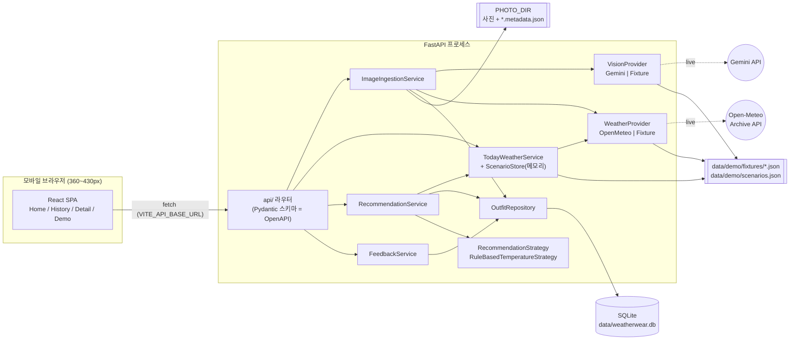
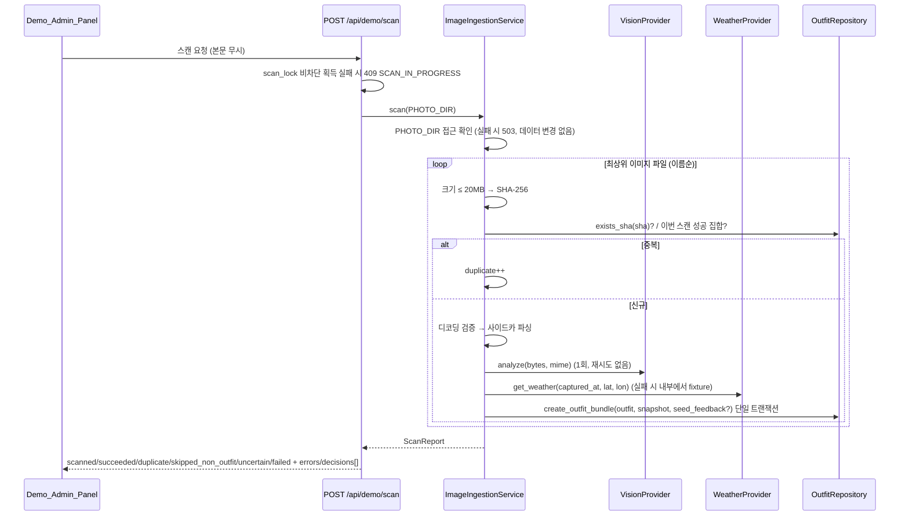
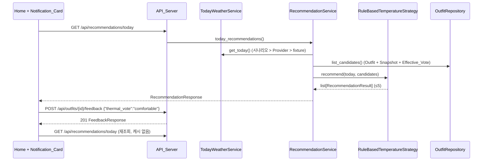
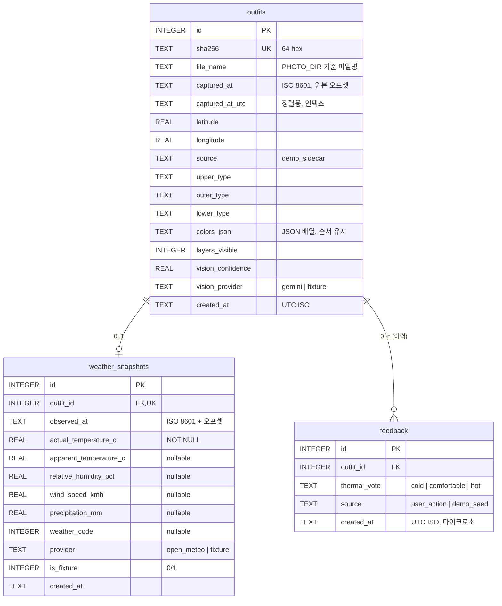

# Design Document: WeatherWear (Phase 1 MVP)

## Overview

WeatherWear는 지정 폴더의 착장 사진을 스캔해 의류 태그와 촬영 시점 날씨를 붙여 SQLite에 저장하고, 오늘 기온과 비슷했던 과거 착장을 체감 피드백(추웠어 / 적당했어 / 더웠어)으로 가중해 추천하는 모바일 웹 앱이다. 이 문서는 `requirements.md`의 Requirement 1~17을 6시간 데모 안에 구현할 수 있는 크기로 설계한다.

### 설계 원칙

- **작게 유지한다.** 백엔드는 FastAPI 단일 프로세스, SQLite 파일 1개, 계층은 `api → services → repository/providers` 세 단계뿐이다. Hexagonal/DDD/CQRS 같은 별도 계층은 두지 않는다.
- **순수 함수와 I/O를 분리한다.** 사이드카 파싱, 시간 단위 날씨 선택, 단위 정규화, 설정 해석, 유효 피드백 계산, 추천 계산은 모두 I/O 없는 순수 함수로 만든다. 이 함수들이 property-based test의 대상이다.
- **외부 의존은 인터페이스 뒤에 둔다.** `VisionProvider`, `WeatherProvider`, `RecommendationStrategy`는 `typing.Protocol`로 정의하고 팩토리 함수 1개로 구현체를 고른다.
- **Fixture가 기본값이다.** `VISION_PROVIDER=fixture`, `WEATHER_PROVIDER=fixture`가 기본값이므로 API 키나 네트워크 없이 기동, 스캔, 추천, 피드백, 테스트가 모두 동작한다(Req 15.1, 17.5).
- **Phase 2는 구현하지 않는다.** 교체 지점(Strategy 팩토리, Repository 경계)만 남긴다.

### 리서치 요약

| 주제 | 확인 내용 | 설계 반영 |
|---|---|---|
| Gemini 모델 ID | 2026-11-14 확인. Google AI 공식 모델 페이지(현재 `aistudio.google.com/docs/models`로 리디렉션)는 Gemini 4 Hydrogen의 모델 코드를 `gemini-4-hydrogen`으로 안내하고(입력: 텍스트·이미지·오디오·비디오·PDF), 2.5 Flash-Lite 안내에서 신규 프로젝트에 Gemini 4 Hydrogen 사용을 권한다. `gemini-3.8-flash`는 "이전 세대 Flash"로 바뀌었다 ([모델 목록](https://ai.google.dev/gemini-api/docs/models)). `scripts/check_gemini_model.py`로 `client.models.get`을 호출해 실제 키로 모델이 존재함을 확인했다 | 사용자 요청에 따라 `GEMINI_MODEL` 기본값은 `gemini-4-hydrogen`이다 |
| Gemini SDK | 공식 SDK는 `google-genai`(`from google import genai`)이고, 구 SDK `google-generativeai`는 2025-11-30에 지원이 끝났다 ([PyPI](https://pypi.org/project/google-generativeai/)). SDK는 Pydantic 타입을 지원한다 | `google-genai`만 사용, 응답 스키마로 Pydantic `ClothingTags` 전달 |
| Open-Meteo Archive | Historical Weather API는 재분석(reanalysis) 데이터 기반이다. 최근 며칠 데이터는 지연될 수 있어 공식 문서는 최근 데이터에 Forecast API의 `past_days` 사용을 권한다 ([Historical Weather API](https://open-meteo.com/en/docs/historical-weather-api), [이슈 #1480](https://github.com/open-meteo/open-meteo/issues/1480)) | 사용자 지정에 따라 오늘 날씨도 Archive API로 조회하되, 오늘 값이 없으면 fixture로 대체(Req 4.7, 5.8). 화면에 "추정치/재분석값" 안내(Req 4.9) |
| 라이브러리 버전 | 2026-11-14에 PyPI/npm 레지스트리에서 최신 버전을 조회했다(아래 표) | 구현 시 설치 후 테스트 통과한 버전으로 고정(Req 17.7) |
| UI 트렌드 | 아래 "UI 디자인 방향" 절 참고 | Soft Glass + Bento 스타일 |

*리서치 출처의 내용은 라이선스 준수를 위해 요약·재서술했다.*

### 기술 스택과 고정 버전 후보

2026-11-14 레지스트리 조회 기준 최신 버전이다. 구현자는 이 버전으로 설치하고 pytest가 통과하면 그대로 `==`로 고정한다. 호환 문제가 생기면 바로 아래 마이너 버전으로 내리고 README에 기록한다.

| 영역 | 패키지 | 버전 |
|---|---|---|
| Backend | fastapi | 0.162.7 |
| | uvicorn | 0.54.0 |
| | pydantic | 2.14.3 |
| | pydantic-settings | 2.16.3 |
| | sqlmodel | 0.0.50 |
| | httpx | 0.28.1 |
| | google-genai | 3.3.0 |
| | pillow | 13.0.0 |
| | python-dotenv | 1.2.4 (pydantic-settings의 `.env` 읽기에 사용) |
| Backend test | pytest | 9.2.0 |
| | hypothesis | 6.170.15 |
| | respx | 0.23.1 (httpx 목킹) |
| Frontend | react / react-dom | 19.3.1 |
| | vite | 8.3.8 |
| | @vitejs/plugin-react | 6.3.0 |
| | typescript | 7.0.2 (Vite 타입체크 도구와 충돌하면 직전 안정 버전으로 내린다) |
| | tailwindcss / @tailwindcss/vite | 4.3.5 |
| | react-router | 8.5.1 |
| | openapi-typescript | 7.13.0 |
| Frontend test | vitest | 5.1.0 |
| | @testing-library/react | 16.3.3 |
| | jsdom | 31.0.1 |
| | fast-check | 4.10.2 |

로컬 확인 환경: Python 3.14.8, Node 26.12.1. `google-genai`는 Python 3.10 이상을 요구한다.

## Architecture

### 시스템 구성



### 저장소 레이아웃과 작업 소유권

병렬 작업을 위해 파일 소유자를 나눈다. **공유 계약 파일(`domain.py`, `schemas.py`, `db.py`)은 리드가 소유**하며, 다른 사람은 PR로 변경을 요청한다. 리드는 첫 30분 안에 이 세 파일과 `frontend/src/api/schema.d.ts` 초안을 먼저 머지한다.

```
.
├── .env.example                     # 리드 (Req 16.1, 16.3)
├── .gitignore                       # 리드 (Req 16.4)
├── README.md                        # 리드 + D (Req 17)
├── backend/
│   ├── pyproject.toml / requirements.txt   # 리드 (버전 고정)
│   ├── app/
│   │   ├── main.py                  # 리드: 앱 생성, CORS, 예외 핸들러, 라우터 등록, DI
│   │   ├── config.py                # 리드: RawSettings, resolve_config()
│   │   ├── domain.py                # 리드: 공유 값 객체 (ThermalVote, ClothingTags, WeatherReading, WeatherContext …)
│   │   ├── schemas.py               # 리드: API 요청/응답 Pydantic 모델
│   │   ├── db.py                    # 리드: SQLModel 테이블, engine, session
│   │   ├── api/                     # 리드: outfits.py, demo.py, weather.py, recommendations.py
│   │   ├── ingestion/               # A
│   │   │   ├── service.py           #   ImageIngestionService
│   │   │   ├── sidecar.py           #   parse_sidecar_text() 순수 함수
│   │   │   └── image_check.py       #   확장자/크기/디코딩 검증
│   │   ├── providers/
│   │   │   ├── vision/              # A: base.py, gemini.py, fixture.py, factory.py
│   │   │   └── weather/             # A: base.py, open_meteo.py, fixture.py, normalize.py, factory.py
│   │   ├── repository.py            # B: OutfitRepository
│   │   ├── feedback.py              # B: effective_vote() 순수 함수 + FeedbackService
│   │   ├── today_weather.py         # B: TodayWeatherService, ScenarioStore, load_scenarios()
│   │   └── recommendation/          # B: base.py, rule_based_v1.py, explain.py, factory.py, service.py
│   └── tests/                       # D (각 소유자도 자기 단위 테스트 추가 가능)
├── frontend/                        # C
│   ├── src/api/schema.d.ts          #   openapi-typescript 생성물 (리드가 재생성)
│   ├── src/api/client.ts
│   ├── src/lib/format.ts
│   ├── src/pages/ , src/components/
│   └── src/styles/app.css           #   Tailwind v4 @theme 토큰
├── data/demo/                       # D
│   ├── photos/                      #   ex_img/ 권한 확인 사진 전체(159장: PNG 119 + JPG 40) + 같은 이름 *.metadata.json
│   ├── photos.manifest.json         #   출처/권한 기록 (Req 15.3)
│   ├── scenarios.json               #   Weather_Scenario 4개
│   └── fixtures/vision.json, fixtures/weather.json
└── scripts/                         # D: prepare_demo_photos.py, make_placeholders.py, build_fixtures.py
```

### 주요 흐름: 폴더 스캔



### 주요 흐름: 오늘 추천과 피드백



추천은 요청마다 다시 계산하고 캐시하지 않는다. 데이터가 150여 건(데모 사진 159장) 수준이라 비용이 작고, 피드백 직후 결과가 바로 바뀐다(Req 9.6).

### 설계 결정과 근거

| 결정 | 선택 | 근거 / 대안 |
|---|---|---|
| ORM | SQLModel (SQLAlchemy 2 기반) | Pydantic과 같은 타입을 공유한다. 단, API 스키마는 `schemas.py`에 따로 두어 테이블 변경이 OpenAPI에 새지 않게 한다 |
| 시각 저장 | ISO 8601 TEXT 2개 (`captured_at` 원본 오프셋 유지, `captured_at_utc` 정렬용) | SQLite는 타임존을 저장하지 않으므로 SQLAlchemy `DateTime`을 쓰면 오프셋이 사라진다(Req 2.2) |
| 점수 계산 | `decimal.Decimal` + 소수 첫째 자리 반올림(ROUND_HALF_UP) | 부동소수점 오차로 경계값(정확히 3.0°C) 판정과 동점 판정이 흔들리지 않게 한다(Req 6.7, 7.1) |
| 스캔 동시성 | 프로세스 전역 `threading.Lock` + `acquire(blocking=False)` | 단일 프로세스 데모이므로 충분하다(Req 1.13). 멀티 워커는 Phase 2 |
| 스캔 실행 | 요청 안에서 동기 실행 후 결과 반환 | 데모 사진 159장(약 290MB, 모두 1024×1536. PNG 119장 장당 약 2.2MB, JPG 40장 장당 약 0.6MB). Fixture 모드는 해시·디코딩 검증·저장만 하므로 30초 안에 끝난다. Live 모드는 `ThreadPoolExecutor(max_workers=4)`로 분석만 병렬화한다(저장은 순차). 그래도 Gemini 159회 호출은 Demo 패널 30초 제한(Req 14.6)을 넘길 수 있다. 이때 패널은 실패를 표시하지만 서버 스캔은 끝까지 진행되고, 재스캔하면 이미 저장된 사진은 duplicate로 집계된다. README에 Live 모드 첫 스캔은 발표 전에 미리 돌리라고 적는다 |
| 시나리오 선택 상태 | 프로세스 메모리(`ScenarioStore`) | 재시작 시 초기화가 요구사항이다(Req 5.3) |
| Demo 패널 노출 | 프론트엔드 `import.meta.env.DEV`로 판단 | `.env.example` 변수 12개 목록(Req 16.1)을 늘리지 않는다. 백엔드 `/api/demo/*`는 로컬 데모 전용이라 항상 켠다 |
| "추천 재계산" | 별도 엔드포인트 없이 `GET /api/recommendations/today` 재호출 | 추천은 항상 요청 시 계산되므로 서버 상태가 필요 없다 |
| 프론트 데이터 패칭 | `fetch` + 작은 `useAsync` 훅 | 의존성을 늘리지 않는다. 화면 4개 규모 |
| API 타입 | `openapi-typescript`로 `schema.d.ts` 생성 후 커밋 | 프론트가 OpenAPI 필드만 쓰도록 강제한다(Req 10.7). 백엔드 없이도 프론트 빌드가 된다 |

## Components and Interfaces

### 1. Config_Loader (`app/config.py`)

pydantic-settings로 원시 문자열을 읽고(우선순위: 프로세스 환경 변수 > `.env` > 기본값, Req 16.2), 순수 함수 `resolve_config`가 검증과 기본값 대체를 한다. 검증 실패는 예외 대신 `ConfigIssue`로 모아 로그에 남긴다(Req 15.6, 16.8, 16.9).

```python
class RawSettings(BaseSettings):
    model_config = SettingsConfigDict(env_file=".env", extra="ignore")
    GEMINI_API_KEY: str = ""
    VISION_PROVIDER: str = "fixture"
    GEMINI_MODEL: str = "gemini-4-hydrogen"
    WEATHER_PROVIDER: str = "fixture"
    DATABASE_URL: str = "sqlite:///./data/weatherwear.db"
    PHOTO_DIR: str = "./data/demo/photos"
    APP_TIMEZONE: str = "Asia/Seoul"
    TEMPERATURE_TOLERANCE_C: str = "3"
    DEFAULT_LATITUDE: str = "37.5665"
    DEFAULT_LONGITUDE: str = "126.9780"
    CORS_ORIGINS: str = "http://localhost:5173"

@dataclass(frozen=True)
class AppConfig:
    vision_provider: Literal["gemini", "fixture"]
    gemini_model: str
    gemini_api_key: SecretStr          # repr/str에 값이 나오지 않음
    weather_provider: Literal["open_meteo", "fixture"]
    database_url: str
    photo_dir: Path
    app_timezone: ZoneInfo
    temperature_tolerance_c: Decimal   # 0 < x < 5.0
    default_latitude: float
    default_longitude: float
    cors_origins: tuple[str, ...]

@dataclass(frozen=True)
class ConfigIssue:
    variable: str
    message: str        # 변수 이름과 허용값/범위만 포함, 입력값은 포함하지 않음

def resolve_config(raw: Mapping[str, str]) -> tuple[AppConfig, list[ConfigIssue]]: ...
def parse_cors_origins(value: str) -> tuple[str, ...]: ...   # 쉼표 분리, 앞뒤 공백 제거, 빈 항목 제거
```

해석 규칙:

- `VISION_PROVIDER ∉ {gemini, fixture}` 또는 `WEATHER_PROVIDER ∉ {open_meteo, fixture}` → 이슈 기록, `fixture` 사용(Req 16.8).
- `VISION_PROVIDER=gemini`인데 `GEMINI_API_KEY` 또는 `GEMINI_MODEL`이 빈 문자열 → 누락 변수 이름만 기록, `fixture` 사용(Req 15.6).
- `TEMPERATURE_TOLERANCE_C`: 빈 문자열이면 3.0(Req 6.2). 숫자가 아니거나 `0 < x < 5.0`이 아니면 이슈 기록 후 3.0(Req 16.9). NaN/inf도 거부한다.
- `DEFAULT_LATITUDE ∉ [-90, 90]`, `DEFAULT_LONGITUDE ∉ [-180, 180]` 또는 숫자 아님 → 이슈 기록 후 기본값(Req 16.9, 5.4).
- `APP_TIMEZONE`이 유효한 IANA 이름이 아니면 이슈 기록 후 `Asia/Seoul`.
- `VITE_API_BASE_URL`은 프론트엔드 전용이며 백엔드는 읽지 않는다. `.env.example`에는 12개 변수를 모두 문서화한다.

비밀값 처리(Req 16.5): `gemini_api_key`는 `SecretStr`로만 보관한다. 로깅 설정에 `RedactingFilter`를 붙여 로그 레코드 메시지와 예외 텍스트에서 키 문자열을 `***`로 치환한다. API와 Demo 패널에는 `gemini_api_key_configured: bool`만 노출한다.

### 2. 도메인 값 객체 (`app/domain.py`, 리드 소유)

```python
ThermalVote = Literal["cold", "comfortable", "hot"]
FeedbackSource = Literal["user_action", "demo_seed"]
WeatherProviderName = Literal["open_meteo", "fixture"]

UpperType = Literal["unknown", "t_shirt", "long_sleeve_t_shirt", "shirt", "blouse", "knit",
                    "turtleneck", "sweatshirt", "hoodie", "sleeveless_top", "cardigan",
                    "fleece", "jersey", "dress", "jumpsuit", "coveralls"]
OuterType = Literal["unknown", "none", "long_puffer", "short_puffer", "puffer_jacket",
                    "parka", "coat", "trench_coat", "jacket", "blazer", "cardigan",
                    "denim_jacket", "leather_jacket", "bomber_jacket", "fleece_jacket",
                    "rain_jacket", "windbreaker", "track_jacket", "utility_jacket",
                    "shirt_jacket", "varsity_jacket", "vest", "jersey"]
LowerType = Literal["unknown", "none", "jeans", "trousers", "slacks", "chinos",
                    "cargo_pants", "corduroy_pants", "leggings", "shorts", "skirt",
                    "track_pants", "jogger_pants", "parachute_pants"]

class ClothingTags(BaseModel):            # Req 3.1, 3.6
    model_config = ConfigDict(extra="forbid")
    upper_type: UpperType
    outer_type: OuterType                  # 겉옷 없음: "none"
    lower_type: LowerType
    colors: conlist(constr(min_length=1, max_length=30), min_length=0, max_length=5)
    layers_visible: conint(ge=0, le=5)
    confidence: confloat(ge=0.0, le=1.0)

UNKNOWN_TAGS = ClothingTags(upper_type="unknown", outer_type="unknown", lower_type="unknown",
                            colors=[], layers_visible=0, confidence=0.0)   # Req 15.8

PhotoType = Literal["outfit", "non_outfit", "uncertain"]

class VisionAnalysis(BaseModel):
    photo_type: PhotoType
    photo_type_confidence: confloat(ge=0.0, le=1.0)
    reason: constr(min_length=1, max_length=200)
    tags: ClothingTags

UNKNOWN_ANALYSIS = VisionAnalysis(photo_type="uncertain", photo_type_confidence=0.0,
                                  reason="No fixture analysis is available.", tags=UNKNOWN_TAGS)

class SidecarMetadata(BaseModel):         # Req 2.1, 2.8
    captured_at: AwareDatetime            # 오프셋 필수
    latitude: float                       # [-90, 90]
    longitude: float                      # [-180, 180]
    thermal_vote: ThermalVote | None = None

class WeatherReading(BaseModel):          # Weather_Snapshot에 저장될 값
    observed_at: AwareDatetime
    actual_temperature_c: float
    apparent_temperature_c: float | None
    relative_humidity_pct: float | None   # [0, 100]
    wind_speed_kmh: float | None
    precipitation_mm: float | None
    weather_code: int | None
    provider: WeatherProviderName
    is_fixture: bool

class WeatherContext(BaseModel):          # 오늘 날씨
    actual_temperature_c: float | None    # 내부에서는 None 가능 → API에서 503 (Req 6.8)
    apparent_temperature_c: float | None
    relative_humidity_pct: float | None
    wind_speed_kmh: float | None
    precipitation_mm: float | None
    observed_at: AwareDatetime | None
    provider: Literal["open_meteo", "fixture", "scenario"]
    is_fixture: bool
    scenario_id: str | None
    scenario_name: str | None

class OutfitWithWeatherAndFeedback(BaseModel):   # 추천 입력
    outfit_id: int
    captured_at: AwareDatetime
    tags: ClothingTags
    weather: WeatherReading | None
    effective_vote: ThermalVote | None

ConfidenceLevel = Literal["high", "medium", "low"]

class RecommendationResult(BaseModel):
    outfit_id: int
    rank: int                             # 1부터
    score: float                          # 소수 첫째 자리
    temperature_diff_c: float             # 소수 첫째 자리
    selected_by_fallback: bool
    confidence_level: ConfidenceLevel
    reasons: list[str]                    # 예: "과거에 적당했음 (+15.0점)"
    explanation: str                      # 한국어 1~300자
    algorithm_version: Literal["rule_based_v1"]
```

### 3. Ingestion_Service (`app/ingestion/`, 소유자 A)

```python
SUPPORTED_EXTENSIONS = {".jpg": "JPEG", ".jpeg": "JPEG", ".png": "PNG", ".webp": "WEBP"}
MAX_IMAGE_BYTES = 20 * 1024 * 1024

FailureStage = Literal["validation", "analysis", "storage"]   # 화면 표기: 검증/분석/저장

class ScanError(BaseModel):
    file_name: str          # 파일 이름만. 절대 경로는 넣지 않는다
    stage: FailureStage
    code: str               # 아래 오류 코드 표 참고
    message: str            # 한국어 사유

class ScanReport(BaseModel):
    scanned: int; succeeded: int; duplicate: int; skipped_non_outfit: int; uncertain: int; failed: int
    errors: list[ScanError]
    decisions: list[ScanDecision]

class ImageIngestionService:
    def __init__(self, photo_dir: Path, vision: VisionProvider, weather: WeatherProvider,
                 repo: OutfitRepository, tz: ZoneInfo): ...
    def scan(self) -> ScanReport: ...       # PhotoDirUnavailable 예외 가능

def list_image_files(photo_dir: Path) -> list[Path]: ...   # 최상위, 일반 파일, 확장자 소문자 비교, *.metadata.json 제외, 이름순
def sidecar_path_for(image: Path) -> Path: ...              # 001_front.png → 001_front.metadata.json
def parse_sidecar_text(text: str) -> SidecarMetadata | SidecarError: ...   # 순수 함수
def check_image(data: bytes, ext: str) -> ImageCheckError | None: ...      # Pillow verify + 형식 일치
```

파일 1건 처리 순서(실패하면 그 단계에서 멈추고 레코드를 남기지 않는다, Req 1.6):

1. `stat().st_size > 20MB` → failed(validation, `FILE_TOO_LARGE`). 파일 내용을 읽지 않는다(Req 1.12).
2. 바이트 전체를 읽고 SHA-256 계산(Req 1.3).
3. DB에 같은 해시가 있거나 이번 스캔에서 이미 **성공 저장된** 해시면 duplicate. Provider를 호출하지 않는다(Req 1.4). 같은 스캔에서 앞 파일이 실패한 해시는 성공 집합에 들어가지 않으므로 뒤 파일이 다시 처리된다. 이 규칙 덕분에 재스캔 시 실패 파일이 재처리된다(Req 1.7).
4. `check_image`: Pillow `Image.open(BytesIO).verify()` 성공 + 감지 형식이 확장자 형식과 일치. 실패 → failed(validation, `INVALID_IMAGE_FORMAT`)(Req 1.8). 데모 세트의 JPG 40장(`.jpg`, 실제 형식 JFIF JPEG)은 `.jpg → JPEG` 매핑으로 통과하므로 JPEG를 위한 별도 처리는 없다. `mime`은 형식에서 정한다(`image/jpeg`, `image/png`, `image/webp`).
5. 사이드카 읽기/파싱. 실패 → failed(validation, `SIDECAR_*`)(Req 2.3~2.5, 2.9, 2.10).
6. `vision.analyze(data, mime)` 1회. `VisionError` → failed(analysis, `VISION_SCHEMA_INVALID | VISION_API_ERROR | VISION_TIMEOUT`), 로그 기록, 재시도 없음(Req 3.5).
7. `weather.get_weather(captured_at, lat, lon)`. OpenMeteo 구현은 내부에서 fixture로 대체하므로 이 단계는 실패하지 않는다(Req 4.7).
8. `repo.create_outfit_bundle(...)` 단일 트랜잭션(Outfit + Weather_Snapshot + 선택적 demo_seed feedback). 예외 → 롤백, failed(storage, `STORAGE_ERROR`)(Req 1.10, 2.6).

PHOTO_DIR 검사(Req 1.11): `exists()`, `is_dir()`, `os.access(R_OK|X_OK)` 중 하나라도 거짓이면 `PhotoDirUnavailable` → API 503 `PHOTO_DIR_UNAVAILABLE`. 응답 메시지에 서버 경로를 넣지 않는다.

사이드카 파싱 규칙(`parse_sidecar_text`):

| 조건 | 오류 코드 | Req |
|---|---|---|
| 파일 없음 | `SIDECAR_NOT_FOUND` | 2.3 |
| JSON 파싱 실패 또는 최상위가 객체가 아님 | `SIDECAR_PARSE_ERROR` | 2.3 |
| `captured_at`/`latitude`/`longitude` 누락 또는 null | `SIDECAR_MISSING_FIELD` (+필드 이름) | 2.3 |
| `captured_at`이 문자열이 아니거나 ISO 8601로 파싱 불가, 또는 오프셋 없음 | `SIDECAR_CAPTURED_AT_INVALID` | 2.4 |
| 위도/경도가 숫자 아님(문자열·불리언 포함) 또는 범위 밖 | `SIDECAR_OUT_OF_RANGE` (+필드 이름) | 2.5 |
| `thermal_vote`가 있으나 `cold/comfortable/hot` 아님 | `SIDECAR_THERMAL_VOTE_INVALID` | 2.9 |
| 그 밖의 필드 | 무시 | 2.11 |

`captured_at`은 `datetime.fromisoformat`으로 파싱하고 `tzinfo is None`이면 거부한다. 저장 시 원본 오프셋을 유지한 `isoformat()`을 쓴다(Req 2.2).

### 4. Vision_Provider (`app/providers/vision/`, 소유자 A)

```python
class VisionError(Exception):
    kind: Literal["schema_invalid", "api_error", "timeout"]

class VisionProvider(Protocol):
    name: Literal["gemini", "fixture"]
    def analyze(self, image: bytes, mime_type: str, sha256: str) -> ClothingTags: ...

def build_vision_provider(cfg: AppConfig) -> VisionProvider: ...
```

**GeminiVisionProvider** (Req 3.2, 3.4, 3.5, 3.7):

- `genai.Client(api_key=cfg.gemini_api_key.get_secret_value(), http_options=types.HttpOptions(timeout=30_000))`. SDK의 timeout 단위(ms)와 자동 재시도 옵션은 구현 시 SDK 문서로 확인하고, 자동 재시도는 끈다. 추가 안전장치로 호출을 `concurrent.futures` 30초 타임아웃으로 감싼다.
- `client.models.generate_content(model=cfg.gemini_model, contents=[types.Part.from_bytes(data=image, mime_type=mime_type), PROMPT], config=types.GenerateContentConfig(response_mime_type="application/json", response_schema=ClothingTags, temperature=0))`.
- 요청에는 이미지 바이트와 고정 프롬프트만 넣는다. 파일 이름, 사이드카 값, EXIF는 넣지 않는다. 업로드 전에 Pillow로 EXIF를 제거한 바이트를 보낸다. 데모 JPG 40장에는 합성 EXIF(파일 이름과 같은 촬영 시각, 서울 GPS 좌표 약 37.556, 126.924, 설명 문구)가 들어 있으므로 이 처리가 실제로 필요하다. 수집 서비스는 EXIF를 읽지 않고 사이드카만 쓴다.
- 응답 텍스트를 `ClothingTags.model_validate_json`으로 다시 검증한다. 실패 → `VisionError("schema_invalid")`.
- 프롬프트(한국어 요약): "사진 속 인물의 착장만 분석하라. 보이지 않거나 판단할 수 없는 속성은 추측하지 말고 'unknown'으로 답하라. 겉옷이 없으면 outer_type은 'none'. 원단 두께, 보온성, 속옷은 판단하지 마라. 색상은 최대 5개."(Req 3.6)

**FixtureVisionProvider** (Req 3.3, 15.8): 기동 시 `data/demo/fixtures/vision.json`(`{sha256: VisionAnalysis}`)을 읽는다. 해시가 있으면 그 값을, 없으면 `UNKNOWN_ANALYSIS`(`photo_type="uncertain"`)를 반환한다. 네트워크 호출이 없다.

### 5. Weather_Provider (`app/providers/weather/`, 소유자 A)

```python
class WeatherProvider(Protocol):
    name: WeatherProviderName
    def get_weather(self, at: datetime, latitude: float, longitude: float) -> WeatherReading: ...

def build_weather_provider(cfg: AppConfig, fixture: FixtureWeatherProvider) -> WeatherProvider: ...
```

순수 함수(`normalize.py`):

```python
def select_nearest_hour(times: Sequence[datetime], target: datetime) -> int | None:
    """모든 시각을 같은 기준(UTC instant)으로 비교. |t - target| 최소인 인덱스.
    동률이면 더 이른 시각. 빈 목록이면 None."""   # Req 4.2

def normalize_value(value: float | None, unit: str, target: Literal["C", "pct", "kmh", "mm"]) -> float | None:
    """°F→°C, inch→mm, m/s·mph→km/h 변환. 이미 목표 단위면 그대로.
    습도가 [0,100] 밖이면 None. 알 수 없는 단위면 None."""   # Req 4.8

def map_archive_response(payload: dict, target: datetime, tz: ZoneInfo) -> WeatherReading | None:
    """hourly.time(타임존 없는 로컬 시각 문자열)을 tz로 지역화 → select_nearest_hour →
    temperature_2m→actual, precipitation→precipitation_mm, relative_humidity_2m→relative_humidity_pct,
    apparent/wind/weather_code=None, provider='open_meteo', is_fixture=False.
    선택 시각의 temperature_2m이 없으면 None."""   # Req 4.12
```

**OpenMeteoWeatherProvider** (Req 4.5, 4.7, 4.11, 4.12):

- 요청 1건: `GET https://archive-api.open-meteo.com/v1/archive` 파라미터 `latitude`, `longitude`, `start_date=end_date=at.astimezone(tz).date().isoformat()`, `hourly=temperature_2m,precipitation,relative_humidity_2m`, `timezone=APP_TIMEZONE`. API 키 없음.
- `httpx.Client(timeout=10.0)`. 타임아웃, 네트워크 오류, 2xx 아님, JSON 오류, `map_archive_response`가 None → `fixture.get_weather(...)`를 반환한다. 이때 결과의 `provider='fixture'`, `is_fixture=True`이며 경고 로그를 남긴다.
- 조회일을 하루로 고정하므로 23:30처럼 자정 근처 시각은 같은 날 23:00 값이 선택된다. 요구사항(start_date=end_date)을 따른 결과이며 README에 적는다.
- 오늘 날씨(`TodayWeatherService`)도 같은 메서드를 `at=now(tz)`로 호출한다. Archive API는 최근 며칠 데이터가 비어 있을 수 있어 Live 모드에서도 오늘 날씨가 fixture로 대체될 가능성이 높다. 화면은 이 경우 fixture 라벨을 보여준다.

**FixtureWeatherProvider** (Req 4.6, 4.10): `data/demo/fixtures/weather.json`의 항목을 `(captured_at UTC instant, round(lat,4), round(lon,4))` 키로 찾는다. 없으면 결정적 계절 공식 `seasonal_temp(month, hour)`(서울 월평균 기온표 + 시간대 보정, 난수 없음)으로 값을 만든다. 항상 `provider='fixture'`, `is_fixture=True`, `observed_at`은 `at`을 정시로 내린 시각이다.

### 6. TodayWeatherService와 ScenarioStore (`app/today_weather.py`, 소유자 B)

```python
class WeatherScenario(BaseModel):
    id: str; name: str
    actual_temperature_c: float
    apparent_temperature_c: float | None = None
    relative_humidity_pct: float | None = None
    wind_speed_kmh: float | None = None
    precipitation_mm: float | None = None

def load_scenarios(path: Path) -> tuple[list[WeatherScenario], list[str]]:
    """파일 없음/파싱 실패 → ([], [오류]). 항목별로 검증해 유효한 것만 반환.
    id 중복은 뒤 항목을 버린다."""   # Req 5.2, 5.6

class ScenarioStore:                      # 기동 시 1회 로드, 메모리 보관
    def list(self) -> list[WeatherScenario]: ...
    def selected(self) -> WeatherScenario | None: ...
    def select(self, scenario_id: str) -> WeatherScenario   # 없으면 UnknownScenario, 상태 유지
    def clear(self) -> None: ...

class TodayWeatherService:
    def get_today(self) -> WeatherContext:
        """선택 시나리오가 있으면 provider='scenario', is_fixture=True, scenario_id/name 포함.
        없으면 weather_provider.get_weather(now, DEFAULT_LAT, DEFAULT_LON) 결과를 변환.
        OpenMeteo 실패 시 provider 내부 fallback으로 is_fixture=True."""   # Req 5.1, 5.3~5.5, 5.8
```

### 7. Outfit_Repository (`app/repository.py`, 소유자 B)

```python
class OutfitRepository:
    def __init__(self, engine: Engine): ...
    def exists_sha(self, sha256: str) -> bool: ...
    def create_outfit_bundle(self, outfit: OutfitCreate, weather: WeatherReading,
                             seed_vote: ThermalVote | None) -> int: ...   # 단일 트랜잭션
    def get_outfit(self, outfit_id: int) -> OutfitRecord | None: ...
    def list_outfits(self) -> list[OutfitRecord]: ...          # captured_at_utc DESC, id DESC
    def list_candidates(self) -> list[OutfitWithWeatherAndFeedback]: ...
    def add_feedback(self, outfit_id: int, vote: ThermalVote, source: FeedbackSource,
                     created_at: datetime) -> FeedbackRecord: ...
    def counts(self) -> dict[str, int]: ...                     # 테스트/상태 표시용
```

`OutfitRecord`는 Outfit 행 + Weather_Snapshot(없으면 None) + Effective_Vote(없으면 None)를 담는다. Effective_Vote는 SQL 대신 `feedback.effective_vote()` 순수 함수로 계산해 규칙을 한 곳에 둔다(Outfit이 150여 건 규모라 N+1 비용은 무시한다. 필요하면 feedback을 한 번에 읽어 Outfit별로 묶는다).

SQLite 설정: 연결 시 `PRAGMA foreign_keys=ON`, `PRAGMA journal_mode=WAL`. `DATABASE_URL`의 부모 디렉터리가 없으면 만든다. 기동 시 `SQLModel.metadata.create_all()`로 테이블을 만든다(마이그레이션 도구 없음).

### 8. Feedback_Service (`app/feedback.py`, 소유자 B)

```python
def effective_vote(records: Iterable[FeedbackRecord]) -> ThermalVote | None:
    """max(records, key=(created_at, id)).thermal_vote. 0건이면 None. source 무관."""   # Req 9.4

class FeedbackService:
    def submit(self, outfit_id: int, vote: ThermalVote) -> FeedbackRecord:
        """Outfit 없으면 OutfitNotFound. created_at = now(UTC, 마이크로초). source='user_action'.
        항상 INSERT만 한다(수정/삭제 없음). 저장 예외 → 롤백 후 FeedbackSaveFailed."""   # Req 9.1, 9.3, 9.5, 9.8
```

### 9. Recommendation_Strategy (`app/recommendation/`, 소유자 B)

```python
class RecommendationStrategy(Protocol):
    algorithm_version: str
    def recommend(self, today: WeatherContext,
                  candidates: list[OutfitWithWeatherAndFeedback]) -> list[RecommendationResult]: ...

def build_strategy(name: str = "rule_based_v1", *, tolerance_c: Decimal) -> RecommendationStrategy: ...
```

전략은 입력 인자만 쓰고 Provider나 Repository를 import하지 않는다(Req 7.13). `main.py`는 FastAPI `Depends(get_strategy)`로 팩토리 결과를 주입한다(Req 7.14).

**RuleBasedTemperatureStrategy (`rule_based_v1`)** 설정 상수(Req 7.9):

```python
ALGORITHM_VERSION = "rule_based_v1"
FALLBACK_TOLERANCE_C = Decimal("5.0")
TEMP_SCORE_BASE = Decimal("100.0")
TEMP_WEIGHT_PER_C = Decimal("10.0")     # 기온 차이 1°C당 10점 감소
COMFORTABLE_BONUS = Decimal("15.0")     # 과거에 적당했음
MISMATCH_PENALTY = Decimal("15.0")      # 과거에 추웠음/더웠음
MAX_RESULTS = 5
```

알고리즘:

1. `today.actual_temperature_c is None` → `MissingTodayTemperature` 예외(API가 503으로 변환, Req 6.8).
2. 유효 후보 = `weather is not None and weather.actual_temperature_c is not None`(Req 6.9).
3. `diff = round_half_up(|past − today|, 1)` (Decimal, Req 6.7).
4. `tolerance` 이내(`diff ≤ tol`) 후보가 1건 이상이면 `fallback=False`. 아니면 `diff ≤ 5.0` 후보로 다시 고르고 `fallback=True`(1회만, Req 6.3). 그래도 0건이면 빈 목록(Req 6.5).
5. `score = TEMP_SCORE_BASE − TEMP_WEIGHT_PER_C × diff + adj(vote)`, `adj(comfortable)=+15`, `adj(cold|hot)=−15`, `adj(None)=0`(Req 7.1~7.5). 같은 diff에서 순서는 comfortable > 없음 > cold/hot이 된다(Req 7.6).
6. 정렬 키: `(−score, tb(apparent), tb(humidity), tb(wind), tb(precip), outfit_id)`. `tb(x) = (0, |past_x − today_x|)` 두 값이 모두 있을 때, 아니면 `(1, 0)`(Req 7.7, 7.8). 입력 순서와 무관하게 전순서가 정해진다(Req 7.10).
7. 상위 5건만 반환하고 `rank`를 1부터 붙인다(Req 8.1).
8. `confidence_level`: 투표 있음 & 기본 허용 오차 이내 → `high`, 둘 중 하나만 미충족 → `medium`, 둘 다 미충족 → `low`(Req 8.5, 7.5).

**RecommendationService** (`service.py`)는 `TodayWeatherService`, `OutfitRepository`, 전략을 묶어 `RecommendationResponse`를 만든다. 결과 0건이면 `status="insufficient_data"`, `fallback=True`, `items=[]`로 200을 반환한다(Req 8.7).

### 10. 설명 생성 (`app/recommendation/explain.py`)

```python
VOTE_KO = {"cold": "추웠음", "comfortable": "적당함", "hot": "더웠음"}

def display_tags(tags: ClothingTags, limit: int = 3) -> list[str]:
    """[outer_type, upper_type, lower_type] 순서로 'none'/'unknown' 제외 후 최대 3개.
    부족하면 colors로 채우지 않는다(옷 종류만 표시)."""

def build_explanation(today_c: Decimal, past_c: Decimal, diff: Decimal, tags: list[str],
                      vote: ThermalVote | None, fallback: bool) -> tuple[str, list[str]]: ...
```

문장 구성(각 값은 소수 첫째 자리, °C):

```
오늘 9.0°C, 지난 8.0°C 기록과 기온 차이 1.0°C입니다. 당시 착장: 코트+니트+슬랙스. 체감: 적당함 (과거에 적당했음, +15.0점).
```

- 태그 0개 → `당시 착장: 착장 태그 정보 없음.`(Req 8.6)
- 투표 없음 → `체감 피드백 기록 없음.`(Req 8.4)
- `cold` → `체감: 추웠음 (과거에 추웠음, −15.0점).`, `hot` → `체감: 더웠음 (과거에 더웠음, −15.0점).`(Req 7.4)
- fallback → 끝에 `기온 허용 범위를 5.0°C로 확장하여 선택되었습니다.` 추가(Req 8.3)
- 300자를 넘으면 태그 문자열을 각 20자로 자른 뒤 다시 만든다. canonical enum의 가장 긴 식별자를 포함해도 300자를 넘지 않는지 테스트로 확인한다(Req 8.1).

### 11. REST API (`app/api/`, 리드 소유)

모든 요청/응답은 `schemas.py`의 Pydantic 모델이며 FastAPI가 `/openapi.json`, `/docs`로 노출한다(Req 10.6). 오류 응답은 공통 형식이다.

```json
{ "error": { "code": "OUTFIT_NOT_FOUND", "message": "착장을 찾을 수 없습니다." } }
```

| 메서드 · 경로 | 성공 | 오류 | Req |
|---|---|---|---|
| `POST /api/demo/scan` | 200 `ScanReport` | 409 `SCAN_IN_PROGRESS`, 503 `PHOTO_DIR_UNAVAILABLE` | 1, 2, 3, 4 |
| `GET /api/demo/status` | 200 `DemoStatus`(providers, `gemini_api_key_configured`, 건수, 선택 시나리오) | – | 14, 16.5 |
| `GET /api/demo/scenarios` | 200 `ScenarioListResponse`(목록 + `selected_id`) | – | 5.2, 14.3 |
| `PUT /api/demo/scenarios/selected` 본문 `{"scenario_id": "..."}` | 200 `ScenarioSelection` | 404 `UNKNOWN_SCENARIO` (상태 유지) | 5.3, 5.7 |
| `DELETE /api/demo/scenarios/selected` | 204 | – | 5.1 (선택 해제) |
| `GET /api/meta` | 200 `AppMeta`(`app_timezone`, `algorithm_version`, provider 이름) | – | 11.4 |
| `GET /api/weather/today` | 200 `WeatherContextOut` | 503 `TODAY_TEMPERATURE_MISSING` | 5 |
| `GET /api/recommendations/today` | 200 `RecommendationResponse` | 503 `TODAY_TEMPERATURE_MISSING` | 6, 7, 8 |
| `GET /api/outfits` | 200 `list[OutfitOut]` | – | 10.1, 10.2 |
| `GET /api/outfits/{id}` | 200 `OutfitOut` | 404 `OUTFIT_NOT_FOUND` | 10.3~10.5 |
| `GET /api/outfits/{id}/photo` | 200 이미지(`FileResponse`) | 404 `PHOTO_NOT_FOUND` | 10.8, 10.9 |
| `POST /api/outfits/{id}/feedback` | 201 `FeedbackOut` | 404 `OUTFIT_NOT_FOUND`, 422 `INVALID_THERMAL_VOTE`, 500 `FEEDBACK_SAVE_FAILED` | 9 |

세부 규칙:

- `POST /api/demo/scan`은 요청 본문을 받지 않는다. 본문에 경로가 있어도 읽지 않는다(Req 1.9).
- `FeedbackIn`: `thermal_vote: Literal["cold","comfortable","hot"]`, `model_config = ConfigDict(extra="ignore", strict=True)`. strict 모드라 `"COLD"`, `" cold"`, `""`, `1`, `null`, 누락이 모두 422가 된다. `RequestValidationError` 핸들러가 이 경로의 오류를 `INVALID_THERMAL_VOTE` 형식으로 바꾼다(Req 9.2, 9.7). 존재 확인(404)은 본문 검증 뒤에 한다.
- 사진 엔드포인트: DB의 `file_name`으로 `photo_dir / file_name`을 만들고 `resolve()` 결과가 `photo_dir.resolve()` 안인지 확인한다. 없으면 404이며 경로를 응답에 넣지 않는다. `StaticFiles` 마운트는 하지 않는다(Req 10.8, 10.9).
- 모든 datetime 필드는 `AwareDatetime`이고 직렬화 시 `+09:00` 또는 `Z`가 붙는다. `captured_at`은 원본 오프셋, `observed_at`은 `APP_TIMEZONE` 오프셋, `created_at`은 UTC(`Z`)다(Req 10.10).
- CORS: `CORSMiddleware(allow_origins=list(cfg.cors_origins), allow_methods=["GET","POST","PUT","DELETE"], allow_headers=["Content-Type"])`. Starlette는 목록과 정확히 일치하는 Origin에만 허용 헤더를 붙인다(Req 16.7).

주요 응답 스키마:

```python
class WeatherSnapshotOut(BaseModel):
    observed_at: AwareDatetime
    actual_temperature_c: float
    apparent_temperature_c: float | None
    relative_humidity_pct: float | None
    wind_speed_kmh: float | None
    precipitation_mm: float | None
    weather_code: int | None
    provider: Literal["open_meteo", "fixture"]
    is_fixture: bool

class OutfitOut(BaseModel):
    id: int
    captured_at: AwareDatetime
    latitude: float
    longitude: float
    source: Literal["demo_sidecar"]
    photo_url: str                        # "/api/outfits/{id}/photo"
    tags: ClothingTags
    vision_provider: Literal["gemini", "fixture"]
    weather: WeatherSnapshotOut | None    # 필드 생략 없이 null (Req 10.4)
    effective_vote: ThermalVote | None    # 필드 생략 없이 null

class RecommendationItemOut(BaseModel):
    rank: int
    outfit: OutfitOut
    score: float
    temperature_diff_c: float
    selected_by_fallback: bool
    confidence_level: Literal["high", "medium", "low"]
    reasons: list[str]
    explanation: str

class RecommendationResponse(BaseModel):
    status: Literal["ok", "insufficient_data"]
    algorithm_version: Literal["rule_based_v1"]
    fallback: bool
    applied_tolerance_c: float            # 3.0 또는 5.0
    today: WeatherContextOut
    items: list[RecommendationItemOut]    # 최대 5건, 점수 내림차순

class FeedbackOut(BaseModel):
    outfit_id: int
    thermal_vote: ThermalVote
    created_at: AwareDatetime
```

FastAPI는 `response_model`의 `None` 필드를 기본적으로 `null`로 직렬화하므로 `response_model_exclude_none`을 쓰지 않는다.

### 12. Mobile_Web_Client (`frontend/`, 소유자 C)

라우트(react-router 선언형 모드):

| 경로 | 화면 | Req |
|---|---|---|
| `/` | 홈: 오늘 날씨 + Notification_Card + 추천 목록 | 11, 13 |
| `/history` | 착장 기록 그리드 | 12.1~12.3, 12.6 |
| `/outfits/:id` | 착장 상세 | 12.4, 12.5 |
| `/demo` | Demo_Admin_Panel (`import.meta.env.DEV`일 때만 컨트롤 표시) | 14 |

모듈:

```ts
// src/api/client.ts — schema.d.ts 타입만 사용
type Schemas = components["schemas"];
export class ApiError extends Error { status: number; code: string }
async function request<T>(path: string, init: RequestInit & { timeoutMs: number }): Promise<T>
export const api = {
  getRecommendations: () => request<Schemas["RecommendationResponse"]>("/api/recommendations/today", { timeoutMs: 10_000 }),
  getWeatherToday, getOutfits, getOutfit, postFeedback /* 10s */, scan, getScenarios, selectScenario, getStatus /* 30s */, getMeta,
};
// src/lib/format.ts — 순수 함수 (fast-check 대상)
export function formatTemp(c: number | null): string        // "9.0°C" | "–"
export function formatHumidity(p: number | null): string    // "55%" (정수 반올림) | "–"
export function formatDate(iso: string, tz: string): string // "2025-01-15" (Intl, tz 기준)
export function voteLabel(v: ThermalVote | null): "추웠어" | "적당했어" | "더웠어" | "미평가"
export function displayTags(tags: ClothingTags, limit = 3): string[]   // 백엔드 규칙과 동일
export function provenance(o: { vision_provider; weather; source }): { tags: boolean; weather: boolean; meta: boolean }  // fixture/가상 라벨 여부
```

컴포넌트: `WeatherHero`, `WeatherBento`, `EstimateNotice`, `FixtureBadge`, `NotificationCard`, `FeedbackButtons`, `RecommendationCard`, `ConfidenceBadge`, `FallbackNotice`, `InsufficientDataState`, `ErrorRetry`, `OutfitGridItem`, `BottomTabBar`, `DemoPanel`.

화면 규칙:

- 홈 데이터는 `getRecommendations` 1회로 받는다(오늘 날씨 포함). 실패/10초 초과 시 `ErrorRetry`를 보여주되 이전 데이터는 유지한다(Req 11.9).
- `status="insufficient_data"`면 추천 카드와 Notification_Card를 숨기고 날씨와 "개인 착장 데이터 부족" 안내만 보인다(Req 6.6, 11.8, 13.9).
- `fallback=true`이고 items ≥ 1이면 `FallbackNotice` "유사 기록 부족 / 범위 확장"을 추천 영역 상단에 보인다(Req 6.4).
- Notification_Card: 1순위 Outfit 썸네일 + 오늘 기온 + 버튼 3개(🥶 추웠어=cold, 😊 적당했어=comfortable, 🥵 더웠어=hot). `effective_vote`에 해당하는 버튼 1개에 `aria-pressed=true`(Req 13.2, 13.3). 탭하면 확인 없이 `postFeedback` 1회, 대기 중 3버튼 `disabled`(Req 13.4, 13.5). 성공 시 선택 표시 후 추천 재조회(Req 13.6). 실패/10초 초과 시 토스트 "저장하지 못했어요. 다시 시도해 주세요.", 선택 상태 복원, 버튼 재활성(Req 13.7). 카드 본문 탭은 `/outfits/:id`로 이동하고 버튼 영역은 `stopPropagation`(Req 13.8).
- 날씨 표시 영역마다 `EstimateNotice` "실측값이 아닌 제공자 추정치/재분석값입니다"를 두고, `is_fixture`면 `FixtureBadge` "fixture"를 붙인다(Req 4.9, 15.4). 태그는 `vision_provider=fixture`일 때, 촬영 시각·위치는 `source=demo_sidecar`일 때 "가상 데이터" 라벨을 붙인다.
- 날짜·시각은 `GET /api/meta`의 `app_timezone`으로 `Intl.DateTimeFormat`에 넘긴다(Req 11.4).
- 수동 입력 필드는 없다(Req 11.7). UI 문구는 한국어 상수 파일 `src/lib/strings.ts`에 모은다(Req 11.5).
- 비개발 모드에서 `/demo`는 "데모 관리 화면은 개발 모드에서만 사용할 수 있습니다" 안내만 보이고, 홈의 진입 링크도 숨긴다(Req 14.2).
- `.env` 계열 중 `VITE_API_BASE_URL`만 참조한다. CI 확인용으로 `dist/`에 `GEMINI` 문자열이 없는지 검사하는 스크립트를 둔다(Req 16.6).

### 13. UI 디자인 방향 (트렌드 리서치 반영)

리서치에서 확인한 흐름은 다음과 같다(요약·재서술).

- **Glassmorphism의 재부상**: 반투명 배경, 블러, 얇은 밝은 테두리로 층을 표현하는 스타일이 2026년에도 쓰이고, 날씨 앱이 대표 사례로 언급된다. 가장 오래 가는 용도는 `backdrop-filter`를 쓴 고정 헤더라는 분석도 있다 ([Clay](https://clay.global/blog/glassmorphism-ui), [The Plus Addons](https://theplusaddons.com/blog/web-design-trends-2026/), [Webcapitan](https://webcapitan.com/blog/glassmorphism-ui-design-guide/)).
- **Apple Liquid Glass**: WWDC 2025에서 발표된 재질로, 전통적 glassmorphism보다 빛 굴절을 강조한다. 웹에서는 정확한 굴절 대신 블러+하이라이트 테두리로 근사하는 것이 현실적이다 ([dev.to 정리](https://dev.to/krlz/mobile-app-trends-2025-the-complete-developer-guide-to-uiux-ai-and-beyond-5265), [Setproduct 비교](https://www.setproduct.com/blog/liquid-glass-vs-glassmorphism)).
- **Bento grid**: 크기가 다른 모듈형 타일로 정보 위계를 만드는 레이아웃이 기본 패턴이 되었고, 타일 6~9개가 적정선이라는 의견이 있다 ([The Plus Addons](https://theplusaddons.com/blog/web-design-trends-2026/), [Appzoro](https://appzoro.com/blog/latest-trends-in-ui-ux-design/)).
- **굵은 타이포그래피, 마이크로 인터랙션, 하단 내비게이션, 다크 모드, 접근성 우선**이 2026 모바일 트렌드 목록에 반복해서 나온다 ([Design Studio](https://www.designstudiouiux.com/blog/mobile-app-ui-ux-design-trends/), [Orbix](https://www.orbix.studio/blogs/web-design-trends)).
- **글래스의 함정**: 반투명 위 텍스트 대비 부족이 흔한 실패 원인이다 ([Medium: Design Bootcamp](https://medium.com/design-bootcamp/glassmorphism-the-most-beautiful-trap-in-modern-ui-design-a472818a7c0a)).
- **도메인 레퍼런스**: Acloset은 날씨와 일정으로 내 옷장에서 착장을 고르는 기능을, Whering/Indyx는 큰 사진 중심의 디지털 옷장 그리드를 쓴다 ([Acloset](https://www.acloset.app/), [Indyx UI 분석](https://screensdesign.com/showcase/indyx-wardrobe-outfit-app)).

이를 바탕으로 정한 방향은 **"Soft Glass + Bento, 기온 적응형 색"**이다.

| 요소 | 설계 |
|---|---|
| 배경 | 오늘 `actual_temperature_c`에 따라 바뀌는 메시 그라디언트. ≤5°C 아이스 블루(#A5C8FF→#E8F0FF), 6~16°C 세이지(#BFE3D0→#F3EFE6), 17~24°C 피치(#FFD3B0→#FFF4E8), ≥25°C 코랄(#FF9F8A→#FFE1C7). 전환 600ms |
| 글래스 표면 | `bg-white/55 backdrop-blur-xl border border-white/60 shadow-[0_8px_32px_rgba(15,23,42,0.08)] rounded-3xl`. 텍스트는 `slate-900`으로 대비 4.5:1 이상 유지. `backdrop-filter` 미지원 시 불투명 `bg-white/90`로 대체 |
| 타이포 | Pretendard Variable(OFL, npm `pretendard` 패키지로 자체 호스팅). 히어로 기온 `text-7xl font-semibold tracking-tight tabular-nums`, 본문 15px |
| 홈 레이아웃 | ① 상단 고정 글래스 헤더(날짜·위치·fixture 배지) ② 히어로 기온 + 체감온도 ③ Notification_Card(iOS 알림 배너 형태, 위에서 슬라이드 인) ④ 1순위 추천 카드: 4:5 사진 전면 + 하단 글래스 오버레이(과거 기온, 태그 칩, 신뢰도 배지, 근거 2줄 + 펼치기) ⑤ 날씨 Bento 2×2(체감·습도·강수·출처) ⑥ 2~5순위 가로 스냅 캐러셀 |
| Notification_Card | 앱 아이콘 + "WeatherWear · 지금" 헤더, 썸네일 56px, "어제 이 착장, 오늘 9.0°C엔 어땠어요?" 문구, pill 버튼 3개(높이 44px 이상). 탭 시 `scale-95` 120ms 후 복귀, 선택 버튼은 기온색 채움 + 체크 |
| 기록 화면 | 2열 그리드, 사진 4:5 `rounded-2xl`, 우상단 기온 칩, 하단 평가 이모지 칩. 날짜 섹션 헤더는 sticky 글래스. 데모 사진이 159장(합계 약 290MB)이므로 그리드 ``에 `loading="lazy"`, `decoding="async"`를 붙인다 |
| 상세 화면 | 사진 전체폭 + 아래 bottom-sheet 형태 글래스 패널(태그 전체, 날씨 Bento, 평가) |
| 하단 탭바 | 떠 있는 pill 형태 글래스 탭바(홈 / 기록), 개발 모드에서만 "데모" 탭 추가. `env(safe-area-inset-bottom)` 반영 |
| Demo 패널 | 같은 글래스 카드 스타일. 스캔 결과는 숫자 4개 Bento 타일 + 실패 목록 |
| 모션·접근성 | `prefers-reduced-motion`이면 모든 전환 제거. 탭 타깃 44px 이상. 360px에서 가로 스크롤 없음(`min-w-0`, `overflow-x-clip`, 이미지 `max-w-full`) |

Tailwind v4 CSS 우선 설정으로 토큰을 둔다.

```css
/* src/styles/app.css */
@import "tailwindcss";
@theme {
  --font-sans: "Pretendard Variable", system-ui, sans-serif;
  --color-cold: #5B8DEF; --color-mild: #3FA37A; --color-warm: #F28C45; --color-hot: #E5533D;
  --radius-card: 1.5rem;
}
```

## Data Models

### ER 다이어그램



제약:

- `outfits.sha256 UNIQUE` → 중복 방지의 최종 방어선(Req 1.4, 1.5).
- `weather_snapshots.outfit_id UNIQUE REFERENCES outfits(id) ON DELETE CASCADE` → Outfit당 최대 1건(Req 4.4).
- `CHECK (thermal_vote IN ('cold','comfortable','hot'))`, `CHECK (source IN ('user_action','demo_seed'))`.
- `CHECK (vision_provider IN ('gemini','fixture'))`, `CHECK (provider IN ('open_meteo','fixture'))`.
- 인덱스: `outfits(captured_at_utc DESC, id DESC)`, `feedback(outfit_id, created_at, id)`.
- feedback은 INSERT만 한다. UPDATE/DELETE 코드 경로가 없다(Req 9.5).

### 데모 데이터 파일

**사이드카** (`data/demo/photos/021_cafe_cream_sweater.metadata.json`):

```json
{
  "captured_at": "2025-11-20T08:30:00+09:00",
  "latitude": 37.5665,
  "longitude": 126.9780,
  "thermal_vote": "comfortable",
  "note": "카페 출근길 (무시되는 추가 필드)"
}
```

`thermal_vote`가 사전 체감 피드백 필드다(선택). 있으면 `demo_seed` feedback 1건이 Outfit과 같은 트랜잭션으로 저장된다(Req 2.6).

**사진 목록과 권한** (`data/demo/photos.manifest.json`, Req 15.3):

사용자(프로젝트 소유자)가 `ex_img/`의 159장(PNG 119장 `007_…`~`125_…`, JPG 40장 `2025-…_KST.jpg`) 전체에 대한 사용 권한을 확인했고, 159장 모두를 데모 세트에 넣기로 했다. manifest에는 159장을 모두 `rights_confirmed: true`로 적는다.

```json
{ "photos": [
  { "file": "021_cafe_cream_sweater.png", "origin": "ex_img/021_cafe_cream_sweater.png",
    "source": "프로젝트 소유자 제공", "license": "프로젝트 소유자가 ex_img/ 159장의 데모 사용 권한을 확인함",
    "rights_confirmed": true }
] }
```

**시나리오** (`data/demo/scenarios.json`, Req 15.9):

```json
{ "scenarios": [
  { "id": "chilly-morning", "name": "쌀쌀한 아침", "actual_temperature_c": 9.0, "apparent_temperature_c": 6.5, "relative_humidity_pct": 55, "wind_speed_kmh": 12, "precipitation_mm": 0 },
  { "id": "cold-snap", "name": "기록적 한파 (경계 3.0°C)", "actual_temperature_c": -12.0, "apparent_temperature_c": -18.0, "relative_humidity_pct": 35, "wind_speed_kmh": 20, "precipitation_mm": 0 },
  { "id": "early-heat", "name": "때 이른 무더위 (범위 확장)", "actual_temperature_c": 30.0, "apparent_temperature_c": 33.0, "relative_humidity_pct": 65, "wind_speed_kmh": 6, "precipitation_mm": 0 },
  { "id": "heatwave", "name": "기록적 폭염 (데이터 부족)", "actual_temperature_c": 38.0, "apparent_temperature_c": 41.0, "relative_humidity_pct": 70, "wind_speed_kmh": 5, "precipitation_mm": 0 }
] }
```

기존 8장 계획의 "한겨울 1.0"과 "애매한 봄날 16.0"은 쓰지 않는다. 159장 중 간절기 착장(트렌치, 카디건, 블레이저)이 많아 13~19°C를 비워 두면 기온 배정이 부자연스럽기 때문이다. 대신 경계 사례는 사진이 드문 혹한 끝(−12.0), 범위 확장 사례는 사진이 없는 더운 끝(30.0)에 둔다.

**Fixture 기온 배정 규칙** (기본 `TEMPERATURE_TOLERANCE_C=3.0` 기준, 데모 데이터 테스트가 이 규칙을 검사한다):

| 규칙 | 내용 | 보장하는 사례 |
|---|---|---|
| T1 격자와 범위 | 모든 fixture 기온은 0.5°C 단위이고 −9.0 이상 26.5 이하다. 시나리오 기온도 0.5°C 단위라 차이 반올림(Req 6.7)이 결과를 바꾸지 않는다 | 전체 |
| T2 한파 경계 | [−15.0, −9.0) 구간은 비어 있고, −9.0인 사진은 정확히 1장(`076_winter_navy_long_parka`)이다. 그다음으로 추운 사진은 −8.5(`071_winter_cream_long_puffer`, 차이 3.5)다 | 기록적 한파 −12.0: 차이가 정확히 3.0인 후보 1건만 포함 |
| T3 더운 끝 공백 | [27.0, 33.0] 구간은 비어 있고, [25.0, 27.0) 구간에 1장 이상 있다(현재 11장) | 때 이른 무더위 30.0: 3.0 이내 0건 → 5.0 확장 |
| T4 폭염 공백 | [33.0, 43.0] 구간은 비어 있다(T1이 보장) | 기록적 폭염 38.0: 데이터 부족 |
| T5 일반 추천 | [6.0, 12.0] 구간에 5장 이상 있다(현재 29장) | 쌀쌀한 아침 9.0: 상위 5건 모두 3.0 이내 |
| T6 고정 투표 | 사이드카 `thermal_vote`: `081_hiphop_varsity_baggy_denim`(9.0)=comfortable, `033_home_sage_sweater`(9.0)=cold, `021_cafe_cream_sweater`(8.0)=comfortable, `076_winter_navy_long_parka`(−9.0)=comfortable. 9.0°C 사진은 이 2장뿐이다. 나머지 사진은 약 1/3에만 투표를 섞어 넣는다(비착장 JPG 20장은 제외) | 9.0에서 1위가 081로 고정되고(100 + 15 = 115.0점, 유일한 최고점), 차이 0.0인 033은 감점(85.0점)으로 1위가 되지 못한다 |

허용 오차를 3.0이 아닌 값으로 바꾸면 이 사례 구성은 보장되지 않는다. 데모와 테스트는 기본값 3.0을 쓴다.

**사진별 fixture 기온** (PNG는 파일 이름의 착장 단서로, JPG는 파일 이름의 촬영 날짜·시각으로 배정. 착장 단서 기준은 5°C 미만 패딩·파카·울 코트, 5~12°C 니트·터틀넥·플리스·가죽, 12~17°C 트렌치·카디건·블레이저, 17~22°C 셔츠·원피스·가벼운 상의, 22°C 이상 린넨·반팔·리조트):

| 기온(°C) | 사진 |
|---|---|
| -9.0 | `076_winter_navy_long_parka` |
| -8.5 | `071_winter_cream_long_puffer` |
| -6.5 | `2025-01-08_081500_KST` |
| -5.0 | `070_winter_puffer_denim` |
| -4.5 | `2025-12-17_081000_KST` |
| -4.0 | `072_winter_forest_puffer` |
| -3.5 | `074_winter_burgundy_puffer` |
| -3.0 | `073_winter_blue_puffer_skirt`, `2025-01-08_121800_KST` |
| -2.5 | `2025-02-12_084000_KST` |
| -2.0 | `2025-01-24_200600_KST` |
| -1.5 | `075_winter_cropped_puffer_corduroy`, `2025-12-17_175400_KST` |
| -1.0 | `2025-01-24_191000_KST` |
| 1.0 | `069_winter_wool_coat_skirt` |
| 1.5 | `2025-02-12_124600_KST` |
| 2.5 | `2025-11-18_082000_KST` |
| 3.5 | `2025-03-05_090500_KST` |
| 5.5 | `117_hiking_fleece_excited`, `2025-03-05_121200_KST`, `2025-11-18_124300_KST` |
| 6.0 | `096_outdoor_hiking_fleece` |
| 6.5 | `059_charcoal_turtleneck_waist` |
| 7.0 | `043_black_turtleneck_jeans_full` |
| 7.5 | `083_techwear_cargo_layers` |
| 8.0 | `021_cafe_cream_sweater`, `082_grunge_leather_plaid`, `116_techwear_alert_focus` |
| 8.5 | `052_burgundy_sweater_skirt_full`, `119_grunge_leather_confident` |
| 9.0 | `033_home_sage_sweater`, `081_hiphop_varsity_baggy_denim` |
| 9.5 | `026_gallery_black_knit`, `104_punk_tartan_trousers` |
| 10.0 | `014_warm_indoor_black`, `079_autumn_denim_corduroy`, `123_gorpcore_color_shell` |
| 10.5 | `045_navy_knit_dress_full`, `099_evening_velvet_satin` |
| 11.0 | `049_sage_running_jacket_full`, `066_autumn_suede_denim`, `094_minimalist_knit_dress`, `125_techwear_red_hoodie` |
| 11.5 | `037_cafe_rust_cardigan`, `057_black_sport_jacket_knee`, `2025-04-14_082500_KST` |
| 12.0 | `015_loose_hair_front_cream`, `032_street_navy_cardigan`, `084_skater_flannel_board`, `124_thrift_patchwork_grunge` |
| 12.5 | `030_park_gray_hoodie`, `067_autumn_burgundy_skirt`, `098_canvas_workwear_utility`, `113_rain_trench_relief`, `2025-10-29_184500_KST`, `2025-10-29_193400_KST` |
| 13.0 | `010_front_subtle_surprise_rust`, `040_rainy_street_ochre_jacket`, `060_navy_cardigan_waist`, `088_preppy_cardigan_pleated`, `107_rainy_day_sage_trench`, `121_hongdae_colorblock_denim` |
| 13.5 | `022_library_blue_cardigan`, `044_olive_cardigan_pleated_midi_full`, `080_rainy_spring_trench`, `118_preppy_cardigan_curious` |
| 14.0 | `012_slight_upward_gaze_grey`, `036_park_beige_jacket`, `061_spring_trench_navy_skirt`, `087_tailored_office_suit`, `112_office_suit_focused`, `2025-10-08_083000_KST` |
| 14.5 | `019_professional_grey_blazer`, `047_beige_trench_trousers_full`, `068_autumn_utility_casual`, `102_balletcore_wrap_cardigan`, `2025-03-25_122000_KST` |
| 15.0 | `008_right_smile_cardigan`, `023_park_denim_jacket`, `053_camel_blazer_seated_knee`, `089_quiet_luxury_camel_blazer` |
| 15.5 | `016_loose_hair_threequarter_black`, `041_taupe_blazer_full`, `086_retro_athleisure_track`, `105_smart_casual_long_vest`, `122_rugby_skater_store`, `2025-03-25_150400_KST` |
| 16.0 | `011_front_composed_navy`, `050_denim_overshirt_full`, `090_monochrome_creative_office`, `101_nineties_colorblock_track` |
| 16.5 | `020_over_shoulder_navy`, `062_spring_cardigan_denim`, `2025-04-14_123200_KST` |
| 17.0 | `013_slight_downward_gaze_denim`, `063_spring_light_jacket_skirt`, `095_denim_on_denim_coffee`, `2025-04-29_175200_KST` |
| 17.5 | `028_cafe_loose_hair`, `077_spring_denim_cream_trousers`, `111_colorblock_street_amused`, `2025-04-29_171500_KST` |
| 18.0 | `009_threequarter_neutral_green`, `038_street_loose_hair`, `055_blue_knit_linen_knee`, `106_eclectic_colorblock_city` |
| 18.5 | `029_home_blue_oxford`, `046_black_evening_midi_full`, `092_vintage_seventies_pleats`, `114_cafe_denim_laugh`, `2025-05-16_091000_KST` |
| 19.0 | `031_library_tan_shirt`, `048_charcoal_activewear_full`, `109_tailored_jumpsuit_evening`, `2025-10-08_150700_KST` |
| 19.5 | `018_soft_backlight_sage`, `085_y2k_parachute_pants` |
| 20.0 | `039_home_striped_top`, `056_forest_green_dress_knee`, `110_denim_maxi_street`, `2025-05-29_191100_KST` |
| 20.5 | `034_gallery_white_blouse`, `097_running_athleisure_tie_shoe`, `2025-05-16_174100_KST` |
| 21.0 | `027_seaside_striped_shirt`, `058_ivory_blouse_waist`, `115_romantic_skirt_shy_smile`, `2025-09-16_091500_KST` |
| 21.5 | `042_white_shirt_navy_skirt_full`, `108_retro_citypop_casual`, `2025-05-29_182000_KST` |
| 22.0 | `017_ponytail_outdoor_white`, `091_romantic_pastel_date_dress` |
| 22.5 | `035_seaside_loose_hair`, `103_cottagecore_gingham`, `2025-06-12_083500_KST` |
| 23.0 | `2025-09-16_171800_KST` |
| 23.5 | `025_street_linen_blouse`, `2025-07-14_182600_KST` |
| 24.0 | `007_front_natural_laugh_linen`, `093_bohemian_floral_maxi`, `2025-06-12_121400_KST`, `2025-08-28_185200_KST` |
| 24.5 | `054_white_tee_denim_skirt_knee`, `2025-06-28_144300_KST`, `2025-07-30_200300_KST`, `2025-08-13_152400_KST`, `2025-08-28_084500_KST` |
| 25.0 | `024_home_white_tee`, `065_summer_stripe_midi`, `2025-07-14_081000_KST` |
| 25.5 | `051_ivory_linen_trousers_full`, `120_resort_linen_serene` |
| 26.0 | `064_summer_linen_trousers`, `100_resort_linen_color`, `2025-06-28_130500_KST` |
| 26.5 | `078_summer_sage_linen_dress`, `2025-07-30_190500_KST`, `2025-08-13_121500_KST` |

구간별 사진 수: 0°C 미만 14장, 0~5°C 4장, 5~10°C 16장, 10~15°C 43장, 15~20°C 40장, 20~25°C 31장, 25°C 이상 11장(합계 159장: PNG 119장, JPG 40장).

표의 이름은 확장자를 뺀 것이다. `2025-…_KST`로 시작하는 40장은 `.jpg`, 나머지 119장은 `.png`다. 원본 114장(`007_…`~`120_…`)의 배정은 바꾸지 않았고, 새 사진 45장은 다음 기준으로 배정했다.

- `121_…`~`125_…` PNG 5장: 기존 사진과 같은 착장 단서 기준(셸 재킷·후디·패치워크 카디건 10.0~12.0, 데님 재킷·럭비 셔츠 13.0~15.5).
- JPG 40장: 파일 이름의 날짜·시각(KST)에 맞는 서울 기온으로 배정했다. 같은 날 두 장은 시각 순서에 맞게 값을 이어지게 했다. T1 상한(26.5°C)과 T3 때문에 6~8월 값은 실제 서울 한여름 낮 기온보다 낮게 잡힌다(흐리거나 비 오는 날 수준). 기존 PNG 표의 여름 사진도 같은 제약을 따른다.
- JPG 40장 중 20장은 착장 사진이 아니다(음식·카페·거리·풍경·장바구니 사진): `2025-01-08_121800_KST`, `2025-01-24_200600_KST`, `2025-02-12_124600_KST`, `2025-03-05_121200_KST`, `2025-03-25_150400_KST`, `2025-04-14_123200_KST`, `2025-04-29_175200_KST`, `2025-05-16_174100_KST`, `2025-05-29_191100_KST`, `2025-06-12_121400_KST`, `2025-06-28_144300_KST`, `2025-07-14_182600_KST`, `2025-07-30_200300_KST`, `2025-08-13_152400_KST`, `2025-08-28_185200_KST`, `2025-09-16_171800_KST`, `2025-10-08_150700_KST`, `2025-10-29_193400_KST`, `2025-11-18_124300_KST`, `2025-12-17_175400_KST`. 사용자 결정에 따라 데모 세트에 포함하지만, 시나리오 데모 결과에 음식·풍경 사진이 나오지 않도록 이 20장의 기온은 [6.0, 12.0] 구간과 25.0°C 이상을 피해 배정했다. 따라서 쌀쌀한 아침 9.0과 때 이른 무더위 30.0의 후보에는 착장 사진만 들어간다. 이 20장은 사이드카에 `thermal_vote`를 넣지 않는다.

`ex_img/`에는 사용자가 확인한 159장 외에 `126_…` 이후 PNG가 더 있고 계속 추가되고 있다(이 문서 수정 시점 `126_blank_baseball_jersey`~`140_mustard_mechanic_hoodie` 15장). 이 파일들은 사용 권한 확인 전이므로 manifest에 `rights_confirmed: false`로 두고 복사·배정하지 않는다. 사용자가 확인하면 T1~T6을 지키며 이 표에 추가한다.

사진을 직접 보고 파일 이름과 착장이 맞지 않으면 그 사진의 기온을 옮겨도 된다. 단, 옮긴 뒤에도 T1~T6을 지켜야 하고, 이 표를 함께 고친다.

그러면 시나리오별 결과가 다음처럼 정해진다(응답은 최대 5건이다, Req 8.1).

| 시나리오 | 3.0°C 이내 후보 | 결과 |
|---|---|---|
| 쌀쌀한 아침 9.0 | 29장(모두 착장 사진) | 일반 추천 5건, `fallback=false`, 모든 차이 ≤ 3.0, 1위 `081_hiphop_varsity_baggy_denim`(115.0점) |
| 기록적 한파 −12.0 | `076`(차이 정확히 3.0) 1장 | 일반 추천 1건, `fallback=false`, `temperature_diff_c=3.0`, `confidence_level=high`. `071`(차이 3.5)은 제외 |
| 때 이른 무더위 30.0 | 0장 → 5.0 확장 시 11장(차이 3.5~5.0, 모두 착장 사진) | fallback 5건, `fallback=true`, `applied_tolerance_c=5.0`, 모든 항목 `selected_by_fallback=true`, 차이 3.5~5.0, 신뢰도 `medium` 또는 `low` |
| 기록적 폭염 38.0 | 0장, 5.0 이내도 0장 | `status=insufficient_data`, 빈 목록, `fallback=true` |

**사이드카 작성 규칙** (159장):

- PNG 119장: `captured_at`은 사진마다 서로 다른 시각으로, `+09:00` 오프셋, 07:00~20:00 사이로 적는다. 날짜는 배정 기온과 맞는 계절로 고른다(5°C 미만 12~2월, 5°C 이상 17°C 미만 3~4월·10~11월, 17°C 이상 22°C 미만 5·9월, 22°C 이상 6~8월). JPG 40장의 시각과도 겹치지 않게 한다. 서로 다른 시각이어야 fixture 날씨 키가 겹치지 않는다.
- JPG 40장: `captured_at`은 파일 이름 `YYYY-MM-DD_HHMMSS_KST.jpg`의 날짜·시각을 KST(`+09:00`)로 그대로 옮긴다(예: `2025-01-08_081500_KST.jpg` → `2025-01-08T08:15:00+09:00`). 이 값은 07:00~20:00 규칙의 예외이며(`2025-01-24_200600`, `2025-07-30_200300`은 20시 이후), 계절 규칙 대신 이 날짜에 맞춰 기온을 배정했다.
- 위경도는 서울 기본 좌표(37.5665, 126.9780) 또는 서울 시내 좌표를 쓴다.
- `thermal_vote`는 T6 규칙을 따른다.

**Fixture 파일**:

- `data/demo/fixtures/vision.json`: `{ "<sha256>": VisionAnalysis }`, 159개 키. `scripts/build_fixtures.py`가 `photos/`의 해시를 계산해 키를 채운다(159장의 SHA-256은 모두 서로 다름을 확인했다). 태그 값은 사람이 각 사진을 보고 적고, 파일 이름에서 바로 알 수 있는 값은 사진 내용과 일치할 때만 사용한다. 착장 사진 139장은 `photo_type="outfit"`, 비착장 JPG 20장은 `photo_type="non_outfit"`과 `UNKNOWN_TAGS`로 기록한다. fixture에 없는 사진은 `uncertain`이다.
- `data/demo/fixtures/weather.json`: `{ "entries": [...159건...], "today_default": {...} }`. 각 항목은 `captured_at`, `latitude`, `longitude`와 위 표의 `actual_temperature_c`, 그리고 `apparent_temperature_c`, `relative_humidity_pct`, `wind_speed_kmh`, `precipitation_mm`을 담는다. 파일 이름에 `rain`/`rainy`가 들어간 사진(040, 080, 107, 113)과 비 오는 거리가 찍힌 `2025-07-14_182600_KST`는 `precipitation_mm > 0`이다. `today_default`는 시나리오 미선택 + fixture 모드의 오늘 날씨이며 9.0°C로 둔다.

### 데모 사진 준비 절차 (소유자 D)

1. 사용자가 `ex_img/`의 159장(PNG 119장: `007_…`~`125_…`, JPG 40장: `2025-01-08_081500_KST.jpg`~`2025-12-17_175400_KST.jpg`) 전체의 사용 권한을 확인하고 159장 모두를 데모 세트에 넣기로 했다. `photos.manifest.json`에 159장을 모두 `rights_confirmed: true`로 적고, `source`/`license`에 위 문구를 기록한다. 그 밖의 `ex_img/` 파일(`126_…` 이후)은 `rights_confirmed: false`다.
2. `scripts/prepare_demo_photos.py`는 manifest에서 `rights_confirmed: true`인 항목(159장)을 `ex_img/`에서 `data/demo/photos/`로 파일 이름과 확장자를 그대로 유지해 복사하고, 사이드카 템플릿이 없으면 만든다(JPG는 파일 이름의 날짜·시각으로 `captured_at`을 채운다). 복사본이 약 290MB(PNG 119장 약 264MB + JPG 40장 약 24MB)이므로 저장소에 넣을 때 용량을 감안한다.
3. 확인된 사진이 0장이면 `scripts/make_placeholders.py`가 Pillow로 8장의 플레이스홀더 PNG(기온색 배경 + 착장 일러스트 텍스트, 예: "코트+니트")와 사이드카, vision fixture를 만든다(Req 15.7). 이 경로는 현재 권한 확인 상태에서는 쓰지 않는 대비책이다. 생성물은 저장소에 커밋해 해시를 고정한다(Pillow 버전에 따른 인코딩 차이 방지).
4. `scripts/build_fixtures.py`로 vision fixture 키를 갱신하고 pytest의 데모 데이터 검사 테스트(사진 수 = manifest의 `rights_confirmed: true` 수, 사이드카 1:1, vision·weather fixture가 모든 사진을 포함, 기온 규칙 T1~T6, 시나리오 4개)를 돌린다.

## Correctness Properties

*A property is a characteristic or behavior that should hold true across all valid executions of a system-essentially, a formal statement about what the system should do. Properties serve as the bridge between human-readable specifications and machine-verifiable correctness guarantees.*

(속성은 시스템의 모든 유효한 실행에서 성립해야 하는 특성이나 동작이다. 사람이 읽는 요구사항과 기계가 검증하는 정확성 보장을 잇는다.)

아래 속성은 prework 분석 후 중복을 합친 결과다. 스캔 관련 기준(1.1, 1.2, 1.4, 1.6, 1.8, 2.1, 2.10, 3.1 호출 횟수, 4.1)은 하나의 참조 모델 속성으로, 추천 점수·정렬 기준(7.1~7.8)은 하나의 참조 정렬 속성으로 묶었다.

### Property 1: 스캔 집계가 참조 모델과 일치한다

*For any* 임의로 생성한 PHOTO_DIR(대소문자가 섞인 지원/비지원 확장자 파일, 하위 폴더, 사이드카, 내용이 같은 파일, 디코딩되지 않는 바이트, 잘못된 사이드카, outfit/non_outfit/uncertain 판정, 무작위 Vision 실패를 포함)에 대해, 스캔 보고서의 모든 건수가 참조 모델과 같고, `scanned = succeeded + duplicate + skipped_non_outfit + uncertain + failed`이며, DB의 Outfit/Weather_Snapshot은 succeeded 파일에 대해서만 존재한다. Vision은 이미지 형식 검증을 통과한 신규 파일에 1회 호출되고, Sidecar와 Weather는 확정된 outfit에만 사용된다.

**Validates: Requirements 1.1, 1.2, 1.3, 1.4, 1.6, 1.8, 2.1, 2.10, 3.1, 3.5, 4.1**

### Property 2: 재스캔은 멱등이고 실패 파일만 다시 처리한다

*For any* PHOTO_DIR와 첫 스캔에서 실패하도록 고른 파일 부분집합에 대해, 장애를 제거하고 다시 스캔하면 이전 성공 파일은 모두 duplicate, 이전 실패 파일은 succeeded로 집계되고, 그 뒤 세 번째 스캔은 Outfit·Weather_Snapshot 건수를 바꾸지 않으며 succeeded가 0이다.

**Validates: Requirements 1.5, 1.7, 4.4**

### Property 3: 사이드카 round-trip

*For any* 유효한 SidecarMetadata(임의 타임존 오프셋의 aware datetime, 범위 안 위경도, 선택적 thermal_vote)에 대해, JSON으로 직렬화한 뒤 `parse_sidecar_text`로 다시 파싱하면 같은 시각·같은 UTC 오프셋·같은 위경도·같은 thermal_vote가 나온다.

**Validates: Requirements 2.8, 2.2**

### Property 4: 사이드카 검증은 결함 종류를 정확히 보고하고 추가 필드는 무시한다

*For any* 유효한 사이드카 객체와 그 객체에 가한 변형 1개(필수 필드 삭제 또는 null, captured_at을 오프셋 없는 시각이나 임의 문자열로 교체, 위경도를 범위 밖 숫자·문자열·불리언으로 교체, thermal_vote를 허용 집합 밖 문자열로 교체, JSON 문법 파괴)에 대해, 파싱 결과는 변형 종류에 대응하는 오류 코드와 필드 이름을 반환한다. 또한 임의의 추가 키만 덧붙인 경우 파싱 결과는 원래 객체의 파싱 결과와 같다.

**Validates: Requirements 2.3, 2.4, 2.5, 2.9, 2.11**

### Property 5: 의류 태그 검증은 제약을 만족할 때만 통과한다

*For any* 6개 필드를 가진 JSON 객체(문자열 길이, colors 개수와 원소 길이, layers_visible, confidence를 범위 안팎으로 생성하고 필드 누락도 포함)에 대해, `ClothingTags` 검증은 Requirement 3.1의 모든 타입·범위 제약을 만족할 때에만 성공한다.

**Validates: Requirements 3.1, 3.4**

### Property 6: 의류 태그 round-trip

*For any* 유효한 ClothingTags에 대해, JSON 직렬화 후 다시 파싱하면 6개 필드가 모두 같고 colors 순서도 같다.

**Validates: Requirements 3.9**

### Property 7: Fixture Vision은 해시별로 결정적이고 미등록 해시에는 unknown 기본값을 준다

*For any* 이미지 바이트와 fixture 맵에 대해, FixtureVisionProvider를 두 번 호출하면 같은 결과가 나오고, 해시가 맵에 있으면 그 VisionAnalysis, 없으면 `UNKNOWN_ANALYSIS`(`photo_type="uncertain"`, 빈 태그)를 반환하며, 네트워크 호출은 0회다.

**Validates: Requirements 3.3, 15.8**

### Property 8: Gemini 요청에는 이미지와 프롬프트만 들어간다

*For any* 파일 이름, captured_at, 위경도 값에 대해, 가짜 Gemini 클라이언트가 받은 요청 내용(텍스트 파트와 바이트 파트)에는 그 파일 이름 문자열, captured_at 문자열, 위경도 숫자 문자열이 포함되지 않고, 파트는 이미지 1개와 고정 프롬프트 1개뿐이다.

**Validates: Requirements 3.7**

### Property 9: 가장 가까운 시각 선택

*For any* 비어 있지 않은 시각 목록(서로 다른 오프셋 포함)과 대상 시각에 대해, `select_nearest_hour`가 고른 인덱스는 UTC instant 기준 |t − target|이 최소인 시각 중 가장 이른 시각을 가리키며, 전수 비교로 만든 참조 구현의 결과와 같다.

**Validates: Requirements 4.2**

### Property 10: 단위 정규화

*For any* 숫자 값에 대해, 이미 목표 단위(°C, %, km/h, mm)인 값은 그대로 반환되고, °F 값은 `(v − 32) × 5/9`, inch 값은 `v × 25.4`, m/s 값은 `v × 3.6`으로 변환되며, [0, 100] 밖의 습도는 null이 된다.

**Validates: Requirements 4.8**

### Property 11: Archive API 요청과 응답 매핑

*For any* 촬영 시각, 위경도, 그리고 그날 24시간에 대한 임의의 hourly 응답(값 일부가 null일 수 있음)에 대해, OpenMeteoWeatherProvider는 Archive 엔드포인트로 요청 1건을 보내고 그 요청의 start_date와 end_date는 촬영 시각을 APP_TIMEZONE으로 바꾼 날짜, hourly는 `temperature_2m,precipitation,relative_humidity_2m`, timezone은 APP_TIMEZONE이다. 선택된 시각의 temperature_2m이 있으면 결과의 actual_temperature_c·precipitation_mm·relative_humidity_pct는 그 시각의 값이고, apparent·wind·weather_code는 null, provider는 `open_meteo`, is_fixture는 false다.

**Validates: Requirements 4.11, 4.12, 4.5**

### Property 12: Open-Meteo 실패 시 fixture로 대체한다

*For any* 실패 형태(타임아웃, 연결 오류, 2xx가 아닌 상태 코드, 잘못된 JSON, 선택 시각의 temperature_2m 누락)와 입력 시각·좌표에 대해, OpenMeteoWeatherProvider의 결과는 같은 입력에 대한 FixtureWeatherProvider 결과와 같고 provider는 `fixture`, is_fixture는 true이며 예외를 던지지 않는다.

**Validates: Requirements 4.7, 5.8**

### Property 13: Fixture 날씨는 결정적이다

*For any* (captured_at, latitude, longitude)에 대해, FixtureWeatherProvider를 여러 번 호출하면 모두 같은 값을 반환하고, provider는 `fixture`, is_fixture는 true다.

**Validates: Requirements 4.6, 4.10**

### Property 14: 저장소 round-trip은 시각 오프셋과 null을 보존한다

*For any* 유효한 Outfit 입력(임의 오프셋의 captured_at)과 일부 선택 필드가 null인 WeatherReading에 대해, `create_outfit_bundle` 후 `get_outfit`으로 읽으면 captured_at의 instant와 오프셋, 날씨 필드 값, null 여부가 모두 같다.

**Validates: Requirements 2.2, 4.3**

### Property 15: 시나리오 로드는 유효한 항목만 남긴다

*For any* 유효/무효 항목(actual_temperature_c 누락, 잘못된 타입, id 누락)이 섞인 시나리오 목록에 대해, `load_scenarios`는 유효한 항목만 원래 순서대로 반환하고, 파일이 없거나 JSON이 깨진 경우 빈 목록과 오류를 반환하며 예외를 던지지 않는다.

**Validates: Requirements 5.2, 5.6**

### Property 16: 시나리오 선택 상태는 마지막 유효 선택을 따른다

*For any* 유효 id와 알 수 없는 id가 섞인 선택 요청 순서에 대해, 각 요청 후 오늘 날씨는 그때까지의 마지막 유효 선택 시나리오 값(provider `scenario`, is_fixture true, scenario_id 포함)이거나 유효 선택이 없으면 Provider 값이며, 알 수 없는 id 요청은 오류를 반환하고 상태를 바꾸지 않는다.

**Validates: Requirements 5.3, 5.5, 5.7**

### Property 17: 허용 오차 후보 선택이 참조 모델과 일치한다

*For any* 오늘 기온, 기본 허용 오차 t(0 < t < 5), 그리고 날씨가 없거나 기온이 없는 Outfit을 포함한 후보 집합에 대해, 반올림한 차이 `round_half_up(|past − today|, 1)`로 계산한 참조 모델에서 `diff ≤ t`인 후보가 있으면 결과는 그 후보들의 상위 5건이고 fallback은 false, 없으면 `diff ≤ 5.0` 후보들의 상위 5건이고 fallback은 true이며 applied_tolerance는 5.0, 그것도 없으면 결과는 빈 목록이고 fallback은 true다. 날씨 또는 기온이 없는 Outfit은 결과에 나오지 않는다.

**Validates: Requirements 6.1, 6.3, 6.5, 6.7, 6.9**

### Property 18: 점수와 순위가 참조 정렬과 일치한다

*For any* 오늘 WeatherContext(선택 필드 일부 null)와 후보 집합에 대해, 각 결과의 score는 `100 − 10 × diff + adj(vote)`(comfortable +15, cold/hot −15, 없음 0)와 같고, 결과 순서는 `(−score, 체감온도 차이, 습도 차이, 풍속 차이, 강수량 차이, outfit_id)` 키(값이 없는 항목은 값이 있는 항목보다 뒤)로 정렬한 참조 결과와 같다.

**Validates: Requirements 7.1, 7.2, 7.3, 7.4, 7.5, 7.6, 7.7, 7.8**

### Property 19: 추천은 입력 순서와 무관하다

*For any* WeatherContext와 후보 집합, 그리고 그 집합의 임의 순열에 대해, 두 입력의 추천 결과는 순서와 점수가 같다.

**Validates: Requirements 7.10**

### Property 20: 투표를 comfortable로 바꾸면 점수가 오른다

*For any* 후보 집합과 Effective_Vote가 `cold` 또는 `hot`인 후보 1개에 대해, 그 후보의 투표만 `comfortable`로 바꾸면 그 후보의 점수는 변경 전보다 크다(두 경우 모두 결과에 포함될 때 비교한다. 후보 선택은 투표와 무관하므로 포함 여부는 같다).

**Validates: Requirements 7.11**

### Property 21: 추천 결과 불변식

*For any* 후보 집합에 대해, 결과는 최대 5건이고, 모든 outfit_id는 입력 후보에 있으며 중복이 없고, score는 내림차순이며, rank는 1부터 연속이고, explanation 길이는 1 이상 300 이하이며, algorithm_version은 `rule_based_v1`이다.

**Validates: Requirements 7.12, 8.1, 7.9**

### Property 22: 설명 문장은 필수 항목을 모두 담는다

*For any* 선택된 후보(태그가 전부 `none`/`unknown`인 경우, 투표가 없는 경우, fallback으로 선택된 경우를 포함)에 대해, explanation은 오늘 기온·과거 기온·차이를 소수 첫째 자리 °C 문자열로 포함하고, `display_tags` 결과가 있으면 그 태그들을, 없으면 "착장 태그 정보 없음"을 포함하며, 투표가 있으면 대응하는 한국어 표기("추웠음"/"적당함"/"더웠음")와 사유("과거에 추웠음"/"과거에 적당했음"/"과거에 더웠음")를, 없으면 "체감 피드백 기록 없음"을 포함하고, fallback 선택일 때에만 "기온 허용 범위를 5.0°C로 확장" 문장을 포함한다.

**Validates: Requirements 8.2, 8.3, 8.4, 8.6, 7.3, 7.4**

### Property 23: 신뢰도 수준 규칙

*For any* 추천 결과에 대해, confidence_level은 (투표 있음, 기본 허용 오차 이내) 조합에 따라 (true, true)→`high`, 하나만 false→`medium`, 둘 다 false→`low`이다. 따라서 같은 응답 안에서 같은 기온 차이를 가진 두 후보 중 투표가 없는 후보의 수준은 투표가 있는 후보보다 낮다.

**Validates: Requirements 8.5, 7.5**

### Property 24: Effective_Vote는 최신 기록이다

*For any* feedback 기록 목록(source 혼합, created_at 동률 포함)에 대해, `effective_vote`는 `(created_at, id)`가 최대인 기록의 thermal_vote이고, 목록이 비면 None이다.

**Validates: Requirements 9.4**

### Property 25: 피드백 이력 보존과 즉시 반영

*For any* Outfit과 유효 thermal_vote의 제출 순서(같은 값 반복 포함)에 대해, 각 POST는 201과 같은 outfit_id·thermal_vote를 반환하고, 제출 N건 후 그 Outfit의 feedback 기록은 정확히 N건 늘며 이전 기록은 바뀌지 않고, 이어진 GET /api/recommendations/today에서 그 Outfit 항목의 투표 관련 사유와 점수는 마지막 제출 값을 반영한다.

**Validates: Requirements 9.1, 9.5, 9.6**

### Property 26: 유효하지 않은 thermal_vote는 422로 거부된다

*For any* JSON 본문 중 thermal_vote가 없거나, null, 숫자, 불리언, 목록, 또는 소문자 `cold`/`comfortable`/`hot`과 정확히 일치하지 않는 문자열(대소문자 변형, 앞뒤 공백, 빈 문자열 포함)인 경우, 응답은 422 `INVALID_THERMAL_VOTE`이고 feedback 기록 수와 그 Outfit의 Effective_Vote는 바뀌지 않는다.

**Validates: Requirements 9.2**

### Property 27: 착장 목록 정렬

*For any* 서로 다른 오프셋과 동일 instant를 포함한 captured_at을 가진 Outfit 집합에 대해, GET /api/outfits의 순서는 (captured_at instant 내림차순, id 내림차순) 참조 정렬과 같다.

**Validates: Requirements 10.1**

### Property 28: 응답 datetime에는 항상 오프셋이 있다

*For any* 저장된 Outfit·Weather_Snapshot·feedback 집합에 대해, GET /api/outfits, GET /api/outfits/{id}, GET /api/recommendations/today, POST feedback 응답의 모든 datetime 문자열은 ISO 8601로 파싱되고 `Z` 또는 `±HH:MM` 오프셋을 가진다.

**Validates: Requirements 10.10**

### Property 29: 설정 해석은 항상 유효한 설정을 만든다

*For any* 12개 환경 변수에 대한 임의 문자열(빈 문자열, 숫자가 아닌 값, 범위 밖 숫자, NaN, 허용 목록 밖 provider 이름 포함)에 대해, `resolve_config`는 예외 없이 AppConfig를 반환하고, 각 변수는 유효하면 그 값, 무효하면 Requirement 16.2의 기본값이 되며(빈 TEMPERATURE_TOLERANCE_C는 3.0), 무효한 변수마다 변수 이름을 담은 ConfigIssue가 1건 생기고, VISION_PROVIDER가 `gemini`인데 키나 모델이 비면 vision_provider는 `fixture`다.

**Validates: Requirements 6.2, 15.6, 16.8, 16.9, 5.4**

### Property 30: CORS 출처 해석과 정확 일치

*For any* 출처 문자열 목록과 항목 사이 임의 공백으로 만든 CORS_ORIGINS 값에 대해, `parse_cors_origins`는 공백을 제거한 원래 목록을 반환하고, 목록에 있는 Origin의 요청에는 `access-control-allow-origin` 헤더가 그 Origin으로 붙으며, 목록에 없는 Origin(대소문자·포트·경로 변형 포함)의 요청에는 붙지 않는다.

**Validates: Requirements 16.7**

### Property 31: API 키는 어디에도 출력되지 않는다

*For any* 길이 16 이상의 임의 GEMINI_API_KEY 값에 대해, 설정 해석 로그, ConfigIssue, GET /api/meta, GET /api/demo/status 응답, 그리고 Gemini 호출 실패로 남은 로그·예외 메시지에는 그 키 전체나 길이 8 이상의 부분 문자열이 나타나지 않고, 상태는 `gemini_api_key_configured` 불리언으로만 노출된다.

**Validates: Requirements 16.5**

### Property 32: 프론트엔드 표시 형식

*For any* 유한한 기온·습도 값, 임의 instant, ClothingTags, Effective_Vote(없음 포함)에 대해, `formatTemp`는 소수 첫째 자리 + "°C" 문자열, `formatHumidity`는 정수 + "%" 문자열, `formatDate(iso, "Asia/Seoul")`는 그 instant의 서울 날짜 `YYYY-MM-DD`, `displayTags`는 백엔드 규칙과 같은 최대 3개 태그, `voteLabel`은 cold→"추웠어", comfortable→"적당했어", hot→"더웠어", 없음→"미평가"를 반환하고, null 입력에는 "–"를 반환한다.

**Validates: Requirements 11.2, 11.3, 11.4, 12.2**

### Property 33: fixture/가상 데이터 라벨은 fixture 출처에만 붙는다

*For any* vision_provider(`gemini`/`fixture`), weather.is_fixture(true/false/날씨 없음), source 조합에 대해, `provenance()`는 태그 라벨을 vision_provider가 `fixture`일 때만, 날씨 라벨을 is_fixture가 true일 때만, 촬영 시각·위치 라벨을 source가 `demo_sidecar`일 때만 true로 반환한다.

**Validates: Requirements 15.4, 4.9**

## Error Handling

### 오류 코드 표

| 코드 | HTTP | 발생 위치 | 사용자 메시지(한국어) | 데이터 변경 |
|---|---|---|---|---|
| `SCAN_IN_PROGRESS` | 409 | scan lock 획득 실패 | 이미 스캔이 진행 중입니다. | 없음 (진행 중 스캔 계속) |
| `PHOTO_DIR_UNAVAILABLE` | 503 | PHOTO_DIR 검사 | 사진 폴더에 접근할 수 없습니다. 설정을 확인해 주세요. | 없음 |
| `UNKNOWN_SCENARIO` | 404 | ScenarioStore.select | 알 수 없는 날씨 시나리오입니다. | 없음 (기존 선택 유지) |
| `TODAY_TEMPERATURE_MISSING` | 503 | RecommendationService / weather today | 오늘 기온 정보를 가져오지 못했습니다. | 없음 |
| `OUTFIT_NOT_FOUND` | 404 | outfit 조회, feedback | 착장을 찾을 수 없습니다. | 없음 |
| `PHOTO_NOT_FOUND` | 404 | 사진 엔드포인트 | 사진을 찾을 수 없습니다. | 없음 (경로 비노출) |
| `INVALID_THERMAL_VOTE` | 422 | FeedbackIn 검증 | 체감 값은 cold, comfortable, hot 중 하나여야 합니다. | 없음 |
| `VALIDATION_ERROR` | 422 | 그 밖의 요청 검증 | 요청 형식이 올바르지 않습니다. | 없음 |
| `FEEDBACK_SAVE_FAILED` | 500 | FeedbackService 저장 예외 | 피드백을 저장하지 못했습니다. | 롤백 |
| `INTERNAL_ERROR` | 500 | 처리되지 않은 예외 | 서버 오류가 발생했습니다. | 트랜잭션 롤백 |

### 스캔 파일 단위 오류(`ScanError.code`)

| 단계 | 코드 |
|---|---|
| validation | `FILE_TOO_LARGE`, `INVALID_IMAGE_FORMAT`, `SIDECAR_NOT_FOUND`, `SIDECAR_PARSE_ERROR`, `SIDECAR_MISSING_FIELD`, `SIDECAR_CAPTURED_AT_INVALID`, `SIDECAR_OUT_OF_RANGE`, `SIDECAR_THERMAL_VOTE_INVALID`, `FILE_READ_ERROR` |
| analysis | `VISION_SCHEMA_INVALID`, `VISION_API_ERROR`, `VISION_TIMEOUT` |
| storage | `STORAGE_ERROR` |

파일 단위 오류는 스캔 전체를 실패시키지 않는다. 스캔 응답은 200이고 오류는 `errors[]`에 들어간다(Req 1.6).

### 처리 원칙

- **대체 가능한 실패는 대체한다.** Open-Meteo 실패는 fixture 날씨로 대체하고 `is_fixture=true`로 표시한다(Req 4.7, 5.8). Gemini 설정 누락은 기동 시 fixture Vision으로 대체한다(Req 15.6). 잘못된 설정값은 기본값으로 대체한다(Req 16.8, 16.9). 시나리오 파일 오류는 유효 항목만 쓴다(Req 5.6).
- **대체할 수 없는 실패는 기록하지 않는다.** Vision 실패, 사이드카 오류, 저장 오류는 해당 파일을 failed로 두고 레코드를 남기지 않는다. 사실이 아닌 태그를 지어내지 않는다.
- **트랜잭션 경계**: Outfit+Snapshot+seed feedback은 한 `Session` 트랜잭션, feedback 제출은 한 트랜잭션. 예외 시 `session.rollback()` 후 도메인 예외로 바꾼다.
- **경로와 비밀값 비노출**: 오류 메시지에는 파일 이름만 넣는다. 전역 예외 핸들러는 스택 트레이스를 응답에 넣지 않고, 로그는 `RedactingFilter`를 거친다(Req 10.9, 16.5).
- **로그**: `logging` 표준 모듈, 형식 `%(asctime)s %(levelname)s %(name)s %(message)s`. 스캔 파일 실패는 WARNING, 설정 이슈는 ERROR, Open-Meteo 대체는 WARNING.

### 프론트엔드 오류 처리

| 상황 | 동작 | Req |
|---|---|---|
| 홈 데이터 실패/10초 초과 | 이전 내용 유지 + "데이터를 불러오지 못했어요" + 다시 시도 버튼 | 11.9 |
| 기록/상세 실패 또는 404 | 목록 유지 + 오류 메시지 + 다시 시도 | 12.7 |
| 피드백 실패/10초 초과 | 토스트 + 이전 선택 복원 + 버튼 재활성 | 13.7 |
| Demo 패널 동작 실패/30초 초과 | 어느 동작인지 표시("폴더 스캔에 실패했어요") + 이전 결과·선택 유지 + 버튼 재활성 | 14.6 |

타임아웃은 `AbortController`로 구현하고, 같은 동작의 중복 요청은 `pending` 상태로 막는다(Req 13.5, 14.5).

## Testing Strategy

### 원칙

- **모든 테스트는 외부 API 없이 돈다.** `tests/conftest.py`의 autouse 픽스처가 `socket.socket.connect`를 감싸 `127.0.0.1`/`localhost` 외 연결을 `RuntimeError`로 막는다. Open-Meteo는 `respx`로, Gemini는 `genai.Client` 대신 주입하는 가짜 클라이언트로 대체한다. 테스트 중 `GEMINI_API_KEY`는 환경에서 제거한다(Req 15.1, 17.5).
- **격리**: 테스트마다 `tmp_path`에 PHOTO_DIR와 SQLite 파일을 만든다. FastAPI는 `TestClient`와 `app.dependency_overrides`로 설정·Provider·전략을 바꾼다.
- **이중 접근**: 순수 로직은 property-based test로 넓게, 구체적 시나리오·오류 경로·UI는 example 테스트로 확인한다. 예제 테스트는 필요한 만큼만 쓴다.

### Property-based test 설정

- 라이브러리: 백엔드 **Hypothesis**, 프론트엔드 **fast-check**. 직접 PBT 프레임워크를 만들지 않는다.
- 반복 횟수: `conftest.py`에서 `settings.register_profile("ci", max_examples=100, deadline=None)` 후 로드. 파일 시스템을 쓰는 Property 1, 2는 같은 100회를 유지하되 이미지 크기를 작게(8×8 PNG) 생성해 시간을 줄인다. fast-check는 `fc.assert(..., { numRuns: 100 })`.
- 속성마다 테스트 함수 1개로 구현하고, 함수 위에 태그 주석을 단다.

```python
# Feature: weatherwear, Property 17: 허용 오차 후보 선택이 참조 모델과 일치한다
@given(today=temps(), tol=tolerances(), candidates=candidate_sets())
def test_tolerance_selection_matches_model(today, tol, candidates): ...
```

- 생성기(`tests/strategies.py`, 소유자 D): `temps()`는 −30.0~45.0을 0.05 단위로 생성하고 경계(today ± tol, ± 5.0, ± 5.05) 값을 `st.one_of`로 섞는다. `aware_datetimes()`는 −12:00~+14:00 오프셋. `candidate_sets()`는 weather None·기온 None·투표 None·동일 diff·동일 score를 일부러 만든다. `clothing_tags()`, `sidecars()`, `archive_payloads()`, `raw_env()`.

### 속성-테스트 매핑

| 파일 | 속성 |
|---|---|
| `tests/test_ingestion_props.py` | 1, 2 |
| `tests/test_sidecar_props.py` | 3, 4 |
| `tests/test_vision_props.py` | 5, 6, 7, 8 |
| `tests/test_weather_props.py` | 9, 10, 11, 12, 13 |
| `tests/test_repository_props.py` | 14, 27 |
| `tests/test_scenarios_props.py` | 15, 16 |
| `tests/test_recommendation_props.py` | 17, 18, 19, 20, 21, 22, 23 |
| `tests/test_feedback_props.py` | 24, 25, 26 |
| `tests/test_api_props.py` | 28, 30, 31 |
| `tests/test_config_props.py` | 29 |
| `frontend/src/lib/format.test.ts` | 32, 33 |

### 예제·엣지 케이스 단위 테스트 (pytest)

Requirement 17.4의 (a)~(f) 영역을 이름으로 드러낸다.

| 영역 | 테스트 | Req |
|---|---|---|
| (a) 수집·중복 제거 | `test_rescan_same_hash_creates_no_outfit`, `test_same_content_two_names_one_outfit`, `test_body_path_ignored`, `test_snapshot_insert_failure_rolls_back_outfit`, `test_photo_dir_missing_notdir_unreadable_returns_503`(3개 파라미터), `test_file_over_20mb_fails_without_vision`(sparse 파일), `test_concurrent_scan_returns_409`, `test_seed_vote_saved_as_demo_seed`, `test_source_is_demo_sidecar` | 1.4, 1.9~1.13, 2.6, 2.7 |
| (b) 날씨 정규화 | `test_archive_mapping_example`(서울 실제 응답 형태 고정 JSON), `test_open_meteo_no_api_key_param`, `test_fixture_weather_marks_fixture` | 4.5, 4.12 |
| (c) 허용 오차 경계 | `test_diff_exactly_3_0_included`, `test_diff_3_1_excluded`, `test_rounding_3_04_included_3_05_excluded`, `test_fallback_boundary_5_0_included_5_1_excluded`, `test_fallback_applied_once_only` | 6.1, 6.3, 6.7 |
| (d) 데이터 부족 | `test_insufficient_data_returns_200_empty`, `test_outfits_without_weather_excluded`, `test_missing_today_temperature_returns_503` | 6.5, 6.8, 6.9, 8.7 |
| (e) 피드백 갱신 | `test_latest_vote_becomes_effective`, `test_same_timestamp_uses_larger_id`, `test_seed_then_user_vote_user_wins`, `test_extra_fields_not_stored`, `test_storage_error_returns_500_and_keeps_vote` | 9.4, 9.7, 9.8 |
| (f) API 상태 코드 | `test_get_outfits_200_empty_list`, `test_get_outfit_404`, `test_feedback_201`, `test_feedback_404`, `test_feedback_422_variants`, `test_unknown_scenario_404_keeps_selection`, `test_photo_404_no_path_leak`, `test_null_fields_present_in_json`, `test_openapi_lists_all_paths` | 9.1~9.3, 10.2~10.6, 10.8, 10.9, 5.7 |
| Vision | `test_gemini_factory_uses_model_env`(가짜 클라이언트), `test_gemini_schema_invalid_api_error_timeout_fail_once`, `test_vision_provider_stored`, `test_prompt_instructs_unknown` | 3.2, 3.5, 3.6, 3.8 |
| 오늘 날씨 | `test_today_uses_scenario_else_provider`, `test_today_uses_default_coordinates`, `test_scenario_response_labeled` | 5.1, 5.4, 5.5 |
| 설정 | `test_env_precedence_process_over_dotenv_over_default`, `test_gemini_missing_key_falls_back_to_fixture_and_logs_name_only` | 16.2, 15.6 |
| 구조 | `test_strategy_module_imports_no_providers_or_repo`(AST import 검사), `test_strategy_injected_via_dependency_override` | 7.13, 7.14 |

### 스모크·통합 테스트

| 테스트 | 내용 | Req |
|---|---|---|
| `test_demo_data_layout` | `data/demo/photos`의 사진 수가 manifest의 `rights_confirmed: true` 항목 수(현재 159)와 같고 각 사진이 manifest에 있음, 사이드카 1:1, vision·weather fixture가 모든 사진을 포함, fixture 기온이 규칙 T1~T6을 만족. 확인된 사진이 0장이면 placeholder 6~10장 | 15.2, 15.3, 15.7 |
| `test_demo_scenarios_cover_cases` | 데모 데이터로 스캔 후 시나리오별 결과가 "데모 데이터 파일" 절의 결과 표(일반 5건 / 경계 3.0 1건 / fallback 5건 / 데이터 부족)와 같다 | 15.9 |
| `test_fixture_mode_end_to_end_deterministic` | 두 개의 새 DB에서 기동→스캔→시나리오 선택→추천→피드백을 반복하고 태그·날씨·순위가 같음을 확인. 소켓 가드로 외부 연결 0건 | 15.1 |
| `test_env_example_and_gitignore` | `.env.example`에 12개 변수와 설명, `GEMINI_API_KEY=` 빈 값, `.gitignore`에 `.env`, `!.env.example` | 16.1, 16.3, 16.4 |
| `test_dependencies_pinned` | `requirements.txt` 모든 줄 `==`, `package.json` 의존성에 `^`/`~` 없음 | 17.7 |
| `npm run check:bundle` | `vite build` 후 `dist/`에 `GEMINI` 문자열이 없는지 검사 | 16.6 |
| `npm run typecheck` | `schema.d.ts` 기반 타입 검사로 OpenAPI에 없는 필드 사용을 막는다 | 10.7 |

### 프론트엔드 테스트 (vitest + Testing Library, jsdom)

`vitest --run`으로 한 번 실행한다. `fetch`는 `vi.fn`으로 대체한다.

- `NotificationCard.test.tsx`: 버튼 3개 문구·순서·매핑(13.2), effective_vote 4가지 상태별 `aria-pressed`(13.3), 탭 시 POST 1회(13.4), 대기 중 disabled(13.5), 성공 시 재조회(13.6), 실패 시 복원(13.7), 본문 탭 이동(13.8).
- `HomePage.test.tsx`: 정상 표시 항목(11.1), 데이터 부족 상태(6.6, 11.8, 13.9), fallback 문구(6.4), 실패 후 재시도와 기존 내용 유지(11.9), input/textarea 없음(11.7), 추정치 안내와 fixture 배지(4.9).
- `HistoryPage.test.tsx`: 순서(12.1), 날씨 없음 표시(12.3), 탭 이동(12.4), 빈 상태(12.6), 오류(12.7). `OutfitDetailPage.test.tsx`(12.5).
- `DemoPage.test.tsx`: DEV 플래그별 노출(14.1, 14.2), 컨트롤 구성(14.3), 결과 표시(14.4), 중복 방지(14.5), 실패 처리(14.6), 적용 시나리오 표시(14.7).

### 수동 확인

- 360px, 390px, 430px 뷰포트에서 가로 스크롤이 없는지 브라우저 개발자 도구로 확인한다(Req 11.6).
- 한국어 문구 검수는 `src/lib/strings.ts`를 리뷰한다(Req 11.5).
- README 항목(Req 17.1~17.3, 17.6, 17.8, 17.9)과 5분 데모 절차는 발표 전 Fixture_Mode로 리허설한다.

### 실행 명령 (README에 기재)

```bash
cd backend && python -m pytest -q          # 통과 기준: 실패 0건, 종료 코드 0
cd frontend && npx vitest --run
```
